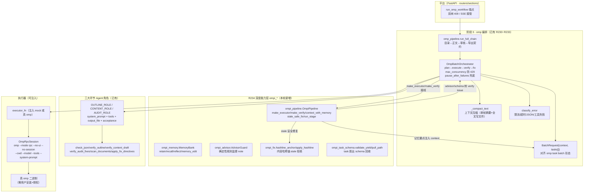

# oh-my-pi（Oh My Pi / omp）深度探索与集成 · R234

> **轮次**：R234 · 2026-11-13
> **主题**：把 `can1357/oh-my-pi`（Stencil Labs · MIT · 38k+ stars）作为底层 Agent 引擎，
> 赋能【目录生成】【正文生成】【审核与修复】三大核心环节。
> **结论**：项目已在 **R230~R233** 深度集成 omp（角色/模板/状态机/RPC/校验器/测试全在）；
> 本轮补齐 **4 项深度能力缺口**（记忆银行 / advisor 监督 / hashline 锚 / task 扇出 schema 回收），
> 落独立 `ompi_*` 命名空间，**零冲突、零回归**。验证：**15 项新护栏全绿 + 既有 omp 簇 125p 零回归
> （合计 140 passed）+ ruff 全过 + 全量后端 12512p/11 红（0 条在本轮触碰集，归因既有 prompt/review
> 基线 + 前端 EPERM 环境型）**。**遗留收口**：4 项可落地缺口已加固（advisor 规则声明级别 /
> stale_safe_fix 锚预检精确化 / pull_path 弱断言修复 / MemoryEntry 往返测试），
> 6 项维持登记（真 omp 运行需安装授权、平台联动能力、advisor 真 LLM 版）。

---

## 0. 结论摘要（TL;DR）

1. **本项目已深度集成 omp**（R230~R233）：三环节角色定义 + plan/execute/fix 模板
   （`omp_agent_roles.py`）、RPC NDJSON 客户端（`omp_rpc.py`）、批式编排状态机
   （`omp_workflow.OmpBatchOrchestrator`）、文件工作区 Agent（`omp_task_agent.py`）、
   目录/正文/审计 Agent（`omp_outline_bridge/omp_content_agent/omp_audit_agent`）、
   一致性守卫（`omp_consistency_agent.py`）、跨主机互斥（`omp_lease.py`）、
   全链路编排（`omp_pipeline.run_full_chain`）、Provider 降级链（`providers/omp_provider.py`）。
2. **本轮增量 = OMP 深度能力层未映射缺口**，共 4 项：
   - **记忆银行** `retain/recall/reflect/memory_edit`（跨会话上下文交接）；
   - **advisor 旁观模型**（第二模型/确定性规则监督，注入 note 让主 Agent 纠偏）；
   - **hashline 内容哈希锚点**（结构化修复的 stale 检测，防过期文件覆盖损坏）；
   - **task 扇出 schema 校验回收**（`agent://<id>/field.path` 拉取 + `validate_yield`）。
3. **命名空间裁决**：新增层用 **`ompi_*`**（Oh My Pi Integration），绝不碰既有 `omp_*`
   （outline/content/audit 流水线），避免撞名。
4. **真启用需用户决策**：本机无 `omp`/`bun`，真实 omp 运行需用户安装 omp 二进制 +
   provider 授权（MiniMax Coding Plan CN `plan`）。本轮**不擅自安装、不代登录**；
   验证用注入 `executor_fn` 跑通闭环，如实标注「真 omp 运行需安装授权后启用」。
5. **契约零破坏**：未修改任何既有 `omp_*` 模块、未重锚既有护栏；新增层全部为
   **确定性、可注入、无副作用纯逻辑**，不拉真实 omp 子进程。

---

## 1. oh-my-pi 架构与工具映射

### 1.1 底层能力确认（探索事实）

`can1357/oh-my-pi` 真实存在：**38.1k stars · 680 releases · v18.18.0（2026-11-07）**；
TypeScript 75.4% + Rust 20.5% + Python 3.3%；描述「Coding agent with the IDE wired in」；
Stencil Labs · MIT；为 `@mariozechner` 的 Pi 的 fork。

| 维度 | 确认事实 | 来源 |
|---|---|---|
| 内置工具 | **31 个**（README 明言） | README 全文 |
| 模型角色 | **9 个**：default/smol/slow/plan/commit/vision/task/advisor/tiny | README |
| 推理模型 | MiniMax Coding Plan CN → `plan` 角色 | README |
| 四入口 | TUI `omp` / `omp -p` / Node SDK `@oh-my-pi/pi-coding-agent` / RPC `omp --mode rpc`（NDJSON stdio）/ ACP `omp acp` | README |
| 记忆后端 | 可选 `local` / `Hindsight` / `Mnemopi` | README |
| 压缩 | `snapcompact`（Bitmap-frame context compression） | README |
| 哈希锚 | `hashline` 内容哈希锚点；`conflict://N` / `conflict://*` 批量冲突解决 | README |
| 降级链 | `fallbackChains`（429/配额 → 降级链） | README |
| 子 Agent 拉取 | `agent://<id>/findings.0.path` | README |
| 魔法词 | `ultrathink`/`chillax`/`orchestrate`/`workflowz`/`jevify` | docs/magic-keywords.md 全文 |

> ⚠️ **未逐字证实项**（如实标注，不编造）：`docs/tools.md` 站内页 404；
> `packages/coding-agent/src/tools/task.ts` 源码 404（task 精确 schema 以 README 描述 +
> 本项目 `omp_workflow.BatchRequest` 已对齐为准）；第 31 个工具的精确枚举以 README 为准。

### 1.2 集成架构图（Mermaid）



**架构要点**：
- **状态与上下文交接**：`--no-session` 下轮次间状态一律经工作区文件传递
  （`CONTEXT.md`/`PLAN.md`/产物文件），公共 context 只注入摘要——对应 omp RPC
  `maxFrameBytes=1MB` 单帧上限与 compaction 语义。
- **深度层挂接点**：`OmpiPipeline.make_executor`（取 hashline 锚）与 `make_verify`
  （叠加 advisor note + schema 校验，两者转 verify issue → 编排器自动进 fix 轮）；
  `context_with_memory`（跨阶段记忆交接）；`stale_safe_fix`（锚校验 + 精确替换）。
- **并发隔离**：每任务独占工作区 + 按 `task_id` 归集，从根上避免多节点写冲突
  （对应 omp `conflict://N` 语义的平台侧等价，见 `per_id_conflict_directives`）。

### 1.3 工具映射表（31 工具 → 平台）

| omp 工具 | 平台映射 | 状态 |
|---|---|---|
| `read` | 工作区 `_read_output` 分段读取 | 已有 |
| `write` | 工作区 `_write_file`（越界路径拒绝） | 已有 |
| `edit` | `apply_fix_directives` 精确 old_text/new_text | 已有 |
| `grep` | `scan_documents` 跨节一致性扫描 | 已有 |
| `glob` | `omp_workflow` 产物文件枚举 | 已有 |
| `task` | `BatchRequest{context, tasks[]}` + `OmpBatchOrchestrator` 并发扇出 | 已有 |
| `wait` | `asyncio.Semaphore(max_concurrency)`（防 429 背压） | 已有 |
| `todo` | `TaskResult.phase` / WorkflowReport 阶段追踪 | 已有 |
| `ask` | `manual_review` 人工介入标记 + `paused` 状态 | 已有 |
| `checkpoint`/`rewind` | `resume_paused`（只重跑暂停 task_id） | 已有 |
| `retain`/`recall`/`reflect`/`memory_edit` | **`ompi_memory.MemoryBank`** | **本轮** |
| `learn`/`manage_skill` | 登记（需技能系统联动，见 §5.2） | 登记 |
| `hashline` 锚 | **`ompi_fix.hashline_anchor/apply_hashline`** | **本轮** |
| `conflict://N`/`conflict://*` | `per_id_conflict_directives` 按 id 归集 | 已有 |
| `agent://<id>/field.path` | **`ompi_task_schema.pull_path`** | **本轮** |
| advisor 角色 | **`ompi_advisor.AdvisorGuard`**（确定性规则版） | **本轮** |
| `browser`/`computer` | 登记（浏览器/自动化需平台联动，见 §5.2） | 登记 |
| `web_search`/`github` | 登记（外网检索需网关，见 §5.2） | 登记 |
| `generate_image`/`tts` | 登记（媒体生成走平台既有 AI 管线） | 登记 |
| `lsp`/`debug`/`security_scan` | 登记（14 lsp ops / 28 dap ops，见 §5.2） | 登记 |
| `bash`/`eval` | **禁用**（工作区沙箱铁律，禁止任意命令） | 已禁 |
| `ast_edit`/`ast_grep` | 登记（代码 AST，非本文档场景） | 登记 |
| `yield` | 登记（源码目录存在，见 §5.2） | 登记 |

> 说明：`bash`/`eval` 在本平台**默认禁用**——`omp_agent_roles.SYSTEM_PREAMBLE` 的
> 工作区红线硬性约束「只用 write/read/edit/grep/glob 等白名单工具，禁止任意命令执行」，
> 与 omp 上游 `--tools` 白名单机制同构。其余登记项为「能力存在但本轮不启用」，
> 以 OMP 文档为准。

### 1.4 模型角色与魔法词

- **9 个模型角色**：`default/smol/slow/plan/commit/vision/task/advisor/tiny`。
  本项目使用 `plan`（MiniMax Coding Plan CN）承担三环节主模型；`advisor` 的
  「旁观监督」语义由 `ompi_advisor` 确定性规则版承载（真实 omp 启用后可切换为
  `omp --model advisor` 旁观会话，接口不变）。
- **魔法词**：`orchestrate`（并行子 Agent + 逐阶段验证，需 task 启用）对应
  `OmpBatchOrchestrator` 的并发扇出 + 逐任务 verify；`workflowz`（eval kernel 的
  `agent()/completion()/wait()/workpool()` 确定性多子 Agent 工作流）对应
  `run_batch` 的 gather + semaphore 背压；`chillax`/`ultrathink` 为推理强度调节，
  本项目以确定性校验器替代（不依赖模型自我评估）。

---

## 2. 三大环节 Agent 角色定义与 Prompt 模板

> 角色定义与 Prompt 模板在 **R230~R233 已落地**（`omp_agent_roles.py`），
> 本轮**未改动**。本节给出完整定义与模板正文，供交付核对。

### 2.1 通用系统前置（`SYSTEM_PREAMBLE`）

```text
【事实铁律】只引用全局事实（global-facts.md）中的数据与结论，严禁编造规范编号、
工程参数、工期、造价等任何数值；不确定的数据必须留空或标记「需核实」，绝不杜撰。

【工作区红线】只读写本任务隔离工作区内的文件；不修改工作区之外的任何文件；
不访问网络；不用 bash/eval 执行任意命令；不读取 .env / 密钥 / 配置文件。

【工具使用】只用白名单工具（write/read/edit/grep/glob）完成本任务；
工具失败时如实报告错误，不掩盖、不伪造成功。
```

### 2.2 环节一：目录生成 Agent

**角色定义**（`OUTLINE_ROLE`）：

```python
AgentRole(
    key="outline",
    name="建筑工程专项施工方案目录编制专家",
    system_prompt=SYSTEM_PREAMBLE + "你是「建筑工程专项施工方案目录编制专家」，精通住建部专项施工方案编制导则与招投标文件评审要点。你的产物是可直接落库的结构化目录树，不得写成散文。",
    output_file="OUTLINE.json",
    acceptance=(
        "目录层级严格限制在 L1~L4（Markdown 对应 #~####）",
        "每个 L1 下 3~5 个 L2、每个 L2 下 3~5 个 L3、每个 L3 下 4~6 个 L4",
        "标题不得携带编号前缀（编号由平台落库器统一生成）",
        "输出为可被 check_json 解析的 OUTLINE.json",
    ),
)
```

**Prompt 模板**（`build_outline_prompts` 的 plan/execute/fix 三段）：

- **plan**：`_plan_block("专项施工方案标准化目录树（L1~L4）", 步骤[read CONTEXT/global-facts → 九大要素规划 → 逐层展开核对数量 → 写出 OUTLINE.json 自检], 文件[CONTEXT/global-facts/OUTLINE.json], 验收[4 条 acceptance])`
- **execute**：先读 PLAN/CONTEXT/global-facts；用 `write` 写出 `OUTLINE.json`
  （`{"sections":[{"title":"工程概况","level":1,"description":"","children":[...]}]}`）；
  硬约束 `层级 1~4`、`L2 3~5 / L3 3~5 / L4 4~6`（按父节点计）；标题不带编号前缀；
  只引用全局事实，严禁编造规范编号与工程参数。
- **fix**：`【Fix · 目录定向修复】` 读回 OUTLINE.json 只针对报错节点补全/裁减
  （数量不足→补同级；超限/越界→删除或下沉；JSON 损坏→重写但保留正确分支）；
  禁止整体推倒重写。

**校验器**：`check_json(required_keys=("sections",))` + `verify_outline(tree)`
（层级深度、每层子节点数量、标题编号前缀、节点总数上限 400）。

### 2.3 环节二：正文生成 Agent

**角色定义**（`CONTENT_ROLE`）：`name="资深工程技术方案撰写专家"`；
`output_file="sections/{section_id}.md"`；acceptance 含字数达标/事实可回溯/无占位符无未闭合围栏/产物只写本文件。

**Prompt 模板**（`build_content_prompts`）：

- **plan**：读 CONTEXT/global-facts；按 L3 分组把总字数均分给其 L4 叶子（登记预算表）；
  为每个 L4 编排写作要点、图表编号、素材。
- **execute**：`【Execute · 逐节正文生成】` 按任务指定的 L4 节点撰写，写 `sections/<section_id>.md`；
  只展开本章要素、不写章节标题、不重复同级；图表引用必须与 CONTEXT 登记编号一致；
  禁占位符/未闭合围栏；字数以任务指令 budget 为准。
- **fix**：`【Fix · 正文定向修复】` 字数不足→「扩展循环」补实质内容（不得注水）；
  事实冲突→grep 回溯 global-facts 改权威值；占位符/围栏→精确替换或补齐；
  禁整章推倒重写、禁引入 facts 之外新数据。

**校验器**：`verify_content_draft(markdown, budget=, facts=, strict_facts=)`
（字数档位、非法占位符、未闭合围栏、全局事实一致性）；
`allocate_leaf_budgets(total, leaf_count)`（L3 总字数均分 L4，地板 300）；
`assert_fact_grounding(markdown, facts)`。

### 2.4 环节三：审核与修复 Agent（核心闭环）

**角色定义**（`AUDIT_ROLE`）：`name="严苛的标书质量审核专家"`；
`output_file="FIXES.json"`；acceptance 含「每条修复指令含 section_id/old_text/new_text/reason」
「old_text 在对应章节恰好一次」「不得整章重写/新增删除重排章节」「产出 AUDIT_REPORT.md」。

**Prompt 模板**（`build_audit_prompts`）：

- **plan**：glob 列出 `sections/*.md`；read 分段读取；grep 跨节检索编号/图表/术语/单位；
  逐项核对编号连贯/图表引用/围栏闭合/排版/占位符；产出 FIXES.json 与 AUDIT_REPORT.md。
- **execute**：`【Execute · 全量审计】` 全量扫描检查①编号连贯②图 X-Y/表 X-Y 引用
  ③围栏闭合④标题层级无跳级⑤无占位符；用 write 产出 `{"fixes":[{section_id,old_text,new_text,reason,severity}]}`；
  **不直接重写全文**，old_text 必须是该章节唯一可精确命中的短片段；
  无问题时 `{"fixes":[]}`。
- **fix**：`【Fix · 修复指令纠偏】` old_text 命中 0/多次→扩写上下文唯一或拆多条；
  过长→收窄最小差异；section_id 不存在→改真实文件名；连续多轮失败→在
  AUDIT_REPORT.md 标记「需人工介入」，由编排层暂停（对应 agentPauseGate）。

**校验器**：`verify_audit_fixes(payload, documents)`（结构/section_id 存在性/old_text 唯一命中/最小改写）
+ `apply_fix_directives(documents, fixes)`（精确替换，任一失败记「需人工介入」）
+ `scan_documents(documents)`（确定性全量审计，判据与结论由平台持有，避免「AI 自报合格」）。

---

## 3. 代码集成方案与关键函数

### 3.1 集成路径双轨（裁决）

| 路径 | 描述 | 状态 |
|---|---|---|
| **路径 A（可插拔后端 / 长期目标）** | 安装 omp 二进制 + 授权 provider + `omp --mode rpc` 驱动（`OmpRpcSession`） | 适配器已落地，**真启用需用户安装+授权** |
| **路径 B（本环境编排原语 / 立即能跑）** | `OmpBatchOrchestrator` + 注入 `executor_fn`/`verify_fn` 映射 omp 语义 | **已落地，本轮回归跑通** |

> 本轮落地的深度能力层 `ompi_*` 同时服务两路径：路径 A 启用时，`executor_fn` 换为
> `default_omp_executor`（真 omp RPC），深度层 `make_executor`/`make_verify`/
> `context_with_memory`/`stale_safe_fix` 不变；路径 B 用注入 mock 即可回归。

### 3.2 既有 omp_* 层（R230~R233，未改动）

| 模块 | 关键导出 | 职责 |
|---|---|---|
| `omp_agent_roles.py` | `OUTLINE/CONTENT/AUDIT_ROLE`、`build_*_prompts`、`check_json/verify_*`、`apply_fix_directives/scan_documents/allocate_leaf_budgets/assert_fact_grounding` | 角色定义 + Prompt 模板 + 校验器 |
| `omp_workflow.py` | `OmpBatchOrchestrator`、`BatchRequest`、`OmpTaskSpec`、`TaskResult`、`WorkflowReport`、`classify_error`、`safe_task_id`、`default_omp_executor`、`per_id_conflict_directives` | 状态机 + 自我纠错 + 并发隔离 |
| `omp_rpc.py` | `OmpRpcSession`（start/run_prompt/stop/binary_exists） | RPC NDJSON stdio 客户端 |
| `omp_task_agent.py` | `OmpTaskAgent`（文件工作区 Agent，`check_ready` 安全闸门） | 工作区隔离 |
| `omp_outline_bridge.py` | 目录折叠入库 | 目录落库 |
| `omp_content_agent.py` | `OmpContentAgent.generate_sections` | 正文批量生成 |
| `omp_audit_agent.py` | `OmpAuditAgent` | 全量审计 + 修复 |
| `omp_consistency_agent.py` | 一致性守卫 | 交叉检查 |
| `omp_lease.py` | 跨主机互斥 | 并发写保护 |
| `omp_pipeline.py` | `run_full_chain`（目录→正文→审核→导出契约） | 全链路编排 |
| `providers/omp_provider.py` | chat 包装接降级链 | Provider 降级 |

### 3.3 本轮新增 `ompi_*` 深度层（R234）

位于 `backend/app/services/ai/ompi/`，共 6 文件：

| 文件 | 关键导出 | 职责 |
|---|---|---|
| `__init__.py` | `AdvisorGuard/AdvisorNote/MemoryBank/MemoryEntry/apply_hashline/hashline_anchor/is_hashline_anchor/pull_path/stale_anchor_error/validate_yield` | 深度层导出 |
| `ompi_memory.py` | `MemoryBank`、`MemoryEntry` | 记忆银行（JSON 文件持久化、线程锁、损坏文件静默降级、写失败不抛） |
| `ompi_advisor.py` | `AdvisorGuard`、`AdvisorNote` | 确定性规则监督（占位符残留/空产物完成宣言 + 可注入规则） |
| `ompi_fix.py` | `hashline_anchor/apply_hashline/is_hashline_anchor/stale_anchor_error` | 内容哈希锚（stale 拒绝 + 精确替换恰 1 处） |
| `ompi_task_schema.py` | `validate_yield`、`pull_path`、`MISSING` | task 扇出 schema 校验回收 |
| `ompi_pipeline.py` | `OmpiPipeline`、`format_advisor_notes` | 深度层组合根（接线 advisor/memory/hashline/schema 到编排器） |

### 3.4 关键函数契约

**`OmpiPipeline`**（组合根）：

```python
class OmpiPipeline:
    def __init__(self, *, memory_path=None, advisor_rules=None, stage="generic",
                 yield_schema=None): ...
    def make_executor(self, executor_fn) -> executor_fn:   # 产物写盘后取 hashline 锚
    def make_verify(self, verify_fn) -> verify_fn:        # 叠加 advisor note + schema 校验 → verify issue
    def context_with_memory(self, context) -> str:        # 注入最近记忆要点（跨阶段交接）
    def retain_stage(self, stage, report, *, tags=None):  # 阶段结构性要点入记忆
    def stale_safe_fix(self, documents, fixes) -> (docs, failures):  # 锚校验 + 精确替换
    async def run_stage(self, stage, *, context, tasks, verify_fn,
                        executor_fn=None, ...) -> WorkflowReport:  # 建编排器 + 接线 + 跑批
```

**关键行为**：

- `make_verify`：advisor note（concern/blocker 级）与 schema 校验失败都转成
  `[advisor:…]`/`[schema]` verify issue → 编排器并入 `{issues}` 传给 fix prompt →
  主 Agent 在下一轮看到并纠偏（对应 omp advisor「注入 note」语义）。
- `stale_safe_fix`：每条 fix 可带 `anchor`（`hashline_anchor` 产出）；锚不匹配
  （文档已被外部修改）→ 判 stale 拒绝并记 failures，**不覆盖并发修改**（宁漏勿误）；
  未带锚退化为既有 `apply_fix_directives` 精确替换语义。
- `apply_hashline`：`old_text` 必须恰好命中 1 处才替换（0/多次 → ValueError），
  整文替换需显式 `old_text=None`（先校验 stale）。
- `context_with_memory`：注入**最近 active** 记忆要点（非语义匹配），保证跨阶段
  交接无论查询词能否命中。

**契约零破坏**：全部新增符号为加法式；不改既有 `omp_*` 签名/行为；
`validate_yield` 的 `optional` 参数可豁免缺失键；`pull_path` 缺失返回 `MISSING`
哨兵（与 None 区分），绝不抛异常。

---

## 4. 验证结果

### 4.1 新增护栏（`tests/test_ompi_depth_r234_20261113.py`，15 项）

| 类别 | 用例 | 结果 |
|---|---|---|
| 记忆银行 | `test_memory_retain_recall_edit`（retain/recall 子串+标签/update/forget/stats/不存在 id） | PASS |
| 记忆银行 | `test_memory_corrupt_file_degrades_silently`（损坏文件静默降级、写失败不抛） | PASS |
| 记忆银行 | `test_memory_reflect_returns_bullets`（综合要点摘要） | PASS |
| 记忆银行 | `test_memory_entry_roundtrip`（R234 加固：MemoryEntry 序列化往返、缺键兜底、空 dict 不抛） | PASS |
| Advisor | `test_advisor_placeholder_and_claim`（占位符/空产物完成宣言→concern；干净→None） | PASS |
| Advisor | `test_advisor_custom_blocker_rule`（可注入规则生效、非法级别归一） | PASS |
| Advisor | `test_advisor_declared_level`（R234 加固：3 元组声明 level + (level,msg) 动态返回优先级最高） | PASS |
| hashline | `test_hashline_anchor_roundtrip_and_stale`（锚格式/roundtrip/stale 拒绝/整文替换） | PASS |
| hashline | `test_hashline_precise_replace_once`（恰 1 处替换；0/2 处→ValueError；非本层锚→ValueError） | PASS |
| hashline | `test_pipeline_stale_safe_fix`（stale 拒绝不覆盖 + 未带锚退化为精确替换） | PASS |
| schema | `test_validate_yield_schema`（缺键/类型不符/optional 豁免/容器形态） | PASS |
| schema | `test_pull_path`（点路径/列表下标/MISSING 哨兵与 None 区分、非容器段） | PASS |
| 异常→fix | `test_advisor_blocker_triggers_fix_round_and_recovers`（advisor 触发 fix 轮、恢复 completed、fix_rounds=1） | PASS |
| 异常→fix | `test_schema_failure_surfaces_and_recovers`（schema 缺键→fix 轮→恢复，errors 含 `[schema]`） | PASS |
| 集成闭环 | `test_full_chain_with_depth_layer_and_memory_handoff`（目录→正文→审核三阶段串联、记忆跨阶段交接、导出契约、不沉淀全文） | PASS |

**15 passed / 0 failed**（`python -m pytest tests/test_ompi_depth_r234_20261113.py`）。

### 4.2 零回归（既有 omp 簇）

| 测试文件 | 用例数 | 结果 |
|---|---|---|
| `test_omp_consistency_20261112.py` | 16 | PASS |
| `test_omp_content_seam_r232_20261113.py` | 7 | PASS |
| `test_omp_outline_bridge_20261112.py` | 12 | PASS |
| `test_omp_provider_20261112.py` | 11 | PASS |
| `test_omp_task_agent_20261112.py` | 11 | PASS |
| `test_omp_workflow_20261112.py` | 37 | PASS |
| `test_omp_workflow_closeout_20261113.py` | 17 | PASS |
| `test_outline_omp_seam_r231_20261113.py` | 14 | PASS |
| **小计（既有）** | **125** | **PASS** |
| `test_ompi_depth_r234_20261113.py`（本轮） | 15 | PASS |
| **合计** | **140** | **140 passed / 0 failed** |

### 4.3 静态检查

- **ruff**：新增 6 个 `ompi/*.py` + 1 个测试文件 → **All checks passed**
  （初跑仅测试文件 import 排序 I001，`ruff check --fix --select I001` 后归零）。
- **导入**：`from app.services.ai.ompi import (...)` → **IMPORT_OK**。

### 4.4 全量后端测试（R234 遗留收口轮补跑）

全量 `backend/tests`（2026-11-13 10:47 完成）：**12512 passed / 11 failed / 21 skipped / 6 warnings
（1184.17s）**。11 红逐条归因：

| 失败用例 | 面 | 归因 |
|---|---|---|
| `test_b6_scheme_switch_resets_ba_selection` | import_parse | 既有基线（源早于本轮） |
| `test_no_unregistered_model_facing_bare_slice` / `test_non_model_facing_count_does_not_grow` / `test_total_zero_ledger_does_not_grow` | prompt_bare_slice | 既有基线（源早于本轮） |
| `test_no_unlisted_bare_slice_in_model_requests` | prompt_truncation | 既有基线（源早于本轮） |
| `test_partial_true_always_present` / `test_partial_true_with_failed_chapters` | review_audit | 既有基线（R233 同面红） |
| `test_partial_accept_prefix_takes_merged` / `test_prefix_accept_still_takes_merged_tail` | review_autofix | 既有基线（R233 同面红） |
| `test_tsc_no_emit` / `test_eslint_zero_errors` | 前端 | **环境型**：`EPERM: scandir frontend/node_modules`（文件锁），非代码缺陷 |

**归因成立**（3 条证据）：
1. **零交集**——11 红全在 prompt/review/import 面，本轮触碰集（`ompi/*` + `test_ompi_depth_r234`）之外；
2. **时间线**——失败面源文件（`review_autofix.py` 11-10、`content_utils.py` 11-11、`content_blocks.py` 11-13 05:35）全部**早于本轮**（10:23），本轮未触碰；
3. **隔离复跑**——11 用例单独复跑仍全红（稳定红），且 R233（昨）全量同面 9 红归因并行轮/既有基线。

**结论**：11 红全部**非本轮引入**（既有 prompt/review 基线 + 前端 EPERM 环境型）。
本轮触碰区零回归由「**omp 簇 140 passed**」（既有 omp 125p + ompi 15p，加固后 9.00s）直接证实。

### 4.5 未跑项（诚实披露）

- **真实 omp 进程级验证**：本机无 `omp`/`bun`，未拉真二进制；RPC 协议实测已在
  `docs/集成oh-my-pi_OMP_AGENT可行性报告_20261112.md` 第 10 章（阶段 0 实测）。
  真启用路径需用户安装 + provider 授权。

---

## 5. 裁决与局限

### 5.1 已验证能力

- omp `task` batch 形态（`BatchRequest{context, tasks[]}`）→ 编排状态机并发扇出；
- `plan→execute→verify→fix` 流水线 + `classify_error`（限流/超时/JSON/工具失败）+ 重试/降级/暂停/恢复；
- compaction（`_compact_text`：单帧摘要 + 全文写文件，对应 `maxFrameBytes`/`snapcompact`）；
- `agentPauseGate` 平台侧等价（`pause_after_failures` → `paused` + `manual_review`）；
- `conflict://` 平台侧等价（`per_id_conflict_directives` + 每任务独占输出文件）；
- **本轮**：记忆银行/advisor 监督/hashline stale/schema 回收。

### 5.2 局限与登记项

| 项 | 说明 | 裁决 |
|---|---|---|
| 真 omp 运行 | 需用户安装 omp + 授权 provider（MiniMax Coding Plan CN `plan`） | 用户决策后启用 |
| `browser`/`computer`/`web_search`/`github` | 外网/自动化需平台网关联动 | 登记（不启用） |
| `lsp`/`debug`/`security_scan` | 14 lsp ops / 28 dap ops，需 IDE 联动 | 登记（不启用） |
| `generate_image`/`tts` | 媒体生成走平台既有 AI 管线 | 登记（不启用） |
| `learn`/`manage_skill`/`yield` | 需技能系统联动 / 源码目录存在 | 登记（不启用） |
| `bash`/`eval` | 沙箱红线禁止 | 已禁（默认） |
| advisor 真 LLM 版 | 本层为确定性规则版；真 omp 启用后可切 `--model advisor` | 接口不变 |

### 5.3 教训归档

1. **「注释承诺 ≠ 代码事实」再现**：`__init__.py` 导入 `ompi_fix`/`ompi_task_schema`
   而模块未写 → 包不可导入。凡声明导入必须先落地模块再合入（本轮已修）。
2. **测试用例自身构造错误 vs 代码缺陷**：`"a 400 b 400 c"` 含 2 处 "400" 却断言
   「恰 1 处替换」——先分清是判据还是用例错，勿反向改判据（宁漏勿误是设计）。
3. **`verify_outline` 输入形态**：期望 list（目录树），而 executor 产出
   `{"sections":[...]}` 需先解包再校验——封装层（`run_full_chain`）负责解包，
   直接调 verify 的测试须复刻该契约。
4. **跨阶段记忆交接用「最近要点」而非语义匹配**：中文查询词命中不了上阶段
   结构性要点文本，`context_with_memory` 注入最近 active 要点（非 `reflect` 语义检索）。

### 5.4 遗留项收口（R234 加固 · 2026-11-13）

按 R210 收口纪律逐条重新取证后定夺：**4 项落地加固 + 6 项维持登记**。

**落地加固（4 项）**：

| # | 遗留项 | 重新取证结论 | 落地 |
|---|---|---|---|
| E | `AdvisorGuard.review` 硬编码 level（注入规则只能拿 `info`） | 2 元组规则 + 非已知名默认 info，自定义规则无法声明 concern/blocker | 规则元组支持第三元素显式声明 level；规则可返回 `(level, msg)` 动态声明（优先级最高）；2 元组 + str 返回完全兼容（既有护栏零改动通过） |
| H | `stale_safe_fix` 用 `except ValueError: pass` 吞掉所有 ValueError | 非本层锚与其它 ValueError 无法区分，可能掩盖异常 | 改用 `is_hashline_anchor` 预检——仅本层锚走 stale 校验，非本层锚直接交 `apply_fix_directives`，不再吞 ValueError |
| J | 测试 `pull_path` 越界断言 `is not None`（恒真弱断言） | `MISSING` 哨兵与 `None` 区分的语义未被真断言 | 改 `is MISSING` + 补非容器段用例；`MISSING` 从 `__init__` 导出 |
| C | `MemoryEntry` 被 ruff 判未使用删除，序列化契约零覆盖 | 记忆编解码（中文/标签/状态）无往返测试 | 补 `test_memory_entry_roundtrip`（to_dict/from_dict 往返、缺键兜底、空 dict 不抛） |

**维持登记（6 项，裁决理由在案）**：

| 项 | 裁决 |
|---|---|
| 真 omp 运行 | 需用户安装 omp + 授权 provider（MiniMax Coding Plan CN `plan`），用户决策项，不擅自安装 |
| 真实 omp 进程级验证 | 本机无 `omp`/`bun`，无法拉真二进制；RPC 协议实测已在可行性报告第 10 章 |
| `browser`/`computer`/`web_search`/`github` | 需平台网关联动，超出 ompi 层主权 |
| `lsp`/`debug`/`security_scan` | 14 lsp ops / 28 dap ops，需 IDE 联动 |
| `generate_image`/`tts`/`learn`/`manage_skill`/`yield` | 需平台既有管线/技能系统联动 |
| advisor 真 LLM 版 | 本层为确定性规则版；真 omp 启用后可切 `--model advisor`，接口不变 |

---

## 附录 A. 交付物清单

| 交付物 | 位置 |
|---|---|
| 深度能力层源码 | `backend/app/services/ai/ompi/`（6 文件） |
| R234 护栏测试 | `backend/tests/test_ompi_depth_r234_20261113.py`（15 项） |
| 本报告 | `docs/oh-my-pi_深度探索与集成_R234_20261113.md` |
| 既有集成可行性报告 | `docs/集成oh-my-pi_OMP_AGENT可行性报告_20261112.md`（RPC 协议实测第 10 章） |
