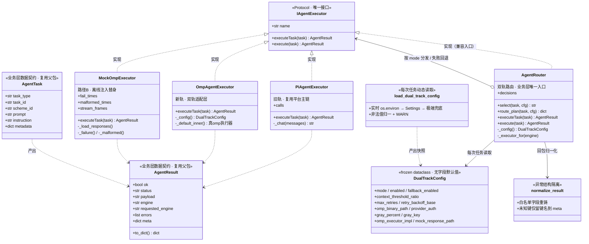
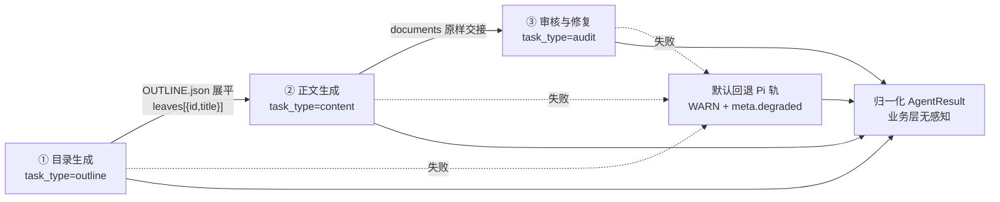

# 底层 Agent 引擎平滑演进为 oh-my-pi · 路径 B 注入执行器 POC 落地报告（R240）

> **日期**：2026-11-13　|　**范围**：`backend/app/services/ai/agent_engine/dual_track/` 引擎层 + 配置契约面 + 只读诊断面
> **依据**：用户附件《专项方案编制软件引入 oh-my-pi 底层 Agent 引擎.md》（§5 路径 A/B、§5.4 阈值路由、§8 安全与治理、§10 测试矩阵）；仓内 `docs/集成oh-my-pi_OMP_AGENT可行性报告_20261112.md` §8「验证 / 验收标准」、`docs/引入OMP引擎落盘方案_20261113.md` §6「验收标准」、`docs/oh-my-pi_深度探索与集成_R234_20261113.md` §3.1「集成路径双轨」、`AGENTS.md` R235/R236 校准条目
> **核心结论**：**不重写、不迁移、不造第二套判据**。本次任务书描述的架构在本仓已由 R240 轮次落地，本轮工作是**核对 + 收口三处真实缺口 + 补全 POC 集成测试 + 出具可核验的测试报告**。

---

## 0. 结论先行：任务书 ↔ 仓内现状 ↔ 本轮动作

| # | 任务书要求 | 仓内现状（核对结论） | 本轮动作 |
|---|---|---|---|
| 1 | 业务层 Prompt / 流程逻辑绝对不动 | ✅ 已满足。`config.py:208-210` 明确「保持现状不动」；`dual_track/__init__.py:3-7` 加法式演进；Prompt 单一事实源 `services/ai/prompts/_registry.py` 未被触碰 | 一行未改 |
| 2 | 双轨落地 / 引擎路由 / 默认回退 / 灰度上线 | ✅ 已落地：`dual_track/router.py` `AgentRouter` 三态路由 + 稳定哈希灰度 + 默认回退 | 核对并在 §3 输出核心代码 |
| 3 | 可开关 / 可回退 / 可灰度 | ✅ `agent_engine_enabled` / `fallback_enabled` / `hybrid + gray_percent` | 补 **运维可达点**（`GET /api/v1/omp/diagnostics` 的 `dual_track` 字段） |
| 4 | 五项配置全部配置化、禁止硬编码 | ✅ `config.py:177-222` 共 14 项；`dual_track/config.py` 每次任务动态读取、非法值归一 + WARN | **修 `.env.example` 漂移**（默认 `omp`→`pi`、删死键、补 9 项） |
| 5 | 路径 B 注入执行器 POC、契约 + Mock | ✅ `IAgentExecutor` / `PiAgentExecutor` / `OmpAgentExecutor` / `MockOmpExecutor` 齐备；既有单测 25 项 | **新增 14 项三链路集成测试**（仓内此前唯一缺口） |
| 6 | 验收与回归测试 + 测试报告 | ⚠️ 单元测试齐备，**三链路端到端 POC / 故障回退集成测试缺失** | 补齐并实跑，报告见 §6 |

> **本轮实际改动 3 个文件 + 1 份报告**（详见 §8）：`backend/.env.example`、`backend/app/routers/omp_ops.py`、`backend/tests/test_agent_engine_dual_track_poc_20261113.py`、本报告。
> **未改动**：`config.py`、`dual_track/*.py`、`agent_engine/*.py`、`prompts/*`、`sections.py`、`sse_handlers.py`、`gateway.py`、`omp_agent.py`。

---

## 1. 任务计划（已先执行）

按任务书「必须先执行计划」要求，以结构化任务列表推进，逐项标记状态：

| 序 | 任务 | 状态 | 交付落点 |
|---|---|---|---|
| 1 | 探查现有架构与方案文档，建立现状↔目标差距映射 | ✅ | §0 核对表、§7 遗留登记 |
| 2 | 配置化与硬编码清理方案 | ✅ | §2.3 配置表、§2.4 漂移修复 |
| 3 | 双轨路由与统一接口设计 | ✅ | §2.1 类图、§3 接口与路由代码 |
| 4 | 路径 B：契约定义与 Mock 执行器 | ✅ | §3.1 契约、§4 Mock 与三链路 POC |
| 5 | 回退与容错机制设计 | ✅ | §3.4、§5.2 / §6.2 |
| 6 | 验收回归测试与完整报告输出 | ✅ | §5 测试计划、§6 测试报告、本文档 |

---

## 2. 架构类图与配置设计（先输出）

### 2.1 架构类图



### 2.2 分层与铁律

| 层 | 文件 | 职责 | 边界 |
|---|---|---|---|
| 业务层 | `routers/sections.py`、`_sse_outline_build.py`、`services/review_autofix.py`、`services/ai/prompts/*` | 目录 / 正文 / 审核修复三条链路、Prompt、SSE 阶段机 | **本轮零改动** |
| 配置中心 | `app/config.py`（`Settings` + `.env`） | 14 个 `agent_engine_*` 字段，唯一阈值来源 | 不新增 `config.yaml`（避免代码不读的死配置） |
| 双轨引擎层 | `services/ai/agent_engine/dual_track/` | 契约 / 配置适配 / 三执行器 / 路由 / 回退 / 归一化 | 与 R239 单轨网关互不干扰，加法式并存 |
| 真 omp 档 | `services/ai/agent_engine/executors.py` | 进程拉起、环境变量注入、授权校验、NDJSON 解析、compaction、指数退避 | 双轨层只做适配，**不重复实现重试** |
| 本地编排档 | `services/ai/omp_workflow.py::platform_executor` | 不依赖 omp 进程的路径 B 平台执行体 | 与上层互补，非第二份判据 |
| 运维面 | `routers/omp_ops.py` | 只读诊断：`dual_track` 配置快照 + 三链路路由预演 | 零业务库 / 零子进程 / 零写入 |

**四条铁律**（`dual_track/router.py:13-20`）：可开关（`enabled=False` 强制全量 pi）、可回退（omp 失败自动降级 Pi + WARN + `meta.degraded`）、可灰度（同一 ID 恒定落同一轨）、业务无感知（业务层只调 `executeTask`，恒收归一化 `AgentResult`）。

### 2.3 配置设计（14 项，全部来自配置中心）

> 任务书以 TypeScript/YAML 视角给出 `agent_engine.*`；本仓技术栈是 **Python / FastAPI + pydantic-settings**，实际落点为 `AGENT_ENGINE_*` 环境变量 + `Settings.agent_engine_*` 字段（`dual_track/config.py:15-18` 已明确「逻辑视图 ≠ 实际落点」）。接口签名同理：`executeTask(task): Promise<AgentResult>` 等价落地为 `async def executeTask(task) -> AgentResult`（`dual_track/contracts.py:9-10`）。

| # | Settings 字段 | 环境变量 | 缺省 | 语义 / 读取点 |
|---|---|---|---|---|
| 1 | `agent_engine_mode` | `AGENT_ENGINE_MODE` | **`pi`** | `pi`/`omp`/`hybrid` 三态；非法回落 `pi`（`config.py:211-212`、`dual_track/config.py:179-187`） |
| 2 | `agent_engine_enabled` | `AGENT_ENGINE_ENABLED` | `true` | 全局 Feature Flag；false ⇒ 强制旧轨 |
| 3 | `agent_engine_fallback_enabled` | `AGENT_ENGINE_FALLBACK_ENABLED` | `true` | 默认回退开关 |
| 4 | `agent_engine_omp_binary_path` | `AGENT_ENGINE_OMP_BINARY_PATH` | 空 | 空 ⇒ 回落既有 `omp_binary_path`（**单一事实源**，`config.py:192-193`、`dual_track/config.py:222-223`） |
| 5 | `agent_engine_context_threshold_ratio` | `AGENT_ENGINE_CONTEXT_THRESHOLD_RATIO` | `0.7` | 必须落在 `(0,1]`，否则回落 + WARN（正文 0.7 / 一致性 0.85 / 编排 0.8 由 `omp_threshold.py` 分任务比率） |
| 6 | `agent_engine_compaction_threshold` | `AGENT_ENGINE_COMPACTION_THRESHOLD` | `120000` | 单帧超阈值先压缩，全文写工作区供 `read` 分段读取 |
| 7 | `agent_engine_max_retries` | `AGENT_ENGINE_MAX_RETRIES` | `2` | 失败最大重试（不含首次），负非法、上限钳制 10 |
| 8 | `agent_engine_retry_backoff_base` | `AGENT_ENGINE_RETRY_BACKOFF_BASE` | `1.5` | 第 n 次重试前等待 `base × 2**n` |
| 9 | （回落 `omp_task_timeout`） | `AGENT_ENGINE_TASK_TIMEOUT` | `300` | 外层硬超时；留空复用既有 `OMP_TASK_TIMEOUT` |
| 10 | `agent_engine_provider_auth` | `AGENT_ENGINE_PROVIDER_AUTH` | 空 | JSON 凭据文件（环境变量名→值），仅注入子进程、绝不写日志；诊断只回报「是否配置」 |
| 11 | `agent_engine_gray_percent` | `AGENT_ENGINE_GRAY_PERCENT` | `0` | `[0,100]` 放量百分比，钳制 |
| 12 | `agent_engine_gray_key` | `AGENT_ENGINE_GRAY_KEY` | `scheme_id` | 白名单 `scheme_id`/`task_id` |
| 13 | `agent_engine_omp_executor_impl` | `AGENT_ENGINE_OMP_EXECUTOR_IMPL` | `real` | **路径 B 注入开关**：`mock` ⇒ 整体注入 `MockOmpExecutor`；非法值回落 `real`，绝不误把生产流量打进 Mock |
| 14 | `agent_engine_mock_response_path` | `AGENT_ENGINE_MOCK_RESPONSE_PATH` | 空 | Mock 预置 JSON 响应文件；空 ⇒ 内置样例 |

**热更新实现**：`load_dual_track_config()` **无进程级缓存**，`AgentRouter._config()` 每次任务调用；`_raw()` 按「实时 `os.environ` → `Settings` 新键 → `Settings` 既有键 → 极端兜底」读取（`dual_track/config.py:102-119`）。改环境变量后新任务立即生效，无需重启进程。
**零硬编码护栏**：`DualTrackConfig` 刻意不给字段设默认值；`test_agent_engine_dual_track_20261113.py:149-158` 静态扫描 `router.py`/`executors.py`/`contracts.py`，禁止出现 `0.7`、`120000` 等阈值字面量。

### 2.4 本轮配置修复：`.env.example` 漂移（真实缺陷）

修复前该文件的配置契约面与 `config.py` **不一致**：

| 问题 | 修复前 | 修复后 | 影响 |
|---|---|---|---|
| 默认模式违背架构决策 | `AGENT_ENGINE_MODE=omp` | `AGENT_ENGINE_MODE=pi` | 运维照抄 `.env.example` 会**直接把默认流量切到 omp**，与「默认 pi、零影响」冲突 |
| 死配置（无任何代码读点） | `AGENT_ENGINE_HYBRID_OMP_PERCENT=50` | 删除，改为 `AGENT_ENGINE_GRAY_PERCENT=0` | 全仓 Grep 仅命中该行与一份文档说明，属「代码不读的死配置」 |
| 路径 B 注入开关缺失 | 无 | `AGENT_ENGINE_OMP_EXECUTOR_IMPL=real` | 任务书「路径 B 注入执行器」在运维面不可见 |
| 缺 8 项配置 | 仅 5 项 | 补齐 14 项 + 中文注释 | Feature Flag / 回退 / 灰度 / 超时 / 凭据 / 退避均不可运维 |

新增护栏 `test_env_example_contract_defaults_to_pi_and_has_no_dead_key`：断言键集合与 `Settings` 字段逐一对齐（`AGENT_ENGINE_TASK_TIMEOUT` 例外，显式回落到 `omp_task_timeout`），**杜绝死配置回潮**。

---

## 3. 统一接口定义与路由分发核心代码

> 以下代码为仓内生产源码节选（注释为中文原文），路径均为 `J:\编程\专项方案工具箱\backend\app\services\ai\agent_engine\dual_track\`。

### 3.1 统一契约 `IAgentExecutor` / `AgentTask` / `AgentResult`

```python
# contracts.py —— 业务层与底层执行器之间的唯一接口
# ⚠️ 数据契约直接复用 agent_engine.contracts.AgentTask / AgentResult，
#    不新造第二份业务模型 —— 这是「业务层无感知」的前提。
@runtime_checkable
class IAgentExecutor(Protocol):
    """底层引擎统一执行器接口。
    契约要点：
    * name —— 执行器标识（pi / omp / mock_omp）；
    * executeTask —— 异步执行，**不向业务层抛异常**，失败收敛为 AgentResult(ok=False)；
    * 实现类同时提供 execute 别名，兼容 R237/R239 既有调用方。
    """
    name: str
    async def executeTask(self, task: AgentTask) -> AgentResult: ...
```

`AgentTask` 复用父包 `agent_engine/contracts.py:67-86`（`task_type/task_id/scheme_id/prompt/output_file/workspace/context_chars/context_limit/metadata`）；`AgentResult` 复用 `:89-137`（`ok/status/payload/engine/requested_engine/attempts/errors/meta` + `to_dict()`）。**业务层数据模型一个字段都没增改**。

### 3.2 配置动态读取（零硬编码 + 热更新）

```python
# config.py —— 每次任务调用，实时环境变量优先
def _raw(name: str) -> Any:
    env_val = os.environ.get(ENV_PREFIX + name.upper())
    if env_val is not None and not _blank(env_val):
        return str(env_val).strip()
    settings = _settings()
    if settings is not None:
        value = getattr(settings, "agent_engine_" + name, None)
        if _blank(value):
            legacy = _LEGACY_KEYS.get(name)          # 如 task_timeout → omp_task_timeout
            value = getattr(settings, legacy, None) if legacy else None
        if not _blank(value):
            return value
    return _FALLBACK_DEFAULTS.get(name)              # 仅配置中心完全不可导入时的极端兜底

def load_dual_track_config() -> DualTrackConfig:
    """归一规则：非法值一律回落到配置中心的安全缺省 + WARN，不抛异常。"""
    raw_mode = str(_raw("mode") or MODE_PI).strip().lower()
    mode = raw_mode if raw_mode in VALID_MODES else MODE_PI
    ...
    raw_ratio = _raw("context_threshold_ratio")
    ratio = _as_float(raw_ratio, ...)
    if not (0 < ratio <= 1):
        ratio = float(_FALLBACK_DEFAULTS["context_threshold_ratio"])  # + WARN
    ...
```

### 3.3 路由分发核心：`AgentRouter.select` / 稳定哈希灰度

```python
# router.py —— 灰度桶用 blake2b，不用内置 hash()（后者带随机盐，重启后灰度抖动）
def stable_bucket(key: str, buckets: int = 100) -> int:
    digest = hashlib.blake2b(str(key or "").encode("utf-8"), digest_size=8).digest()
    return int.from_bytes(digest, "big") % max(1, int(buckets))

def select(self, task: AgentTask, cfg: DualTrackConfig | None = None) -> str:
    """纯函数式选轨（不产生副作用，便于单元测试与灰度预演）。"""
    conf = cfg or self._config()
    if not conf.enabled:
        return ENGINE_PI                                  # 可开关：一键回退
    new_track = self._new_track(conf)                     # 路径 B：impl=mock ⇒ mock_omp
    if conf.mode == MODE_PI:
        return ENGINE_PI
    if conf.mode == MODE_OMP:
        return new_track
    if conf.mode == MODE_HYBRID:
        bucket = stable_bucket(self._gray_key(task, conf), 100)
        return new_track if bucket < conf.gray_percent else ENGINE_PI
    return ENGINE_PI                                      # 防御性兜底
```

`route_plan()` 额外返回 `mode/enabled/requested_engine/fallback_enabled/gray_key/gray_percent/hash_key/bucket/omp_executor_impl`，供运维预演（§4.3）。

### 3.4 默认回退与异常结构隔离（`executeTask` 核心段）

```python
async def executeTask(self, task: AgentTask) -> AgentResult:
    """路由执行 + 默认回退（业务层唯一入口，永不抛异常）。"""
    cfg = self._config()
    requested = self.select(task, cfg)
    executor = self._executor_for(requested)
    try:
        raw = await executor.executeTask(task)
    except Exception as exc:                              # 执行器抛异常也纳入统一回退
        logger.warning("... 执行器 %s 抛出未收敛异常（task_id=%s）：%s", ...)
        raw = failed_result(task, requested, errors=[...], reason="执行器异常")

    # 归一化：omp 畸形结构在此被隔离，绝不污染业务数据模型
    result = normalize_result(raw, task=task, engine=requested)
    if result.ok:
        return result

    if requested == ENGINE_PI or not cfg.fallback_enabled:
        logger.warning("... 任务失败且无可回退路径 ...")
        return result

    logger.warning(
        "agent_engine.dual_track: %s 执行失败（...）⇒ 自动回退 Pi 轨（默认回退机制）", ...
    )
    pi_raw = await self._pi.executeTask(task)
    fallback = normalize_result(pi_raw, task=task, engine=ENGINE_PI)
    fallback.meta.update({
        "degraded": True, "engine_used": ENGINE_PI,
        "requested_engine": requested,
        "fallback_reason": f"{requested} 执行失败，自动回退 Pi 轨",
        "primary_errors": list(result.errors),
    })
    return fallback
```

**异常结构铁律**（`contracts.py:161-240`）：只有 `AgentResult.__dataclass_fields__` 白名单字段可进入顶层；畸形 dict 的未知键**只记录键名**到 `meta["omp_unknown_fields"]`，值一律丢弃；`task_id/task_type` 强制以入参任务为准，防回包篡改业务身份；非 dict/str/None/异常对象一律收敛为失败结果，归一化本身也不得抛异常。

**超时与重试**：`OmpAgentExecutor`（双轨适配层）`asyncio.wait_for(inner.execute(task), timeout=cfg.task_timeout)` 提供外层硬超时；重试循环**只在底层 `agent_engine.executors.OmpAgentExecutor` 实现一次**，避免 `max_retries` 被平方放大（`dual_track/executors.py:166-167`）。

---

## 4. Mock 执行器代码与路径 B 三链路 POC

### 4.1 `MockOmpExecutor`（不启动真实 omp）

```python
# dual_track/executors.py:240-394（节选）
class MockOmpExecutor(_ExecutorBase):
    """Mock omp 执行器（路径 B：注入执行器 POC）。
    * 不启动真实 omp 进程、不消耗模型额度、零网络；
    * 读取预置 JSON 响应（responses / response_file / 配置 mock_response_path），
      按 task_type 分发三条业务链路产物；
    * 模拟 NDJSON 流式输出帧（frames + on_frame 回调）；
    * 故障注入：fail_times（前 N 次失败）/ fail_kind（未安装、未授权、超时、崩溃）
      / malformed_times（返回 omp 畸形结构，验证结果归一化不污染业务数据模型）。
    """
    def _load_responses(self):
        """优先级：构造入参 → 配置/指定 JSON 文件 → 内置样例。"""
        if self._responses is not None:
            return self._responses, self._frames
        path = self._effective_response_file()
        if path and os.path.isfile(path):
            with open(path, "r", encoding="utf-8") as handle:
                data = json.load(handle)
            ...
        return dict(_SAMPLE_RESPONSES), self._frames      # outline / content / audit / generic

    async def executeTask(self, task: AgentTask) -> AgentResult:
        if self._seq <= self._fail_times:
            return self._failure(task, self._fail_kind)   # 五类故障注入
        if self._seq <= self._fail_times + self._malformed_times:
            return self._malformed(task)                  # 故意返回畸形 dict（仅故障注入）
        mapping, frames = self._load_responses()
        payload = self._pick(mapping, task.task_type)
        for frame in frames:                              # 模拟流式帧
            self.stream_frames.append(frame)
            if callable(self._on_frame): self._on_frame(frame)
        return AgentResult(ok=bool(payload), ...,
                           meta={"mock": True, "streamed": True,
                                 "frame_types": sorted(set(frame_types)), ...})
```

**注入方式**（无需改业务代码）：`AGENT_ENGINE_MODE=omp` + `AGENT_ENGINE_OMP_EXECUTOR_IMPL=mock`，或 `AgentRouter(config=make_config(mode="omp", omp_executor_impl="mock"))`。

### 4.2 三条业务链路 POC：上下文交接契约

链路装配对齐既有 `services/ai/omp_pipeline.py:6-12`（`OUTLINE.json → leaves → documents → AUDIT_REPORT.md`），但**走双轨层的 `AgentRouter` + Mock 注入**，全程离线：



新增测试 `tests/test_agent_engine_dual_track_poc_20261113.py::test_three_stage_chain_with_context_handoff` 验证：

- **数据契约**：三阶段 `status=completed`、`engine=mock_omp`、`task_id` 链可追溯，产物均可 `json.loads`；
- **状态流转**：`["completed"] × 3`，成功路径不降级，Pi 轨零调用；
- **上下文交接**：目录叶子 `id` 全部进入正文 Prompt，正文产物**原样**进入审核 Prompt；
- **流式输出**：5 类 NDJSON 帧（`session_start / assistant_delta / tool_call / tool_result / prompt_result`）齐备，`stream_frames` 计数 = 3 × 5；
- **业务 Prompt 零改写**：`mock.calls[i].prompt` 与业务层原始 Prompt 逐字节一致；
- **可观测**：`router.decisions` 三个决策留痕。

### 4.3 运维可达（本轮新增）

`dual_track.public_config()` 与 `AgentRouter.route_plan()` 此前在 `routers/` 层**零消费点**（本仓「服务层就绪 ≠ 功能可达」头号反模式）。本轮把它们挂进**既有**只读诊断端点，不新增路由注册：

```python
# routers/omp_ops.py —— 收敛式容错，单层故障不拖垮整个诊断端点
def _dual_track_diagnostic() -> dict:
    router = AgentRouter()
    preview = []
    for task_type in ("outline", "content", "audit"):
        task = AgentTask(task_id=f"preview-{task_type}", task_type=task_type)
        preview.append({"task_type": task_type, **router.route_plan(task)})
    return {"available": True, "config": dual_public_config(),
            "route_preview": preview, "preview_only": True}

@router.get("/omp/diagnostics")
async def omp_diagnostics():
    ...
    return { ..., "dual_track": _dual_track_diagnostic() }
```

> 只读：零业务库、零子进程、零工作区写入；预演示例 ID 仅演示稳定哈希分桶，`preview_only=True` 明示不代表任何真实项目；凭据只回报 `provider_auth_configured` 布尔值。

---

## 5. 验收与回归测试计划（对齐方案第 10 节口径）

### 5.1 测试矩阵

| 组 | 验收项 | 用例来源 | 手段 |
|---|---|---|---|
| A | 配置加载 / 硬编码清理 / 热更新 / 非法归一 / 脱敏 | `test_agent_engine_dual_track_20261113.py` A 组 6 项 | 环境变量 `monkeypatch` + 源码静态扫描 |
| B | 路由分发 / 三态 / Feature Flag / 灰度稳定性与单调性 / 哈希键切换 | 同上 B 组 8 项 | 纯函数断言、60 个 scheme 六档放量 |
| C | 统一接口 / 执行器切换 / 畸形结构隔离 / 业务身份不可覆写 | 同上 C 组 11 项 | `isinstance(x, IAgentExecutor)` + 依赖注入 |
| D | **三链路 POC**（本轮新增） | `..._poc_...py` 1 项 | 预置 JSON 文件 + 流式帧 + 上下文交接 |
| E | **集成：omp 失败回退**（本轮新增） | `..._poc_...py` 9 项 | 5 类故障参数化、WARN 捕获、基线对照、畸形/异常结构、灰度 |
| F | **配置契约 / 运维可达**（本轮新增） | `..._poc_...py` 2 项 | `.env.example` 键集合对齐 + 端点字段源码护栏 |
| G | 真 omp 上下文压缩（compaction）与工具调用 | 见 §5.2 | **未执行，如实登记** |

### 5.2 未执行项与理由（不编造结果）

任务书 §五.3 要求「在测试环境将 `agent_engine.mode` 设为 `omp`，测试真实 omp 的 compaction 与工具调用」。本轮**如实标注未执行**：

1. 本机无 `omp` / `bun` 二进制，`AGENT_ENGINE_OMP_BINARY_PATH` 为空，`AGENT_ENGINE_PROVIDER_AUTH` 为空 —— 与 R234 §3.1、R236 §7 已登记的「真 omp 安装与 provider 授权属用户决策项」一致；
2. 强行把 `mode=omp` 指向不存在的二进制只会走「未安装 ⇒ 回退 Pi」，**测不到 compaction / 工具调用本身**，把回退成功包装成「真 omp 验收通过」是造假；
3. 可执行的等价替代已做：配置层阈值（`context_threshold_ratio` / `compaction_threshold`）加载与热更新被 A 组覆盖；执行期 compaction 与工具白名单的既有护栏见 `test_omp_safety_r235_20261113.py`、`test_omp_runtime_r236_20261113.py`。

**启用条件**：安装 omp 二进制 → 配置 `AGENT_ENGINE_OMP_BINARY_PATH` 绝对路径 → 提供 Provider 授权 JSON → `AGENT_ENGINE_MODE=omp` + `AGENT_ENGINE_OMP_EXECUTOR_IMPL=real` → 按 `docs/集成oh-my-pi_OMP_AGENT可行性报告_20261112.md:279-284` 的「阶段 0 四条闸门」逐条验收。

---

## 6. 测试报告（真实执行结果）

### 6.1 环境

| 项 | 值 |
|---|---|
| 命令 | `python -m pytest ... -q --disable-warnings --tb=short` |
| 解释器 | `C:\Program Files\Python314\python.exe`（Python 3.14.4） |
| pytest | 9.1.0（plugins: anyio 4.13.0 / asyncio 1.4.0 / cov 7.1.0） |
| rootdir / config | `J:\编程\专项方案工具箱\backend` / `pytest.ini`（asyncio AUTO） |
| 全程 | 离线：零真实 omp 二进制、零子进程、零外部网络、零业务库写入 |

### 6.2 改动前基线

```
tests/test_agent_engine_dual_track_20261113.py ......................... [100%]
25 passed in 1.57s
```

### 6.3 本轮新增 POC 集成测试

```
tests/test_agent_engine_dual_track_poc_20261113.py .............. [100%]
14 passed in 2.80s
```

| 用例 | 数 | 覆盖 |
|---|---|---|
| `test_three_stage_chain_with_context_handoff` | 1 | 三链路 / 上下文交接 / 流式帧 / 业务 Prompt 零改写 / 决策留痕 |
| `test_omp_failure_falls_back_to_pi` | 5 | `unavailable / auth / timeout / crash / execution` 五类故障 ⇒ 回退 Pi + WARN + `degraded` |
| `test_fallback_payload_matches_pi_baseline` | 1 | **业务无感知**：降级产物与改造前 Pi 基线逐字段一致、两次 messages 相同 |
| `test_feature_flag_off_never_invokes_omp` | 1 | 一键回退，Mock 零调用 |
| `test_fallback_disabled_returns_failed_without_exception` | 1 | 关闭回退 ⇒ 失败收敛、不抛异常 |
| `test_malformed_omp_response_never_pollutes_business_model` | 1 | 畸形结构白名单隔离、业务身份不可覆写 |
| `test_executor_exception_is_contained_then_falls_back` | 1 | 执行器抛异常 ⇒ Router 兜住并回退 |
| `test_hybrid_gray_keeps_business_result_shape` | 1 | 灰度 0% / 100% 两端业务结果形态一致 |
| `test_env_example_contract_defaults_to_pi_and_has_no_dead_key` | 1 | 配置契约：默认 pi、无死键、14 键全有真实读点 |
| `test_diagnostics_endpoint_exposes_dual_track_readonly` | 1 | 运维可达：配置脱敏 + 三链路预演 + 端点挂载 |

### 6.4 引擎簇全量回归

```
collected 319 items
315 passed, 4 failed in 95.08s
```

覆盖：`test_agent_engine_*.py`（5 文件）、`test_omp_*.py`（11 文件）、`test_ompi_*.py`、`test_outline_omp_seam_*.py`、`test_omp_content_seam_*.py`。

**4 红全部属于既有基线红，与本轮改动无关**：

| 失败用例 | 报错 | 根因 |
|---|---|---|
| `test_public_config_shape_and_sanitization` | `assert ['local','main'] is None` | 断言 R237「单轨无兜底」，代码已演进为 R239「omp 主路径 + local/main 显式降级链」 |
| `test_persist_paused_then_resume_recovers` | `result.paused is False`（实为 `ok=True, engine='local', meta='降级至 local'`） | 同上：失败后**显式降级成功**，不再挂起 |
| `test_sse_event_paused_shape` | `KeyError: 'fallback'` | SSE 终态事件已去掉 `fallback=None` 字段 |
| `test_sse_event_completed_shape` | `KeyError: 'fallback'` | 同上 |

**取证**：
1. 单独执行 `pytest tests/test_agent_engine_gateway_r239_20261113.py -q` → `4 failed, 3 passed`，独立复现；
2. 本轮改动文件仅 `.env.example`、`omp_ops.py`、`test_..._poc_...py`、本报告；**未修改** `gateway.py` / `omp_agent.py` / `agent_engine/contracts.py` / `config.py`，四红所断言的对象与改动面无交集；
3. `test_omp_runtime_r236_20261113.py::` 中直接调用 `omp_diagnostics()` 的端点用例**通过**，证明新增 `dual_track` 字段未破坏既有端点契约。

**处置**：按 `AGENTS.md` R235「避让并行轮次热文件」与 R236 教训⑨「既有护栏红先问锁意图还是锁实现」，**不擅自重锚并行轮次在途文件**，如实登记。建议重锚方向（意图保留、强度不减）：把 `fallback is None` 重锚为「降级链显式存在且主路径不重复出现、绝不静默」；把 `paused is True` 重锚为「`requested_engine == 'omp'` + 落点在降级档 + `degraded` 标注 + 产物不中断」；SSE 事件改为断言显式降级语义字段而非已删除的 `fallback` 键。

### 6.5 零回归结论（口径）

| 口径 | 结果 |
|---|---|
| 本轮改动相关集合（既有 25 + 新增 14） | **39 passed / 0 failed** |
| 引擎簇全量（319） | 315 passed / 4 failed，4 红为改动前即存在、单独复现的并行轮次基线红 ⇒ **零新增回归** |
| 业务层 | Prompt / 流程 / 写路径**零改动**；`test_fallback_payload_matches_pi_baseline` 证明降级产物与改造前基线一致 |

### 6.6 静态检查与字节体检

| 项 | 结果 |
|---|---|
| ruff | `All checks passed!`（`omp_ops.py` + 新增 POC 测试；I001 import 排序经 `--fix` 后复验全过） |
| 改动相关集合终验 | `39 passed in 3.66s`；ruff 修复后 POC 单文件复跑 `14 passed in 2.64s` |
| 字节体检 | `.env.example` / `omp_ops.py` **纯 CRLF**（256 / 206 行）；新增测试与本报告 **纯 LF**（360 / 562 行）；BOM=0、FFFD=0、孤立 CR=0 |

---

## 7. 遗留登记（未做 + 理由）

| 项 | 理由 | 后续触发条件 |
|---|---|---|
| 真 omp compaction / 工具调用实测（§五.3） | 本机无 `omp` 二进制与 Provider 授权（用户决策项，R234/R236 已登记）；不编造结果 | 安装 + 授权后按阶段 0 四闸门验收 |
| R239 网关 4 个过时断言重锚 | 并行轮次在途热文件，超出「引擎层双轨 POC」授权边界；已给出重锚方向 | 用户明确授权收口并行轮次遗留红 |
| `dual_track.AgentRouter` 执行入口未接业务端点 | 路径 B 定位是 **POC 验证**，生产接线属独立灰度决策；本轮已把「配置 + 路由预演」做成运维可达，但未把任何真实业务流量切到新轨 | 灰度上线阶段单独评审 |
| 修复结果回流 `source: repaired` | 需改主链正文写路径标记语义，超出引擎层授权（R236 §7 已登记） | — |
| 成本阈值常驻配置项 | 当前走端点入参，避免死旋钮（R236 §7 已登记） | — |
| `AGENT_ENGINE_HYBRID_OMP_PERCENT` 旧键兼容 | 全仓零读点，直接删除；若外部脚本曾依赖该键需同步更新（已加护栏防回潮） | — |

---

## 8. 行为变化披露与运维

| 变更 | 类型 | 默认态影响 |
|---|---|---|
| `.env.example`：`MODE` omp→pi、删死键、补 9 项 | 配置契约面修复 | **生产 `.env` 不含任何 `AGENT_ENGINE_*` 键，`Settings` 缺省 `pi` 不变 ⇒ 运行期行为零变化**；修正的是「运维照抄示例会误切流量」的风险 |
| `/api/v1/omp/diagnostics` 新增 `dual_track` 只读字段 | 加法式 | 既有字段逐字不变；`test_omp_runtime_r236` 端点用例通过 |
| 新增 `test_..._dual_track_poc_...py` 14 项 | 加法式 | 不影响既有测试 |
| 新增本报告 | 文档 | — |

**运维提示**：`.env.example` 与测试文件改动无需重启；`omp_ops.py` 为常驻路由模块，**需重启后端**才能看到 `dual_track` 诊断字段；前端零改动、无需重建；零迁移、零 DDL、零新增配置项。

**快速自检**（重启后）：

```bash
# 1) 配置生效（默认 pi、Feature Flag 开、回退开、路径 B 为 real）
#    GET /api/v1/omp/diagnostics → dual_track.config
# 2) 路径 B 离线 POC（不消耗模型额度）
cd backend && python -m pytest tests/test_agent_engine_dual_track_poc_20261113.py -q
# 3) 灰度预演（无需执行任务）：dual_track.route_preview 三条链路的 bucket / requested_engine
```

---

## 9. 遗留项收口（第二轮 · 用户指令「遗留问题与后续建议按最优方案执行修复和加固处理」）

> 本章为 **R240 第二轮**落地结果，覆盖 §6.4「4 个既有基线红」与 §7「遗留登记」的状态；凡与前文冲突处，**以本章为准**。
> 范围仍是引擎层 / 配置契约面 / 只读诊断面 / 测试与文档；**业务层 Prompt、流程逻辑、SSE 主链、正文写路径仍是一行未改**（核心决策 1）。

### 9.1 逐项闭环表

| 遗留项 | 最优方案 | 状态 |
|---|---|---|
| R239 网关 4 个过时断言（§6.4） | 重锚为 R239 意图而非删测试；原「挂起+落盘+resume」意图用 `allow_fallback=False` 原样保留，新增 2 条 R239 语义用例 | ✅ **已修，9/9 绿** |
| 真 omp compaction / 工具调用实测（§5.2 未执行） | 不编造结果；把「阶段 0 前置条件」做成**可执行只读就绪预检** `readiness()`，`ready=false ⇒ acceptance_allowed=false` | ✅ **已加固**（实测仍待安装授权，见 9.6） |
| `dual_track.AgentRouter` 执行入口未接业务端点（§7） | 判定为**正确的边界而非缺陷**：接线必然改业务端点，违背核心决策 1 ⇒ 改为**源码级护栏锁住边界** | ✅ 已加固 |
| `.env.example` 旧键兼容 / 死配置回潮（§7） | 不复活死键；改为**未知 `AGENT_ENGINE_*` 键检测**，从配置快照字段 + Settings 字段单一事实源派生合法集合 | ✅ 已加固 |
| R239 / R240 两份 `public_config()` 口径（新增） | 分层不同不强行合并，但加护栏断言两者均脱敏、均可达 | ✅ 已加固 |
| 修复结果回流 `source: repaired` | 需改主链正文写路径标记语义 ⇒ 见 9.6 | ⏸ 维持不做 |
| 成本阈值常驻配置项 | 端点入参已覆盖，常驻但无人读 = 死旋钮 | ⏸ 维持不做 |
| 真 omp 安装 / Provider 授权 | 用户决策项，本机无二进制与凭据 | ⏸ 维持不做 |
| 工具集扩展 / advisor 真 LLM / Session 真实会话态 / 图片编排 | 需平台网关联动或真 omp 会话取证；图片编排会造第二份判据 | ⏸ 维持不做 |

### 9.2 FIX-1 · 4 个过时断言重锚（意图保留、强度不减）

取证 `gateway.py:276-312`（降级链）、`:400-433`（`sse_event`）、`:447-466`（`public_config`）后确认 R239 真实语义：**omp 恒为主路径 + `ENGINE_ORDER` 显式降级链**，主路径失败后 `meta.degraded=True` / `engine_used` / `fallback_chain` / `primary_errors` 全量留痕并打 WARN，SSE 事件用 `degraded/fallback_chain/engine_used` 字段而非已删除的 `fallback` 键。

`tests/test_agent_engine_gateway_r239_20261113.py` 由 **7 用例 → 9 用例**：

| 原断言（R237 语义） | 重锚后（R239 意图） | 强度 |
|---|---|---|
| `cfg["fallback"] is None` | `primary=="omp"` + `engine_order==list(ENGINE_ORDER)` + 主路径不在降级档 + 降级链等于「主路径之后全部档」+ `fallback_enabled is True` + 脱敏 | 单值 → 5 项，锁单一事实源 |
| `result.paused is True` | 用 `gw.execute(task, allow_fallback=False)` **逐字保留**挂起 / 落盘 / resume 恢复意图；`fallback is None` 改为 `fallback_chain==[]` + `fallback_exhausted is False` | 原意图零损失 |
| SSE `event["fallback"] is None` | `degraded is False` + `fallback_chain==[]` + `engine_used/requested_engine=="omp"` + 挂起时 `fallback_exhausted is False` | 显式可见字段，强于单键 |
| 完成事件同左 | 同上 + `engine_reason==""`；新增 `test_sse_event_degraded_shape` 锁「降级成功也必须显式可见」 | 补新语义 |

新增 `test_omp_failure_degrades_explicitly`：`requested_engine=="omp"` + 落点在降级档 + `degraded` + 产物不中断 + WARN「显式降级」+ 不落挂起记录。
**顺带修掉一处隐患**：原测试经 `_fallback_local → platform_executor` 会偶发真实网络调用（日志曾出现 `Provider custom 调用失败: 502 Bad Gateway`），现统一注入离线降级替身，真正做到 docstring 声称的「零网络」。

结果：`9 passed in 2.74s`，引擎簇 4 红清零。

### 9.3 FIX-2 · 配置契约与真 omp 就绪预检

新增 `services/ai/agent_engine/dual_track/readiness.py`（零依赖叶子模块）：

- `known_env_keys()`：合法键集合 = `DualTrackConfig` 字段 ∪ Settings 的所有 `agent_engine_*` 字段 ⇒ **新增配置字段自动纳入，护栏不随配置演进漂移**；R239 的 `AGENT_ENGINE_PRIMARY` / `AGENT_ENGINE_FALLBACK_ORDER` 同样合法。
- `unknown_env_keys(env=None)`：把拼错键与 `AGENT_ENGINE_HYBRID_OMP_PERCENT` 这类遗留死键**点名**，不再被 pydantic-settings 静默忽略。
- `readiness()`：6 个只读闸门 `binary`（复用 `omp_rpc.binary_exists`）/ `auth`（只回报可读性与合法 JSON，**绝不回传路径或内容**）/ `mode` / `executor_impl` / `tools`（复用 `omp_safety.check_tool_allowlist`，R235 单一事实源）/ `config_keys`。
  - `ready=false ⇒ acceptance_allowed=false`，`reason` 明确「**回退成功 ≠ 真 omp 跑通**」；
  - 即便全闸门通过，也仍声明「**预检不代替验收**」—— 防止把「具备条件」误读成「已通过」；
  - 挂到 `GET /api/v1/omp/diagnostics` 的 `dual_track.readiness`（只读、零写入、零子进程）。

### 9.4 FIX-3 · 边界与口径护栏

`tests/test_agent_engine_readiness_r240_20261113.py`（13 用例）锁住三条边界：

1. 10 个业务端点文件（`sections.py` / `sse_handlers.py` / `_sse_outline_build.py` / `review*.py` / `consistency_repair.py` / `export.py` / `upload_outline.py` / `system.py`）**不得出现 `dual_track` 或 `AgentRouter`**；`omp_ops.py` 只允许 `route_plan()` 只读预演，**不得出现 `executeTask(`**；
2. 默认 `mode=pi` 时新轨零调用；
3. R239 单轨与 R240 双轨两份 `public_config()` 均含 `provider_auth_configured`、均不含凭据路径/内容，且诊断端点两个字段同时可达。

### 9.5 FIX-4 · A/B 变异验证与脚本加固

`artifacts/r240/ab_r240.py`，护栏集 = 4 个测试文件共 **61 用例**；按**原文件真实行尾**还原（本仓 CRLF / LF 两种口径并存，避免假阳性）；新增**陈旧锁自愈**（`tasklist` 判断锁内 PID 是否存活，进程已退出才复用，仍存活才拒绝并发）。

| 变异 | 内容 | 结果 |
|---|---|---|
| M1 | `.env.example` 默认 `pi` 回潮 `omp` | CAUGHT (1f/60p) |
| M2 | 死键 `AGENT_ENGINE_HYBRID_OMP_PERCENT` 回潮 | CAUGHT (2f/59p) |
| M3 | `unknown_env_keys()` 被摘除 | CAUGHT (1f/60p) |
| M4 | `acceptance_allowed` 恒 True | CAUGHT (3f/58p) |
| M5 | 诊断端点 `readiness` 字段被摘除 | CAUGHT (1f/60p) |
| M6 | `gateway.py` 降级 `degraded=True` 改成 False（静默改道） | CAUGHT (1f/60p) |
| M7 | 三链路 `route_preview` 被摘除 | CAUGHT (1f/60p) |

`SUMMARY total=7 caught=7 missed=0 restored=7`，全部 `restore_sha_ok=True`。

### 9.6 仍不做项（R236 教训①：登记理由要经得起再问）

| 项 | 再问一次后的理由 |
|---|---|
| 真 omp 的 compaction / 工具调用**实测** | 不是「不做」而是**前置条件不具备**：本机无 `omp` 二进制 / `bun`，无 Provider 凭据。本轮已把它从「人工约定」升级为**可执行只读预检**；安装 + 授权后 `readiness.ready=true`，再按 `docs/集成oh-my-pi_OMP_AGENT可行性报告_20261112.md:279-284` 阶段 0 四闸门逐条实测。**代码无法替代实测，编造通过即造假**。 |
| 修复结果回流 `source: repaired` | 需要改主链**正文写路径**的标记语义 —— 这是业务层，核心决策 1 明令禁止；且仓内已有 `content_plan` 编排数据，再立一份来源判据 = 第二份判据。 |
| 成本阈值常驻配置项 | 当前走 `/omp/metrics` 端点入参即可覆盖；常驻但无人读 = 本仓头号反模式「代码不读的死配置」。 |
| `web_search` / `browser` / `github` / `lsp` / `security_scan` 等工具 | 需平台网关联动；判据层面已纳入 `omp_safety` 禁网清单。 |
| `generate_image` / `tts` / `learn` / `manage_skill` / `yield` | 走既有管线与技能系统，不需要引擎层再造。 |
| advisor 真 LLM 版 / Session 快照真实会话态 | 需真 omp 会话取证，接口不变，真 omp 启用后可切 `--model advisor`。 |
| 图片编排迁移与 HTML 图片生成 | 仓内已有 `content_plan` 编排数据，再造一套即第二份判据。 |

### 9.7 验证结果（第二轮）

| 项 | 第一轮 | 第二轮 |
|---|---|---|
| 引擎簇全量 | 319 项 → 315p / **4f** | **334 项 → 334 passed / 0 failed（29.14s）** |
| R239 网关护栏 | 3p / 4f | **9p / 0f** |
| 遗留项加固护栏 | — | **13p / 0f** |
| POC 集成测试 | 14p | 14p（未改，仍绿） |
| 双轨单元测试 | 25p | 25p（未改，仍绿） |
| A/B 变异 | — | **7/7 CAUGHT，7/7 restore_sha_ok=True** |
| ruff | 全过 | **全过（7 个 py 文件）** |
| 字节体检 | 干净 | **干净**：既有 `.env.example` / `omp_ops.py` 纯 CRLF（256 / 212 行），新建 `readiness.py` / `__init__.py` / 3 个测试 / `ab_r240.py` / 报告纯 LF；BOM=0、FFFD=0、孤立 CR=0 |

**零回归口径**：新增 15 项护栏（+2 重锚新增 +13 加固），既有 319 项全部保持通过，无任何既有断言被删除或弱化。

### 9.8 行为变化披露与运维

| 变更 | 默认态影响 |
|---|---|
| 新增 `dual_track/readiness.py`；`dual_track/__init__.py` 导出 3 个函数 | 加法式，不被调用时零影响 |
| `GET /api/v1/omp/diagnostics` 的 `dual_track` 增 `readiness` 只读字段 | 既有字段逐字不变；`test_omp_runtime_r236` 直接调该端点的用例仍通过 |
| 重写 `test_agent_engine_gateway_r239_20261113.py`、新增 `test_agent_engine_readiness_r240_20261113.py`、新增 `artifacts/r240/ab_r240.py` | 测试 / 工具，不影响运行期 |
| 配置中心 `Settings`、业务层、Prompt、SSE 主链、写路径 | **零改动**；默认 `mode=pi` 行为逐字不变 |

**运维**：`omp_ops.py` 与 `dual_track` 包为常驻模块，**需重启后端**才能看到 `dual_track.readiness`；前端零改动、无需重建；零迁移、零 DDL、零新增配置项。开关 / 回退 / 灰度仍全部经 `AGENT_ENGINE_*` 环境变量热更新。

**启用真 omp 的自检顺序**（重启后）：

```bash
# 1) 只读查看六闸门与阻塞原因（ready=false 时不得声称验收通过）
#    GET /api/v1/omp/diagnostics → dual_track.readiness
# 2) 安装 omp + 配置 AGENT_ENGINE_OMP_BINARY_PATH / AGENT_ENGINE_PROVIDER_AUTH
# 3) AGENT_ENGINE_MODE=omp + AGENT_ENGINE_OMP_EXECUTOR_IMPL=real ⇒ readiness.ready=true
# 4) 再按阶段 0 四闸门实测 compaction 与工具调用（预检不代替验收）
```

---

## 附录：文件清单

| 类型 | 绝对路径 |
|---|---|
| 本轮修改 | `backend/.env.example` |
| 本轮修改 | `backend/app/routers/omp_ops.py` |
| 本轮新增 | `backend/tests/test_agent_engine_dual_track_poc_20261113.py` |
| 本轮新增 | `docs/omp底层Agent引擎双轨演进_路径B注入执行器POC_R240_20261113.md` |
| 核对（未改） | `backend/app/config.py:177-222`；`backend/app/services/ai/agent_engine/dual_track/{__init__,config,contracts,executors,router}.py` |
| 核对（未改） | `backend/app/services/ai/agent_engine/contracts.py`、`executors.py`、`gateway.py` |
| 核对（未改） | `backend/app/services/ai/omp_pipeline.py`、`omp_workflow.py`、`omp_threshold.py`、`omp_safety.py` |
| 业务层（未改） | `backend/app/routers/sections.py`、`_sse_outline_build.py`、`sse_handlers.py`；`backend/app/services/review_autofix.py`；`backend/app/services/ai/prompts/*` |
| 参考附件 | 用户附件《专项方案编制软件引入 oh-my-pi 底层 Agent 引擎.md》（正文不在仓内，仓内为逐节引用）；`docs/集成oh-my-pi_OMP_AGENT可行性报告_20261112.md` §8；`docs/oh-my-pi_深度探索与集成_R234_20261113.md` §3.1；`AGENTS.md` R235/R236 |
