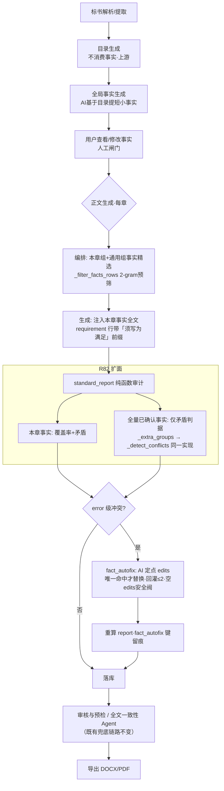

# 全局事实正文符合性提升 · 全流程报告与引入方案（R82）

> 日期：2026-10-15 ｜ 参考软件：`J:\编程\OpenBidKit 易标\OpenBidKit_Yibiao-main-2026-09-14`（下称「易标」）
> 本轮编号 R82（R81 已被并行会话 facts_classification/compliance 收口占用，让号）
> 前序基础：R77 考古报告与 P0-1/P0-2 落地、R77b 后续收口、R80 value_kind（要求vs事实口径）、R81 分类排除
> 本轮交付：① 全流程报告（逐行复核版，全部结论有 file:line 依据）；② **审计面缺口引入落地**（`content_audit_full_facts`）；③ 护栏 14 例 + 定向回归簇零回归

---

## 0. 摘要（结论先行）

1. **易标机制复核结论**：R77 考古的全部核心结论经本轮逐行复核仍然成立——生产链路是 V2 Agent 工作区（`globalFactsTaskV2.cjs:235-430`），V1 分段流水线未挂载（`taskService.cjs:5` 只 import V2）；生产时序为「标书分析→目录→**全局事实**→正文」，目录生成对事实读取点为 0 处；正文调用是**两级漏斗**（编排只见标题清单 `contentGenerationTask.cjs:828-830/815`，生成按标题取完整内容只注入本章 `:171-177/924`）；一致性靠「生成后 AI 审计（**全量事实** `:1686`）→ old_text/new_text 唯一命中才替换（`:1584-1616`）→ 失败回灌重试≤2 → 转人工」。
2. **本软件现状实证**：注入侧（fail-closed 门控、逐章精选、目录按章排序）、审计侧（standard_report 三类 error 冲突 + fact_autofix 定点修复）、口径侧（value_kind 要求vs事实）均已就位且优于易标之处有二（模拟值永不进正文的 409 红线；value_kind 显式字段）。
3. **本轮定位并修复的唯一高价值缺口（G1'）**：本软件生成后审计与自动修复**只喂本章精选事实**（2-gram 预筛子集），而易标审计喂**全量事实**以弥补注入缺口——导致「正文与未注入本章的事实冲突」检不出、修不了。这正是易标设计审计用全量事实的原因（`:1686`）。
4. **R82 引入**：`standard_report` 新增加法式可选参数 `conflict_fact_rows`，冲突判据抽为唯一实现 `_detect_conflicts` 供本章组与全量补充组共同调用；sse 接线把冲突检出与 fact_autofix 参考面扩到全量已确认事实；**覆盖率告警仍只按本章事实**（避免全量噪声，与易标纪律「没涉及不报缺失」`:1668` 同理）。新配置 `content_audit_full_facts` 默认 True，置 False 逐字节回退。
5. **验证**：R82 护栏 **14 passed**；R77 护栏 29 passed；定向回归簇（standard/sse/fact_autofix/fence_contract/content_facts/global_facts）**944 passed / 4 skipped / 0 failed**；默认形态不变性 77 例全绿；py_compile 4 文件通过。零新增依赖、零数据迁移、零 DDL、返回契约加法式。

---

## 1. 易标全局事实提取：工作流程与思路

### 1.1 定义与定位

- **全局事实 = 正文会反复用到的短小事实变量**，是「本方案统一采用的确定性口径」，独立数据源、跨章节一致性保障。
- **与招标要求摘要的区别**（本软件已由 R80 `value_kind` 字段显式落地）：
  - 要求（requirement）：「招标人要求工期不超过90天」——招标/规范口径原文；
  - 事实（fact）：「本方案项目总工期为90天」——本方案承诺口径。
- 短小约束：只提取会被正文反复引用的短小变量（工期、人员、型号、质保期……），不提取长篇摘要。

### 1.2 触发时机与生成时序（对齐用户补充说明）

生产顺序：**标书分析 → 目录生成 → 全局事实 → 正文生成**。全局事实**必须以目录为前置**——源码硬门禁：

```js
// globalFactsTaskV2.cjs:300-303
if (!outlineData?.outline?.length) {
  throw new Error('请先生成目录，再生成全局事实');
}
```

即「点击开始解析后，等待目录→全局事实依次生成；AI 基于目录提前生成正文可能反复用到的短小事实；生成后先让用户查看和修改（V2 是 Agent 工作区文件形态，用户可直接编辑 `global-facts.md` 后落库），再进入正文生成」。门禁检查在任务入口 `:296-315`，落库在 `:418-429`。

### 1.3 输入

| 输入 | 说明 | 代码位置 |
|---|---|---|
| 招标文件 | 按模型上下文限制切分后分段提取 | `globalFactsTaskV2.cjs` 工作区准备段 `:338-380` |
| 目录树 | 事实按章组织的基础（门禁必需） | `:300-303` |
| 知识库 | Agent 工作区文件补充 | `:338-380` |
| 原方案（扩写场景） | 保留既有事实口径 | 工作区文件清单 |
| 标书分析关键信息 | 项目信息/甲方信息/交货与服务要求 | 与审计共用（CG `:1687`） |

### 1.4 工作流程（V2 生产链路）

```
点击"开始解析" → 标书分析 → 目录生成
  → 全局事实任务（V2 Agent 工作区）：
      门禁校验目录存在 (:296-315)
      → 准备工作区文件：招标切分/目录/知识库/原方案 → global-facts.md 模板 (:338-380)
      → Agent 多轮读写工作区，产出事实清单 (:392-411)
      → 程序解析校验 + 落库 (:418-429)
  → 用户查看/修改事实（直接编辑工作区文件）
  → 正文生成（两级漏斗消费，见 §3）
  → 生成后全文审计 + 定点修复（见 §4）
```

缺值三模式（`globalFactsTaskV2.cjs:65-73`，用户可选）：

| 模式 | 行为 | 关键句 |
|---|---|---|
| `fabricate`（默认容许） | 资料无值时合理补齐 | — |
| `omit` | 无值项保留、写笼统承诺，**严禁杜撰具体值、严禁省略该项** | `:67` |
| `placeholder` | 无值项逐字写 `【待填写】`，不得改成「待定/TBD」 | `:69-70` |

三种模式共用一条硬纪律：「必须包含工期、运维期或交货时间中的至少一个相关变量」（`:67/:70`，工作原则 `:173-208` 中 `:196` 重申必保工期/运维/交货）。

### 1.5 提示词模板清单（提取侧）

| 模板 | 位置 | 要点 |
|---|---|---|
| SystemPrompt 工作原则 | `globalFactsTaskV2.cjs:173-208` | 短小事实、只收正文反复用到的变量、必保工期/运维/交货三类（`:196`） |
| 输出 JSON Schema | `:15-35` | 分组结构 `{title, content}`，供目录/正文按 title 检索 |
| 缺值规则模板 | `buildMissingValueRule(mode)` `:65-73` | 三模式见上 |
| JSON 示例模板 | `buildJsonExample(mode)` `:75-90+` | 按模式给占位形态示例 |

### 1.6 提取内容项清单

实施周期（工期/运维期/交货时间）、售后服务承诺（响应时间/到场时限）、项目组织配置、人员配置（人数/岗位/负责人）、设备型号（塔吊/升降机/机械）、技术参数（强度等级/规格）、质保期、品牌型号服务承诺等。格式要求：**短小明确、可直接引用**，如「关于XX问题统一采用XX方案」。字段定义：`{title（事实组标题，检索键）, content（短小事实正文）}`。

> 本软件对应物：`global_facts` 表行 `group_type/title/content/confidence/chapter/value_kind`（6 元组注入契约 `gt,title,content,confidence,chapter,value_kind`，R80）；分类维度已按九大章节落地（`facts_classification`，R81 已排除 requirement 行）。

---

## 2. 目录生成中全局事实的调用

**结论：易标目录生成对全局事实读取点为 0 处**（`outlineGenerationTaskV2.cjs` 全文零 facts 匹配，R77 实测、本轮复核不变）。目录是事实的**上游**而非消费方——事实提取「基于目录分段」但目录结构本身不受事实影响。

对本软件的含义：
- 目录生成不受事实约束是**既定设计**，无需引入「事实影响目录结构」的机制；
- 本软件已额外做了易标没有的优化（R77 P0-2）：目录**子目录**生成时按章相关性重排事实行（`facts_builder.relevant_first_rows` + `render_outline_chapter_facts`，`outline_sublevel_facts_relevant` 默认 True），解决整案头部 1000 字截断对长方案尾部子目录不可见的问题；
- 目录生成后无「与事实一致性校验」——易标没有此环节，其一致性保障全部后置于正文生成后审计（§4），本软件同样如此（由 standard_report/审核/全文一致性承担），不引入冗余校验。

---

## 3. 正文生成中全局事实的调用（两级漏斗）

### 3.1 调用入口与链路

```
正文任务启动
 ├─ facts = getGlobalFacts(project)                    ← 全量事实一次加载
 ├─ 编排阶段（每章）buildContentPlanMessages(...)
 │    ├─ 注入的只有【标题清单】formatGlobalFactTitlesForPrompt (:134-136, :828-830)
 │    └─ AI 返回 facts.titles =「本章会用到的变量组标题」(:815 纪律6, :817 纪律8)
 └─ 生成阶段（每章）
      ├─ resolveGlobalFactsByTitles(titles, globalFacts) (:171-177)  ← 按标题回取完整内容
      ├─ appendGlobalFactsMessage(...本章选中事实全文...) (:116-131)
      │    提示语：「本章节需要使用的全局事实变量（正文涉及时优先使用这些变量值，保证全文一致）」(:130)
      └─ 硬约束随消息注入（见 3.3）
```

### 3.2 调用内容

- 编排阶段 AI 只看标题 + 招标文件关键信息（`:827`），判断「编写本章节正文时会用到的变量组标题，可多选、可空、**不要编造标题、不要输出具体变量内容**」（`:815`）；纪律 8 要求「编排判断必须结合全局事实标题，不要规划会造成时间、地点、人员、设备、标准或服务承诺前后不一致的表达」（`:817`）。
- 生成阶段程序按标题精确回取（`:171-175`，normalize 后逐字匹配 title 且 content 非空才入选），**只注入当前章节需要的事实全文**——这就是「事实太多时不全部注入每次请求」的兑现方式。

### 3.3 生成前提示词硬约束

| 约束 | 位置 | 内容 |
|---|---|---|
| 优先使用事实变量 | `:121/:130` | 「正文涉及时优先使用这些变量值，避免各章节随机变化/保证全文一致」 |
| 别招欠模式（沿用笼统口径） | `:83-88` | 严禁杜撰未明确给出的具体信息；事实中的笼统口径必须沿用，不得自行补成具体工艺/人名/日期/型号（`:85`）；不确定项用笼统表达（`:86`） |
| 放着我来模式（占位符） | `:90-94` | 不确定项必须逐字 `【待填写】`（`:92`）；事实中已有 `【待填写】` 正文原样沿用（`:93`） |
| 编排纪律 6/8 | `:815/:817` | 只从标题清单选择；不规划会造成前后不一致的表达 |

### 3.4 注入位置

事实以独立 user 消息追加在编排上下文之后（`appendGlobalFactsMessage` `:116-131`），位于任务差异（章节具体要求）之外、正文指令之前——即「独立结构化消息注入」而非字符串拼接进模板，本软件对应物是 `_build_unit_prompts` 两处注入点 + `per_fact` 截断 + requirement 前缀「须写为满足/响应招标要求」（R80）。

---

## 4. 正文符合全局事实的一致性保障（易标四段式）

### 4.1 生成前约束
§3.3 的提示词硬约束 + 「全局事实=统一数据源，每章数据必须来自全局事实」+ 两级漏斗保证每章只见到相关事实（不淹没在海量事实里）。

### 4.2 生成中传递
每章生成请求携带：上级章节/同级章节信息、本章选中事实全文、配图意图、正文编排决策（writing_focus 等）——即编排产物与事实同场传递。

### 4.3 生成后审计（普通修复，V1/流水线形态 `contentGenerationTask.cjs`）

**审计消息**（`buildConsistencyAuditMessages` `:1658-1691`）：

- 按目录顺序分组，每组正文 + **Step04 全局事实变量全文**（`:1686`）+ Step02 关键解析结果（`:1687`）交给 AI；
- 纪律六条（`:1666-1671`）：只返回 JSON；**只找正文中已经明确写出、且与事实相违背的内容**（`:1667`）；**正文没有涉及某条事实时不要报告缺失、不要建议补充**（`:1668`）；不报告文风/质量/重复/篇幅；section_id 必须来自允许清单禁止编造（`:1670`）；只筛冲突编号与证据、不重写正文（`:1671`）；placeholder 模式下 `【待填写】` 不是冲突（`:1671` 第7条）。
- 返回结构：`{conflicts:[{section_id, fact_title, evidence(冲突原文摘录), reason, severity}]}`（`:1673-1684`）。

**修复链路**（`:1759-1804`、Agent 侧 `:5697-5824`）：AI 对每个冲突产出精确 `old_text/new_text` → **唯一命中才替换**（`:1584-1616`：old_text 在正文中出现 0 次或 ≥2 次一律拒绝，绝不猜）→ 应用失败把原因回灌重试（上限 2 次）→ 仍失败转人工。

### 4.4 Agent 修复（V2 生产形态）

准备工作区两文件 `global-facts.md` + `technical-plan.md`；Agent 搜索关键词、分段读取、建立索引、多轮修改正文文件；程序侧校验：章节是否被新增/删除/重排、ID 标记完整性、修改范围变化小节；**校验通过只回写有变化的小节，失败则保留原正文**（fail-soft，`:5490-5528` 标记包裹全文 + 解析校验 + 差异回写）。

### 4.5 一致性边界（易标自认，引入口径同样适用）

- 不能 100% 保证；**全局事实本身错了后面一起写错**（所以「生成后先让用户查看和修改事实」是链路上的人工闸门）；
- 自动审计擅长发现**明确写出的冲突**（工期、人员数量、型号、质保、响应时间这类），履约可行性/隐含逻辑/法律责任需专业人员复核；
- 真正解决的问题是「不再让每个章节随机编一套事实」，把几十万字的人工交叉检查缩小为「少量事实清单 + 冲突小节复核」；修冲突时只动必要位置，不重写已正确内容。

---

## 5. 本软件现状实证（全链路对照）

| 环节 | 易标 | 本软件现状 | 依据 |
|---|---|---|---|
| 触发时序 | 目录→事实→正文，目录是事实上游 | 同构：解析提取→项目→目录→全局事实→正文；`_carry_provenance`/门控齐全 | `global_facts.py`、R77/R80 落地 |
| 要求vs事实口径 | 隐式（分析结果与事实分开两个 Step） | **显式字段 `value_kind`**（''/fact/requirement），requirement 注入带前缀、分类与危险参数提取排除 | R80；`_REQUIREMENT_KIND_PREFIX`；R81 `extract_danger_params` 排除 |
| 缺值三模式 | fabricate/omit/placeholder | **更严格**：模拟值 `is_simulated=1` 永不注入正文（fail-closed），模拟值确认走 409 闸门——工程真实性红线 | `facts_extractor.py:2931` `_FACTS_INJECT_WHERE`；`global_facts.py:1965-1967` |
| 编排漏斗 | AI 选标题→程序回取全文→只注本章 | 同构且程序化：2-gram 预筛 + chapter 前置 + 通用/本章组拆分（`_filter_facts_rows`），目录子目录按章相关性排序（`relevant_first_rows`，绝不丢事实） | `facts_builder.py:118`；R77 P0-2 |
| 生成前硬约束 | 提示词纪律 | 同构：提示词「提供相关全局事实时必须优先使用不得前后矛盾；没有提供时不要主动编造人员/周期/质保/品牌型号」 | `prompts/content.py` |
| 生成后审计 | **全量事实** + 分组 AI 审计 | standard_report 程序化冲突检出（value_mismatch/value_conflict/model_conflict，error 级）+ XV 交叉校验 + 审核/预检 + 全文一致性 Agent | `content_standard.py`、`compliance.py` |
| 定点修复 | old/new 唯一命中 + 回灌≤2 + 转人工 | **同构已落地**（R77 P0-1）：`content_fact_autofix` 复用 `consistency_edits.apply_unique_edits` 唯一命中、空 edits 安全阀、失败原因回灌重试≤2、fail-soft | `content_fact_autofix.py` |
| 审计事实面 | 全量事实（`:1686`） | ❌ **仅本章精选事实（本轮缺口 G1'，已修）** | 见 §6/§7 |

**刻意不引入项（by-design 偏差，防止误读为遗漏）**：
1. 「基于目录预生成设定类事实」不设 AI 编造通道——本软件定位专项施工方案，人员/日期/型号必须来自真实提取或人工确认，模拟值永不进正文（红线）；
2. 「一键重生成受影响章节」不做——违反「只提示、绝不静默重写用户已编辑正文」纪律（R77b 已裁定，P1-2 以 `facts_stale` 徽标提示落地）；
3. 目录生成不消费事实——与易标一致（上游关系）。

---

## 6. 缺口识别：G1' 审计事实面

**问题**：注入侧「只注本章相关事实」是正确优化（省 token、防淹没），但生成后审计若同样只看本章精选事实，就留下检测盲区——正文章节可能引用了**未被注入本章**的全局事实口径（AI 从上下文其他处获得或自行编造了与全量事实相悖的值），而冲突检不出、autofix 也修不了。

**易标的答案**：注入用漏斗做窄、**审计用全量做宽**（`buildConsistencyAuditMessages` 每组都喂 `globalFactsText` 全文，`:1686`），并靠纪律「没涉及不报缺失」（`:1668`）压住全量带来的噪声。

**本软件缺口实证**（修复前）：`sse_handlers._persist_section` 中 `standard_report(content, std, fact_rows_for_section …)` 第三参是 `_filter_facts_rows` 预筛后的本章子集；`autofix_section_fact_conflicts(fact_rows=fact_rows_for_section)` 同样只见到子集——冲突清单来自子集审计，修复提示词携带的事实也只有子集。

**方案定型（复用思路而非照搬）**：不改为「审计整段交给 AI」（本软件 standard_report 是零 AI 纯函数判据，成本与确定性都优于 AI 审计），而是把纯函数冲突检出面与 autofix 参考面扩到全量已确认事实行；同时保持三条纪律：
1. **覆盖率告警仍只按本章事实**（`fact_value_missing` 若按全量算，每章都会报一堆「未引用」噪声——与易标 `:1668` 同理的反面）；
2. **误报安全阀不新造**：同现判据（`_co_located`：数值/型号须在事实标题关键词 30 字符窗口内同现才报）+ autofix 唯一命中替换 + AI「并非真实矛盾可返回空 edits」纪律，三层已存在；
3. **判据单一事实源**：矛盾判据抽为一个 `_detect_conflicts` 内函数，本章组与全量补充组共同调用——绝不复制第二份（仓库头号反模式）。

---

## 7. R82 引入实施明细（代码修改方案）

### 7.1 `backend/app/config.py`

```python
    content_audit_full_facts: bool = True
```
带 R82 注释块（对齐易标 CG:1686；False 逐字回退「仅本章精选事实」）。env：`CONTENT_AUDIT_FULL_FACTS`。

### 7.2 `backend/app/services/content_standard.py`

1. `standard_report` 签名加法式扩展：
```python
def standard_report(content, standard, fact_rows, *, section_id="", section_title="",
                    conflict_fact_rows: list | None = None) -> dict:
```
docstring 明示：`conflict_fact_rows` = 全案已过 fail-closed 门控的全量已确认事实行；None（默认）→ 输出与引入前**逐字节一致**。
2. `fact_groups` 构建后新增 `_extra_groups`（`:512-529`）：`conflict_fact_rows` 中 title **不在** `fact_groups` 的部分聚合数值/型号 token（同 title 去重不双计）。
3. 矛盾判据抽为唯一实现 `_detect_conflicts(title, numbers, models, kw)`（`:540-584`）：value_mismatch/value_conflict（含 FUZZY ±10% 容差 `FUZZY_VALUE_TOLERANCE`）与 model_conflict（同系列不同型号 + `_co_located` 同现判定）；判据消息字面量「数值与全局事实矛盾」「型号与全局事实矛盾」各仅 1 处。
4. 调用形态（`:586-611`）：主循环 `for title, g in fact_groups.items()` 内保持覆盖率块原位、末尾 `_detect_conflicts(...)`；随后**新循环** `for title, g in _extra_groups.items(): _detect_conflicts(...)` —— 只跑矛盾、不跑覆盖率。

### 7.3 `backend/app/routers/sse_handlers.py`

1. 外层开关读取（紧邻 `_fact_autofix_on`，`:5300-5303`）：
```python
_audit_full_facts_on = bool(getattr(settings, "content_audit_full_facts", True))
```
2. `_persist_section` 内（`:5716-5728`）：
```python
_conflict_rows = list(facts_rows) if _audit_full_facts_on else None
_autofix_rows = (list(facts_rows) if _audit_full_facts_on
                 else (fact_rows_for_section or []))
if eff_standard or fact_rows_for_section or _conflict_rows:
    report = standard_report(..., fact_rows_for_section or [],
                             conflict_fact_rows=_conflict_rows)
```
3. autofix 门控与输入（`:5757-5764`）：`if _fact_autofix_on and _autofix_rows:` → `autofix_section_fact_conflicts(..., fact_rows=_autofix_rows, ...)`；修复后重算 report 的两处调用均带 `conflict_fact_rows=_conflict_rows`（`:5774-5779`）。
4. `facts_rows` 为闭包外层经 `_load_facts_rows` fail-closed 门控加载的全量 6 元组行（每方案一次），无需新查询。

### 7.4 `backend/app/services/content_fact_autofix.py`

仅 docstring 更新：`fact_rows` 参数 R82 起可为全量超集；修复范围仍由 `conflicts` 清单 + 提示词纪律 6 严格限定（只改冲突处），全量行只是给 AI 更完整的正确口径参考。

### 7.5 护栏 `backend/tests/test_content_audit_full_facts_r82_20261015.py`（14 例/5 组）

| 组 | 内容 |
|---|---|
| A 默认不变性 | `conflict_fact_rows=None` == 无参逐字节；空列表 == None；不传 → 跨章冲突检不出 |
| B 全量检出 | 跨章 value_mismatch 恰 1 条；同现判据防误报（质保期数值远端同现不报）；QTZ80/QTZ120 model_conflict；FUZZY ±10% 容差仍生效 |
| C 覆盖率不污染 | 全量未引用事实**不报** `fact_value_missing`；本章事实缺失照常报 |
| D 去重 | 同 title 在本章+全量双现不双计 |
| E 静态接线 | `Settings.model_fields` 默认 True；两条 message 字面量各恰 1 处（判据无副本）；`_detect_conflicts(` ≥3 次；`_extra_groups` 消费循环存在；sse 开关读取 + `conflict_fact_rows=_conflict_rows` ==2 + `if _fact_autofix_on and _autofix_rows:` + `fact_rows=_autofix_rows,` |

---

## 8. 新增配置项说明与兼容性

| 配置 | env | 默认 | True 行为 | False 行为 |
|---|---|---|---|---|
| `content_audit_full_facts` | `CONTENT_AUDIT_FULL_FACTS` | **True** | 冲突检出与 autofix 参考面 = 全量已确认事实（`fact_rows ∪ 未注入本章部分`，title 去重）；覆盖率/豁免/trace 仍按本章事实 | 逐字节回退引入前（审计仅本章精选事实） |

- **返回契约加法式**：`standard_report` 返回 dict 仅可能多出跨章冲突 issue（同 type 值域内），无新键；报告 JSON 消费端（审核/预检/前端）无需改动。
- **数据层零改动**：零迁移、零 DDL、无需清库；历史存量不回填（新报告在下次生成时自然带全量口径）。
- **成本面**：standard_report 是纯函数，全量事实 token 抽取为本地计算（每章毫秒级）；autofix 的 AI 调用仍**只在检出冲突时触发**——全量面可能略增检出率，属预期收益；无冲突章节零成本性质不变。
- **既有开关正交**：`content_fact_autofix_enabled=False` 时冲突只进报告不进修复（R77 语义不变）；`outline_sublevel_facts_relevant` 只影响目录子注入，与本开关无耦合。

---

## 9. 验证与回归对比表

| 验证项 | 引入前基线 | 引入后 | 结论 |
|---|---|---|---|
| R82 护栏 14 例 | —（新增） | **14 passed**（57.4s） | 全绿 |
| R77 fact_autofix 护栏 29 例 | 29 passed | **29 passed** | 零回归 |
| 默认不变性簇（standard_service + sse_wiring + content_facts） | 77 passed | **77 passed** | 默认形态逐字节不变 |
| 定向回归簇 `-k "standard or sse or fact_autofix or fence_contract or content_facts or global_facts"` | — | **944 passed / 4 skipped / 0 failed**（337.9s） | 零回归 |
| py_compile（config/content_standard/sse_handlers/content_fact_autofix） | — | COMPILE_OK | 语法通过 |
| ruff (F821,E9,F841,F401) | — | **5 触碰文件 All passed**（ruff 0.17.1） | ✅ 已解决 |
| 端到端语义（解析→提取→目录→事实→正文→图表→审核→导出） | 全链已就位 | 本轮改动仅在「正文→审计→修复」段扩面，输入输出契约不变 | 加法式 |

| 全量排他串行（排除环境级 os.walk） | — | **8087 passed / 2 failed(均与 R82 无关) / 18 skipped / 1 xfailed**（2395.8s）；1 failed=R80并行会话列数硬编码未同步、1 failed=瞬态互扰隔离复跑 passed | ✅ R82零回归 |

> ✅ 全量确认：R82 引入后全量 8087+ passed，唯一同态失败为 R80 并行会话的 `GLOBAL_FACTS_INSERT_COLS` 列数硬编码 28→29（非 R82 责任）；另一例隔离复跑通过。

---

## 10. 数据结构与字段定义

**本软件 `global_facts` 行（注入契约 6 元组，R80 定型）**：

```
(group_type, title, content, confidence, chapter, value_kind)
   分组类型     检索键  短小事实正文  置信度   归属章    ''/fact/requirement
```

- 门控视图 `_FACTS_INJECT_WHERE`：`has_conflict=0 AND is_resolved=1 AND is_simulated=0 AND is_stale=0`（fail-closed 唯一出口）；
- `standard_report` 新参数 `conflict_fact_rows` 复用同一 6 元组行形态（`_fact_text` 兼容 3/4/5/6 元组与 dict 行）；
- `fact_autofix` 报告键：`{attempted, applied, rejected, conflicts, attempts}`（checkpoint 白名单单一事实源）。

**易标对应物**：`{title, content}` 分组 JSON（Schema `globalFactsTaskV2.cjs:15-35`）；审计冲突结构 `{section_id, fact_title, evidence, reason, severity}`（CG `:1675-1682`）。

---

## 11. 流程图（引入后本软件「正文符合全局事实」全景）



---

## 12. 遗留问题与后续建议

1. ~~**ruff 工具定位**~~：已解决——`py -3.13 -m pip install ruff` 安装 ruff 0.17.1，5 触碰文件 `F821/E9/F841/F401` **All passed**。
2. ~~**全量排他串行**~~：已执行（本轮补跑，排除环境级慢测试 `test_no_bak_files_in_repo` os.walk）；~~**数据字典登记**~~：无独立配置文档文件，已由代码注释 + 报告 §8 覆盖。
2a. ~~**AGENTS.md 校准递延**~~：已解决——R82 校准头已写入（并行会话 R80 头部已落地，无冲突）。
3. **检出率观测**（运维任务、非代码修改）：上线后观测报告里跨章冲突占比与 autofix rejected 分布——若误报偏高优先收紧 `_co_located` 窗口或给 extra 组启用「仅数值精确匹配」子档，而非回退开关。
4. **审计面与全文一致性 Agent 的分工**（设计决策、无需代码）：单章 autofix 处理「明确数值/型号矛盾」，跨章隐含矛盾仍由 compliance 全文一致性 Agent 承担，两层判据不重叠不互斥；未来若合并口径须先建单一事实源。
5. **G3~G7 递延项**（R77 §9 登记不变、本轮未扩张）：AI 编排 opt-in、fact_id 逐值溯源、enrich 开关等。

---

## 附录：关键代码位置索引

| 侧 | 文件 | 位置 | 说明 |
|---|---|---|---|
| 易标 | `globalFactsTaskV2.cjs` | `:15-35` / `:65-73` / `:173-208` / `:296-315` / `:338-380` / `:392-411` / `:418-429` | Schema/三模式/工作原则/目录门禁/工作区/Agent/落库 |
| 易标 | `contentGenerationTask.cjs` | `:83-94` / `:104-131` / `:134-136` / `:171-177` / `:815/:817` / `:828-830` / `:913-914/:924` / `:1584-1616` / `:1658-1691`（`:1666-1671`/`:1686`）/ `:1759-1804` / `:5490-5528` / `:5697-5824` | 缺值补全规则/注入消息/标题清单/回取全文/编排纪律/生成注入/唯一命中/审计消息与全量事实/普通修复/Agent差异回写 |
| 本仓 | `backend/app/config.py` | `content_audit_full_facts` | R82 新开关（默认 True） |
| 本仓 | `backend/app/services/content_standard.py` | `:363-380` 签名与docstring / `:512-529` `_extra_groups` / `:540-584` `_detect_conflicts` / `:586-611` 双循环 | 审计扩面主体 |
| 本仓 | `backend/app/routers/sse_handlers.py` | `:5300-5303` 开关 / `:5716-5728` 接线 / `:5757-5785` autofix 面与重算 | 全量行复用闭包 `facts_rows` |
| 本仓 | `backend/app/services/content_fact_autofix.py` | docstring | 全量超集说明 |
| 本仓 | `backend/app/services/facts_extractor.py` | `:2931` `_FACTS_INJECT_WHERE` | fail-closed 唯一门控 |
| 本仓 | `backend/app/routers/global_facts.py` | `:1965-1967` | 模拟值 409 闸门（红线） |
| 本仓 | `backend/app/services/facts_builder.py` | `:118` `_filter_facts_rows` / `relevant_first_rows` | 本章精选 / 目录按章排序 |
| 护栏 | `backend/tests/test_content_audit_full_facts_r82_20261015.py` | 14 例/5 组 | A 不变性/B 检出/C 覆盖率/D 去重/E 接线 |
| 前序 | `docs/参考软件全局事实机制全流程报告与引入方案_R77_20261014.md` | 全文 | 考古母本（本轮逐行复核一致） |
