# 技术架构文档 · 专项方案工具箱

> **版本**：v5.4 · **更新日期**：2026-11-09 · **状态**：已发布 · **对齐代码版本**：`APP_VERSION = 5.3.0`（`backend/app/config.py:24`；前端 `package.json` 5.3.0）· **对齐基线**：`ec3e1426d6461b6ff6a7d4b5327c2ed6bf85e1b5`（2026-11-08）
> 关联文档：软件编译计划书 / 交付使用说明书 / 产品需求文档（docs/）
> **数字口径**：所有规模数字（行数/文件数/表数）2026-11-09 实测，验证命令见《软件编译计划书》附录 A；未复核的历史基准保留原引用出处。

---

## 修订说明（v5.3 → v5.4，2026-11-09 全面更新）

| 章节 | 变更 | 依据 |
|------|------|------|
| 头部 | 版本 v5.4，更新日期 2026-11-09，对齐基线 HEAD | `git log -1` |
| 图1-1 | 技术栈：Python **3.12+**；SSE 自实现（`StreamingResponse`，sse-starlette 已移除）；日志改标准库 + `SafeRotatingFileHandler`（loguru 移除）；DB = WAL + **读写分离连接池** | `requirements.txt`、`sse_handlers.py`、`db.py` |
| 图2-1 | 目录结构全量重绘：路由 43 模块 / 服务 100 顶层 + 3 子包 / 测试 545 / 新增 11 个路由模块与 3 个服务子包 | 实测 |
| 2.3 设计模式 | 新增 **2.3.7 提示词预算与留痕裁剪**、**2.3.8 缺陷账本与修复权分离**、**2.3.9 连接池取消安全** | `prompt_governance.py`、`defects.py`、`db.py` |
| 图2-4 | 降级/熔断对冲文案：45s 固定 → **45s 基线 + p90 自适应（30~90s）** | `config.py` `AI_HEDGE_ADAPTIVE_*` |
| 图3-1/3-2 | 路由 5 条 → **8 条 + `*`**；工作台 8 区块 → **6 个顶层工作流 Tab（import 含解析子 Tab）+ AI 配置侧边 Tab**；页面 5 → **8**（新增 PlaygroundPage、PromptMetricsPage、AgreementPage 等） | `App.tsx`、`SchemeWorkbenchPage.tsx` |
| 图4-3 ER | 新增 10+ 实体（doc 四层、缺陷账本、条款库、评分项、编排状态机、审计治理），表总数 26 → **47** | `schema_sql.py` 等 4 处 DDL |
| 6.3 API | 新增 `doc_pipeline` / `defects` / `scoring` / `review_autofix` / `standards_admin` / `agent_runs` / `export_dossier` / `prompts` / `global_facts_docs` 模块行与端点示例 | 各路由实测 |
| 7/8/9/11 | 性能补连接池/写锁/提示词预算；安全补自动密钥文件；部署补 `start_backend.ps1` 单进程、`stop_all`/`cleanup_guard`；测试补 545/104 规模与 2026-11-08 基线 | 实测 |
| 13 附录 | 参数速查补七开关与对冲自适应；代码规模全量重测；遗留说明更新 | 实测 |
| **全图集** | **第二批（2026-11-09）合并 v5.3（HEAD `ababdf4`）版图集：新增图 2-3/2-5/2-7、4-3~4-11、7-1、8-1 与全新第 10 章「核心状态机图集」（10-1~10-6），原第 10~12 章顺延为 11~13 章；合计 34 张图** | `git show ababdf4:docs/技术架构文档.MD` 切图 + 逐图实测核验（熔断 5 次/15s、并发窗口 20/上限 5、知识注入 3000 字等已按现网代码修正） |

---

## 图表索引

| 图号 | 图名 | 所在章节 |
|------|------|---------|
| 图 1-1 | 整体技术栈关系图 | 1.2 |
| 图 2-1 | 后端分层架构图 | 2.1 |
| 图 2-2 | 业务服务模块图 | 2.2 |
| 图 2-3 | 后端模块依赖关系图 ⭐ | 2.2 |
| 图 2-4 | AI Provider 设计模式图 | 2.3.1 |
| 图 2-5 | 自适应并发控制 ⭐ | 2.3.3 |
| 图 2-6 | AI 降级链路图 | 2.3.4 |
| 图 2-7 | AI 熔断器状态机 ⭐ | 2.3.4 |
| 图 3-1 | 前端路由架构图 | 3.1 |
| 图 3-2 | SchemeWorkbenchPage 模块图 | 3.2 |
| 图 3-3 | 前端组件关系图 | 3.3 |
| 图 4-1 | 文件上传与解析数据流图 | 4.1 |
| 图 4-2 | BidAnalysis 与全局事实库数据流图 | 4.2 |
| 图 4-3 | 项目资料数据链总览 ⭐ | 4.3 |
| 图 4-4 | 文件解析多通道与闸门 ⭐ | 4.4 |
| 图 4-5 | 全局事实提取管线 ⭐ | 4.5 |
| 图 4-6 | 目录生成时序 ⭐ | 4.6 |
| 图 4-7 | 正文与图表同步生成时序 ⭐ | 4.7 |
| 图 4-8 | 图表渲染与登记流水线 ⭐ | 4.8 |
| 图 4-9 | 一致性 Agent 修复闭环 ⭐ | 4.9 |
| 图 4-10 | 六维就绪度评分与程序化预检 ⭐ | 4.10 |
| 图 4-11 | 导出流水线 ⭐ | 4.11 |
| 图 5-1 | 数据表 ER 图 | 5.2 |
| 图 6-1 | 统一 SSE 事件流图 | 6.4 |
| 图 6-2 | AI 配置与治理流图 | 6.5 |
| 图 7-1 | 弱模型稳定 JSON 工作流 ⭐ | 7.4 |
| 图 8-1 | 中间件执行顺序与鉴权 ⭐ | 8.1 |
| 图 9-1 | 部署拓扑图 | 9.1 |
| 图 10-1 | 方案生命周期状态机 ⭐ | 10.1 |
| 图 10-2 | 章节评审状态机 ⭐ | 10.2 |
| 图 10-3 | 入库审核三态状态机 ⭐ | 10.3 |
| 图 10-4 | 章节内容状态机 ⭐ | 10.4 |
| 图 10-5 | 任务状态机 ⭐ | 10.5 |
| 图 10-6 | 审核定向修复状态机 ⭐ | 10.6 |

> ⭐ = 本版（v5.4 第二批）合并自 v5.3（HEAD `ababdf4`，2026-10-05）同名文档的图集，已逐张核对现网代码后按所在章重排图号；原 v5.3 版「图 2-3 AI Provider / 图 2-4 降级链路 / 图 4-3 ER / 图 5-1 SSE / 图 5-2 治理」相应顺延为 2-4 / 2-6 / 5-1 / 6-1 / 6-2。全图 34 张（v5.4 首批 14 张 + 合并 20 张）。

---

## 1. 总览

### 1.1 技术栈概述

**专项方案工具箱**采用前后端分离架构：

- **后端**：Python 3.12+ / FastAPI 0.139 / Uvicorn 0.49 / SQLite（WAL + 读写分离连接池）
- **前端**：React 18.3 + TypeScript 5.9 + Vite 6 + Ant Design 5.29 + react-router-dom 7
- **AI 层**：自研 Provider 抽象（**24 个平台预设** + OpenAI/Anthropic 兼容）+ 降级 + 熔断 + 对冲
- **通信**：REST（axios）+ SSE（`StreamingResponse` 自实现事件流）
- **存储**：SQLite（WAL + 连接池）+ 文件存储（导出/上传/密钥）
- **质量门禁**：ruff（后端主 lint）/ pytest 9（545 文件）/ ESLint 9 + Prettier 3 / vitest 3（104 文件）/ CI 双 Python 腿（3.12 主 + 3.14 观察）

### 1.2 整体技术栈关系图

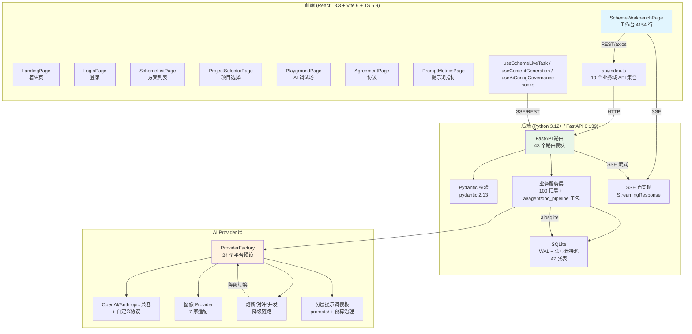

---

## 2. 后端架构

### 2.1 后端分层架构图

```mermaid
graph TB
    subgraph Router["路由层 (routers/ · 43 个模块)"]
        R1[sse_handlers.py ★ 7698 行<br/>Upload→BidAnalysis→Outline→Content→Review→Export]
        R2[export.py ★ 6592 行<br/>+ _export_cache/_export_docx_parts/_export_issue_scan]
        R3[ai_config/ 子包 9 模块<br/>config/connectivity/models/usage/audit/key_rotation/scene_routes/runtime]
        R4[projects/schemes/sections/outline_library<br/>upload_outline/global_facts/bid_analysis]
        R5[compliance/consistency_repair/review/charts<br/>knowledge/system/scheme_catalog]
        R6[doc_pipeline/agent_runs/defects/scoring<br/>review_autofix/standards_admin/export_dossier]
        R7[prompts/global_facts_docs/sse_checkpoint/sse_utils]
    end

    subgraph Service["业务服务层 (services/)"]
        S1[内容生成<br/>content_*]
        S2[大纲<br/>outline_*]
        S3[事实<br/>facts_* + facts_query]
        S4[审核<br/>audit_rules 六维 25/20/20/15/10/10]
        S5[图表 mermaid_service<br/>+ 程序化渲染]
        S6[导出 python-docx<br/>+ 占位符 audit/resolve]
        S7[doc_pipeline/ 四层存储<br/>doc_chunker/doc_storage/md_structured]
        S8[agent/state_machine<br/>编排状态机]
        S9[数据投影 data_projection<br/>bid_section_detector 等]
    end

    subgraph AI["AI 服务层 (services/ai/)"]
        A1[ProviderFactory<br/>24 平台预设]
        A2[providers/<br/>OpenAI/Anthropic 兼容]
        A3[image_providers/<br/>7 家 + image_engine]
        A4[llm_tasks + task_registry<br/>分块合并/并发/排队]
        A5[熔断/对冲/降级<br/>warmup 暖机]
        A6[prompts/ 15 模块<br/>预算 _limits/截断 _metrics/审计]
    end

    subgraph Data["数据层"]
        D1[(SQLite<br/>WAL + 读写连接池)]
        D2[schema_sql.py<br/>41 表 + 4 处 DDL = 47]
        D3[seed_data.py<br/>13 分类/175 清单]
        D4[文件存储<br/>导出/上传/密钥]
    end

    R1 --> S1
    R1 --> S2
    R1 --> S3
    R2 --> S6
    R3 --> A1
    R4 --> S9
    R6 --> S8
    R6 --> S7
    R7 --> A6
    S1 --> A1
    S2 --> A1
    S3 --> A1
    S4 --> D1
    S5 --> A4
    S6 --> D4
    S7 --> D1
    S8 --> D1
    A1 --> A2
    A1 --> A3
    A1 --> A4
    A1 --> A5
    A1 --> A6
    Service --> D1
    AI --> D1

    style R1 fill:#e1f5fe
    style A1 fill:#fff3e0
    style D1 fill:#e8f5e8
```

**分层职责**：

| 层 | 目录 | 职责 | 规模 |
|----|------|------|------|
| 路由层 | `routers/` | HTTP/SSE 端点、请求校验、响应封装 | **43 个模块文件**（27 公开 + 7 私有 + `ai_config/` 子包 9） |
| 服务层 | `services/` | 业务逻辑、领域规则、编排 | **100 个顶层文件 + 3 子包**（`ai/` 53、`agent/` 2、`doc_pipeline/` 5） |
| AI 层 | `services/ai/` | LLM 调用、降级、熔断、提示词治理 | 24 平台预设 / 7 图像适配 / 15 提示词模块 |
| 数据层 | `schema_sql.py` + `db.py` | 表结构、迁移、连接池 | **47 张表**（41 + db.py 3 + system.py 1 + agent 2） |
| 配置层 | `config.py` | pydantic-settings 200+ 字段集中配置 | 1332 行 |

**启动序列**（`main.py` lifespan，676 行）：`init_db` → 孤儿导出 GC → 僵尸任务恢复（≥0.95 完成否则回退）→ 日志上下文 → 鉴权声明 → 主密钥自检（R175）→ 提示词契约校验（G4）→ 治理开关回放 → 条款库探测（开关开时）→ `apply_config_concurrency` → 熔断/供应商状态暖机 → 就绪。

### 2.2 业务服务模块图

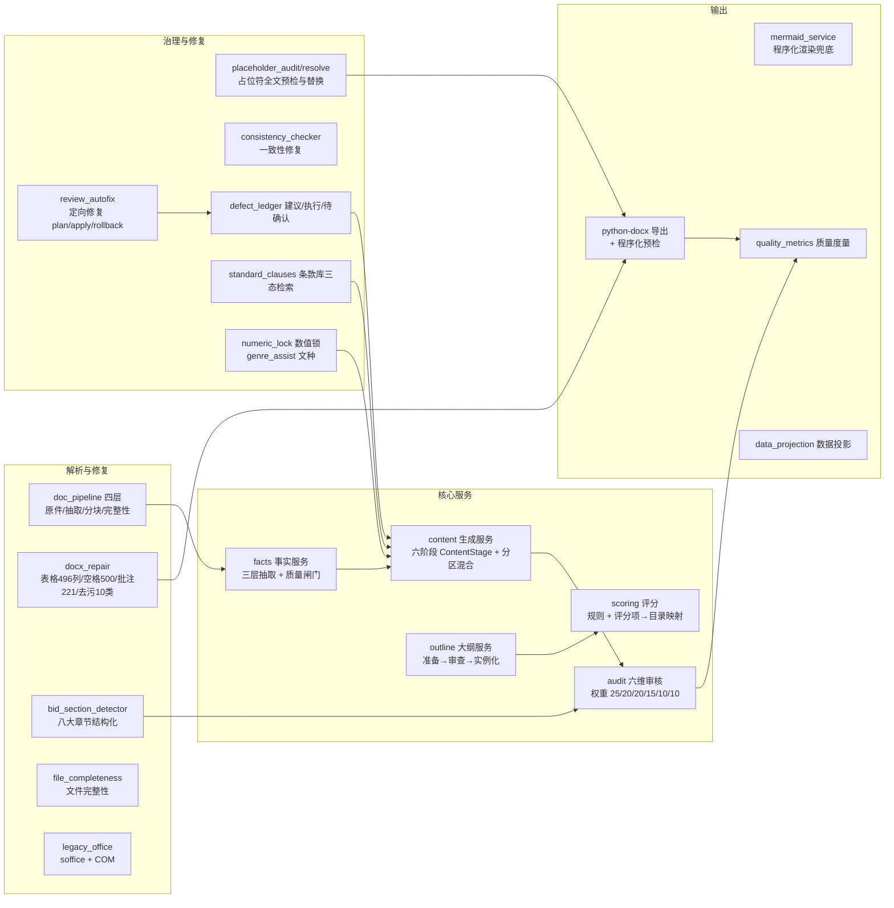

**图 2-3 后端模块依赖关系**（⭐ 合并自 v5.3 版图 2-2，方框内数字已按 2026-11-09 实测更新为路由 43 / 服务 100+子包 / 表 47）：

```mermaid
graph LR
    subgraph Routers["Routers 路由层（43 个模块）"]
        SSE[sse_handlers 全链编排]
        EXP[export 导出]
        AIC[ai_config/ 子包 9]
    end
    subgraph Services["Services 服务层（100 顶层 + 子包）"]
        content(content 生成)
        outline(outline 目录)
        facts(facts 事实)
        doc(doc_pipeline 解析)
        agent(agent 状态机)
        auto(review_autofix 定向修复)
    end
    subgraph AI["AI Provider 层"]
        factory(ProviderFactory<br/>24 平台预设)
        tasks(llm_tasks + task_registry<br/>分块合并/并发/排队)
        gover(prompt_governance<br/>预算/截断/审计)
    end
    subgraph DB[("SQLite")]
        schema[(schema_sql<br/>47 张表)]
        cache[(缓存表)]
    end
    SSE --> content
    SSE --> outline
    SSE --> doc
    EXP --> content
    AIC --> factory
    content --> facts
    outline --> facts
    content --> tasks
    tasks --> factory
    content --> gover
    agent --> auto
    auto --> content
    doc --> schema
    content --> schema
    outline --> schema
    tasks --> cache
```

### 2.3 设计模式与亮点

#### 2.3.1 Provider 工厂模式

**意图**：统一封装多平台 AI 调用，支持动态切换与扩展。

**核心组件**：

- `ProviderFactory`：根据配置创建 Provider 实例
- `AIProvider` 抽象基类：定义 `chat()` / `stream_chat()` 接口
- `ProviderConfig`：平台配置（api_key / base_url / model / 协议类型）
- **24 个平台预设**（`provider_factory.py` 实测键名）：deepseek / qwen / zhipu / moonshot / doubao / kimi / minimax / baichuan / iflytek / spark / yi / stepfun / minimax-text / openrouter / groq / ollama / siliconflow / together / perplexity / mistral / cohere / azure-openai / bedrock / nvidia …

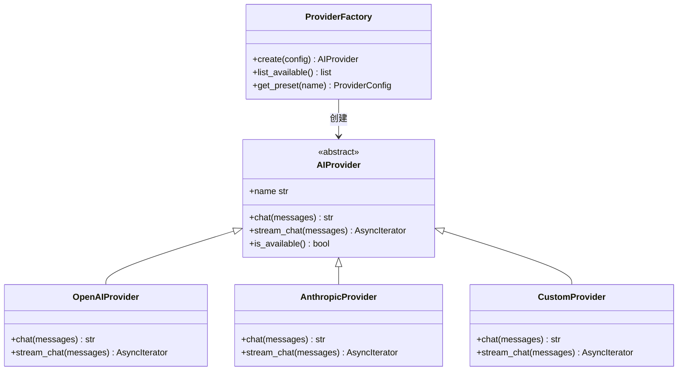

**亮点**：

- 支持 24 个预设平台 + 任意 OpenAI 兼容端点
- 支持运行时热切换（界面配置即时生效）
- 支持流式输出（SSE）
- 支持图像生成（`image_providers/` 注册 **7 家**：agnes / baidu / dashscope / hunyuan / stepfun / volcengine / zhipu，见 `__init__.py` 注册表）
- 图像引擎 `image_engine` 自动裁剪 2K 边长、最多 2 张、30s 超时

#### 2.3.2 策略模式：可插拔审核维度

**意图**：审核维度可独立开关、独立评分，支持动态配置。

**核心组件**：

- `Dimension` 数据类：定义维度 id、名称、权重、检测函数
- `RuleRegistry`：注册/管理所有维度
- 六维：completeness(25) / compliance(20) / safety(20) / consistency(15) / traceability(10) / deliverability(10)

**亮点**：

- 权重可调（1~100），总分归一化到 100
- 维度可独立启用/禁用
- 支持新增维度（向 `RuleRegistry` 注册即可）

#### 2.3.3 队列模式：并发任务管理

**意图**：AI 生成任务排队执行，防止超发与资源竞争。

**核心组件**：

- `llm_tasks` / `task_registry`：任务注册与排队
- `LLMTaskQueue`：并发控制（默认 2 并发）
- `TASK_REGISTRY`：任务状态查询（SSE 进度推送）

**亮点**：

- 支持优先级（大纲 > 正文 > 图表）
- 支持取消（前端停止 → 后端中断）
- 支持重试（网络超时自动重试 1 次）
- 事实抽取分块合并：`GLOBAL_FACTS_LLM_CONCURRENCY=4` + 跨方案 `GLOBAL_FACTS_MAX_CONCURRENCY=8` + 队列上限 64（超载返回 `FACTS_OVERLOADED`）

**图 2-5 自适应并发控制**（⭐ 合并自 v5.3 版图 2-5 内嵌流程，判据已按 `workflows_base.py` `adjust()` 现网代码修正：慢响应不降档，降档仅由失败率>30% 或连续 429≥2 触发）：

```mermaid
graph TD
    A[每次调用写入 20 次滑动窗口<br/>window=20 · adjust 只收敛档位不直接限流] --> B{升档：avg < 8s<br/>且失败率 < 5%}
    A --> E{降档：失败率 > 30%<br/>或连续 429 ≥ 2}
    B -->|是| C[target + 1<br/>全局硬上限 5 · cap 优先]
    B -->|慢但成功| D[档位不变<br/>SLOW_THRESHOLD=30s 只标记慢，不降档]
    E -->|是| F[target - 1<br/>下限 max(min_c, target-2)]
    F --> G[429 附加收益：全局等待上限 2s<br/>对冲 sleep 0.01~0.04s]
    C --> H[持续 evaluate · 优雅扩展窗口累积修正]
    D --> H
    G --> H
    H --> A
```

#### 2.3.4 策略模式：AI 降级链路

**意图**：主平台故障时自动切换备用平台，保证可用性。

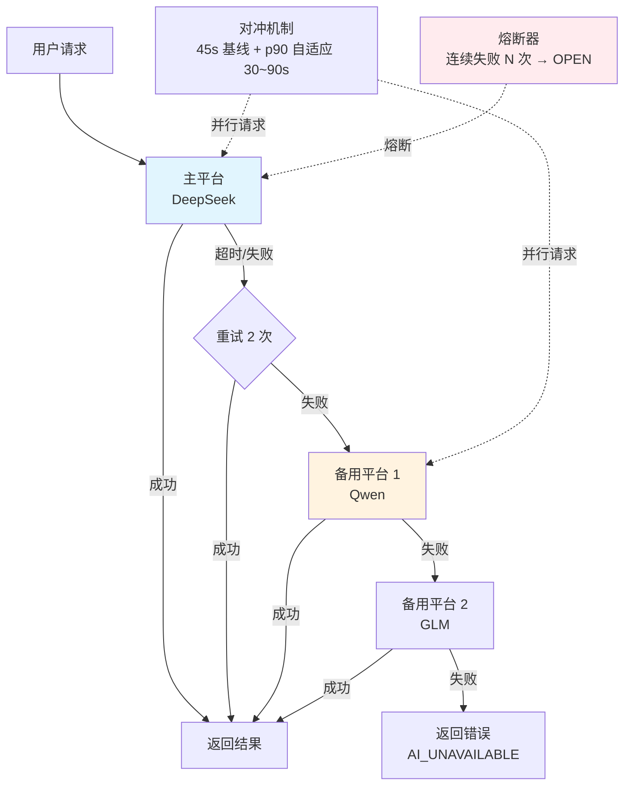

**核心机制**（实测参数）：

- 超时：请求 900s / 每供应商累计 1800s 自动切换
- 对冲：**45s 基线，p90 自适应 30~90s**（ratio 1.5×p50，min_samples 12，`AI_HEDGE_ADAPTIVE_*`）
- 熔断：连续失败 **5 次（10 秒窗口）** → OPEN，冷却 **15 秒**半开探测（429 加倍 ≤120s）；全部供应商另有全局快断 **2 次 / 60 秒**；状态持久化 `ai_provider_state` 并暖机恢复
- 并发：全局 5 / 每模型 3，抖动 0~500ms
- 可观测：`ai_config_audit_logs` / `ai_runtime_settings` / `ai_scene_routes`（七场景）

**图 2-7 AI 熔断器状态机**（⭐ 合并自 v5.3 版图 2-5，阈值已按现网代码修正：`AnalysisCircuitBreaker` 默认 **5 次/15 秒**（`workflows_base.py`，429 加倍冷却最长 120s），旧图「2 次/5 秒」为 v5.3 前历史值；另有全局快断 **2 次/60 秒** `ai_all_circuit_fast_fail_*`）：

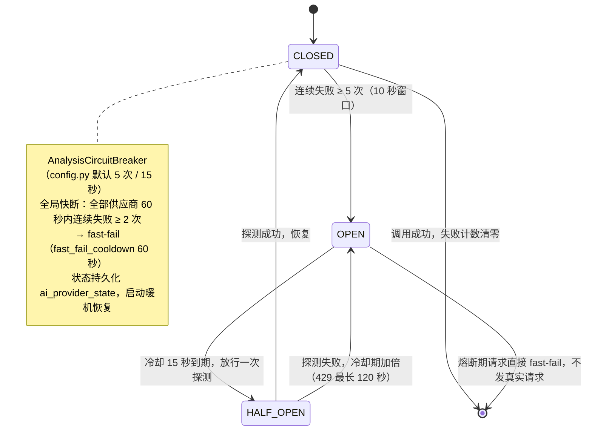

#### 2.3.5 策略模式：场景化提示词切换

**意图**：不同场景（生成/审查/修复）使用不同提示词模板，运行时可切换。

**核心组件**：

- `PromptTemplate`：模板定义（system / user / few_shot）
- `SceneManager`：场景路由（`ai_scene_routes` 七场景）
- `PromptService`：模板加载与变量替换

**亮点**：

- 支持运行时切换（界面配置即时生效）
- 支持版本管理（`prompt_audit_logs` 快照 + 回滚）
- 支持预算治理（见 2.3.7）

#### 2.3.6 工厂函数 + 注册表：Markdown 结构解析与程序化图表

**意图**：`mermaid_service.py` 工厂返回 `HeadingV1/V2` 两代策略，`_canonical()` 归一化块（六通道）经 ASCII 灰度图 + OpenCV 8 邻域连通域 → 12 项几何特征 → 决策树输出 12 类。渲染闭环：`chart_pipeline`（LLM → 语法修复 → AST 重排 → **程序化渲染兜底**）→ 2×2 评审 → 入库 13 类图表（`preview_charts.py` / `render_standalone.py` / `_chart_pipeline.py` 路由）。

**亮点**：`bind` 表按模板槽位→方向词聚合；schema 自由度 0.37→0.00；`mermaid_service` 仅 `_PROC` 注册表触发，**默认关闭**（历史遗留见 13.3）。

#### 2.3.7 提示词预算与留痕裁剪（v5.4 新增）

**意图**：防止提示词超长导致截断黑箱——超预算时**成对、可追溯**地裁剪，而不是无声截断。

- **预算器**：`PROMPT_TEXT_BUDGET=3000` / `PROMPT_DICT_BUDGET=4000` / `PROMPT_OVERVIEW_BUDGET=1800` / `PROMPT_HEADING=400` / `PROMPT_JSON=1000`（`services/ai/prompts/_limits.py`、`_metrics.py`）
- **留痕**：裁剪必挂 `clip_text_notice`（谁被裁、裁多少、为何）；围栏必须成对（`围栏裁剪` 检测未闭合 ```/引号）
- **截断棘轮**：历史最大截断量只降不升（棘轮回归测试锁死）
- **字典裁剪顺序**：按注入价值排序（`_norm_dicts` 归一词典优先级）
- **契约校验**：G4 变量契约启动期双向校验（模板声明 `requires` ↔ 实际占位符）；`PROMPT_CONTRACT_FAIL_FAST` 默认关
- **审计**：每次调用写 `prompt_audit_logs` 快照，`/api/v1/prompts/audit-logs` 可查、可回滚

#### 2.3.8 缺陷账本与修复权分离（v5.4 新增）

**意图**：修复建议（AI 可提）与修复执行（人工确认后才落值）权责分离，防止 AI 静默改写正文。

- **三态**：`建议`（AI 生成 diff）→ `待确认`（人工审核）→ `执行`（落库 + `fix_decisions` 记账）
- **载体**：`scheme_defects`（缺陷）+ `fix_decisions`（决策）+ `verify`（修复后复检）
- **入口**：工作台「审核→修复」页签（`DEFECT_LEDGER_ENABLED`，default **OFF**）；未开开关时路由 404
- **定向修复**：`review_autofix` 按严重度分批：`plan`（计划）→ `apply`（应用）→ `rollback`（回滚），六阶段收集与确认（`collect`/`stage`/`confirm`/`repairs`）

#### 2.3.9 连接池取消安全（v5.4 新增）

**意图**：SQLite 单文件下解决并发读写与取消竞态。

- **读写分离**：读池只读查询 / 写池 `BEGIN IMMEDIATE`（目录写锁），避免升级锁死锁
- **取消安全**：`CancelledError` 不吞、不回滚到错误计数；回退逻辑与写池同构（精确归还，不重算总数）
- **收尾**：`close_db()` 在 lifespan 关闭期排干双池，避免句柄泄漏
- **WAL 模式**：读不阻塞写；`busy_timeout` 防 `database is locked`
- **事实写租约**：`facts_write_leases` + `facts_chunk_failures` + `facts_cross_conflicts` 记账跨方案写冲突

---

## 3. 前端架构

### 3.1 前端路由架构图

```mermaid
graph TB
    subgraph Router["React Router (react-router-dom 7)"]
        P1[="/" → LandingPage<br/>着陆页]
        P2["/login" → LoginPage<br/>登录页]
        P3["/list" → SchemeListPage<br/>方案列表]
        P4["/schemes/:id" → SchemeWorkbenchPage<br/>工作台 4154 行]
        P5["/project-selector" → ProjectSelectorPage<br/>项目选择]
        P6["/playground" → PlaygroundPage<br/>AI 调试场]
        P7["/agreement" → AgreementPage<br/>协议]
        P8["/settings/prompt-metrics" → PromptMetricsPage<br/>提示词指标]
        P9["*" → NotFoundPage<br/>404]
    end

    P1 -->|快速开始/已有方案| P3
    P1 -->|先去登录| P2
    P2 -->|登录成功| P3
    P3 -->|选择方案| P4
    P3 -->|选择项目| P5
    P5 -->|选择项目| P3

    style P4 fill:#e1f5fe
```

**API 层**：`src/api/index.ts` 集中 **19 个业务域** API（schemes / sections / facts / audit / charts / aiConfig / compliance / consistency / knowledge / review / export / bidAnalysis / docPipeline / defects / scoring / reviewAutofix / standardsAdmin / agentRuns / prompts …），统一 axios 实例（baseURL `/api/v1`、Bearer Token、错误拦截）。

### 3.2 SchemeWorkbenchPage 模块图

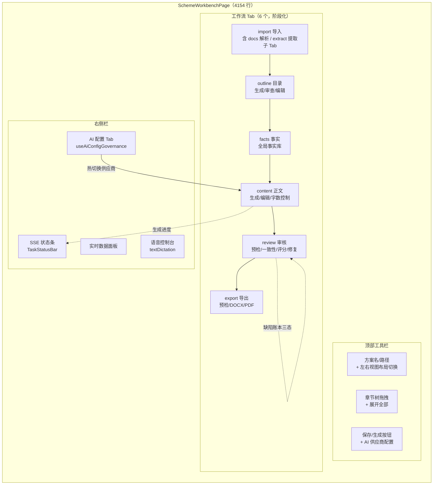

**六区块说明**（阶段化工作流）：

| Tab | 职责 | 关键能力 |
|-----|------|---------|
| import 导入 | 文件上传与解析 | `.docx`/`.pdf`/扫描件 OCR、四层存储状态、解析子 Tab、提取子 Tab |
| outline 目录 | 目录生成与编辑 | AI 生成 / 模板实例化（开关）、层级调整、计划字数 |
| facts 事实 | 全局事实库 | 三层抽取、质量闸门、docx/pdf/md 导入（`global-facts/docs`） |
| content 正文 | 正文生成与编辑 | 流式生成、字数压缩、分区混合（开关）、数值锁 |
| review 审核 | 预检与修复 | 六维评分、一致性修复、缺陷账本三态（开关）、定向修复、评分项映射 |
| export 导出 | 导出与预检 | 程序化预检、占位符检查、DOCX/PDF、底稿导出（开关） |

### 3.3 前端组件关系图

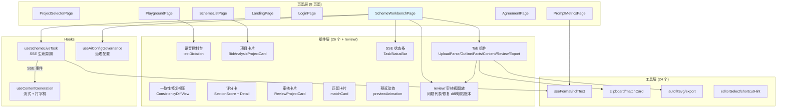

### 3.4 状态管理方案

**方案**：React Hooks + Context（轻量级，无 Redux）

- **`useState` / `useEffect`**：组件本地状态
- **`useContext`**：全局状态（方案数据、用户配置）
- **`useRef`**：可变值（SSE 连接、定时器）
- **自定义 Hooks**：
  - `useSchemeLiveTask`：SSE 连接生命周期管理（断连退避、全局重连态）
  - `useContentGeneration`：流式生成 + 打字机效果
  - `useAiConfigGovernance`：AI 配置治理（七场景路由）

**亮点**：

- 无全局状态库，体积小、上手快
- 自定义 Hooks 封装复用逻辑
- `useRef` 避免闭包陷阱（SSE 连接、定时器）

### 3.5 SSE 流式处理

**协议**：`text/event-stream`，自实现（`StreamingResponse`，无 sse-starlette）

**事件类型**：`progress`（进度）/ `content`（内容块）/ `error`（错误）/ `done`（完成）

**处理器**（`src/utils/sseFormat.ts`）：

- `parseSSEChunk()`：分块解析
- `formatProgress()`：进度格式化
- `handleStreamContent()`：流式内容累积

**亮点**：

- 断线重连（指数退避 + 全局重连态）
- 取消请求（`AbortController`）
- 检查点恢复（`sse_checkpoint` 进度落库，刷新不丢）

### 3.6 构建与打包

| 项 | 值 |
|----|-----|
| 构建工具 | Vite 6（`vite.config.ts`） |
| 开发端口 | 5175（`server.port=5175`、`host: true`） |
| 代理 | `/api` → `http://localhost:8000`（无重写；另有 `/system`、`/admin` 根前缀代理）；SSE 路径自动加 `no-cache`/`x-accel-buffering` 头，后端不可达时返回可读 502 |
| TypeScript | 5.9（`strict: true`、`noEmit: true`、`noFallthroughCasesInSwitch`；`noUnusedLocals/Parameters` 当前关闭，见 `tsconfig.json`） |
| 测试 | vitest 3 + jsdom 30 + @testing-library/react 16.3 |
| 代码质量 | ESLint 9（flat config + react-hooks）+ Prettier 3.9 |
| 产物 | `dist/`（HTML/CSS/JS + 字体/图片） |

**性能优化**：代码分割（路由级 `lazy`）/ 图片压缩 / CSS 提取 / JS 混淆（`esbuild` minify）。

### 3.7 部署架构

**开发环境**：

```text
浏览器 → Vite Dev Server (5175) → 代理 /api → FastAPI (8000)
```

**生产环境**：

```text
浏览器 → FastAPI (8000) → 静态资源 (dist/) + API (/api/v1/*)
```

**部署方式**：本地部署（`start_all.bat` 5 阶段）/ Docker 部署 / 反向代理（Nginx）。

---

## 4. 数据流

### 4.1 文件上传与解析数据流图

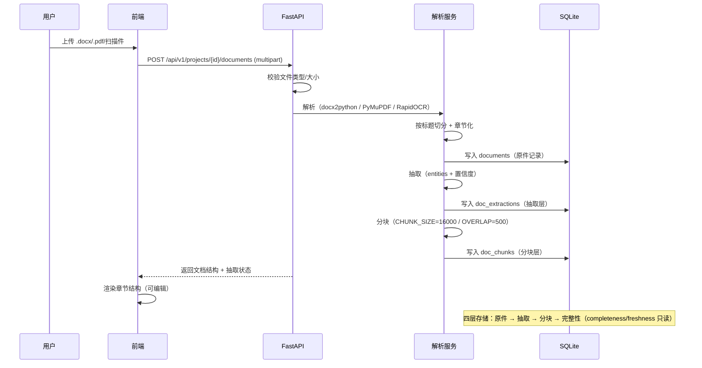

**关键端点**：`GET /documents/{doc_id}/status` / `extractions` / `chunks` / `completeness` / `freshness`，`POST /documents/{doc_id}/reparse` / `sync-extractions` / `cross-check`，`GET /projects/{project_id}/documents/index`。

### 4.2 BidAnalysis 与全局事实库数据流图

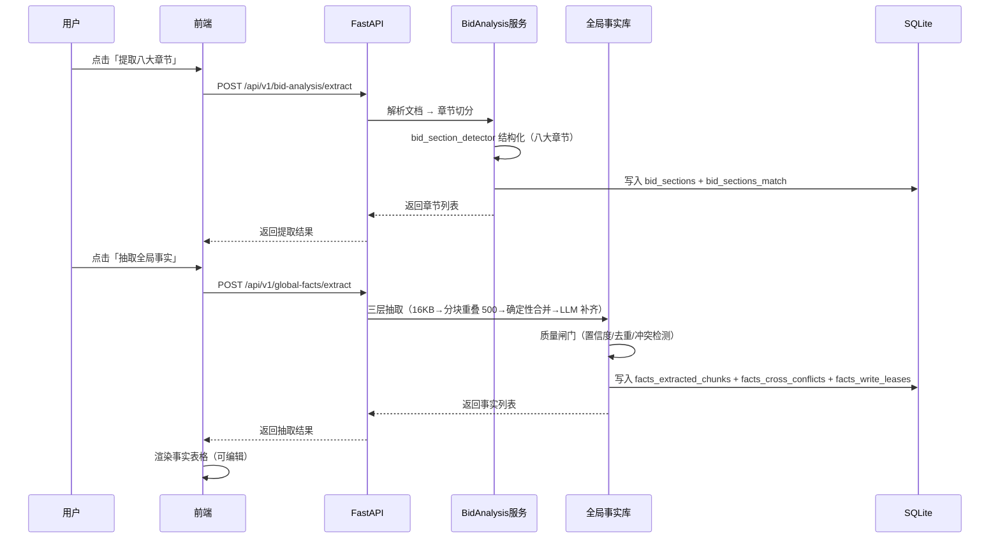

**关键端点**：`POST /api/v1/bid-analysis/extract` / `match` / `import-selected`；`/api/v1/global-facts/*`（extract / list / docs 上传）；`/api/v1/global-facts/docs/{id}`。

### 4.3 项目资料数据链总览

（⭐ 图 4-3，合并自 v5.3 版图 4-1）

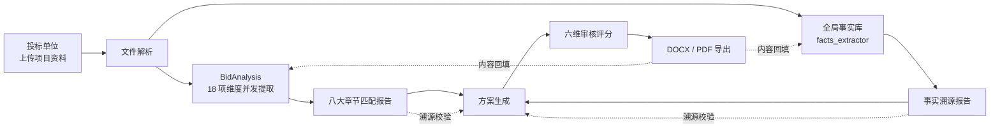

### 4.4 文件解析多通道与闸门

（⭐ 图 4-4，合并自 v5.3 版图 4-5；闸门阈值 16000/500 与 `config.py` `CHUNK_SIZE/CHUNK_OVERLAP` 一致）

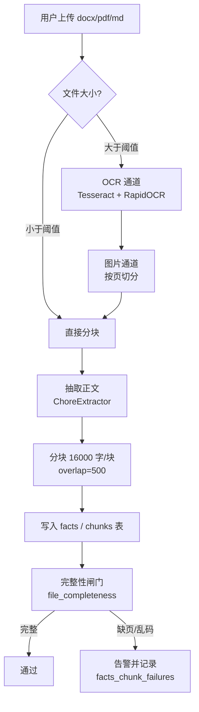

### 4.5 全局事实提取管线

（⭐ 图 4-5，合并自 v5.3 版图 4-6；分块 16000/500 与 `config.py` 一致）

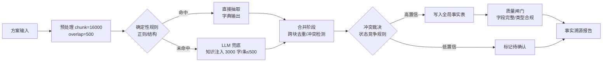

### 4.6 目录生成时序

（⭐ 图 4-6，合并自 v5.3 版图 4-2；事实/知识注入预算已按 `sse_handlers.py` 现网参数修正为 3000/3000（单条 500），旧图「知识 6000」为历史值）

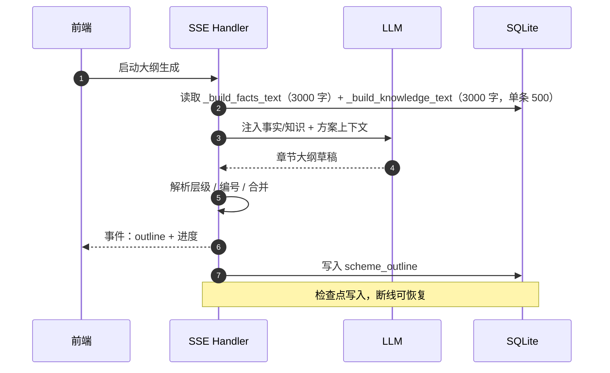

### 4.7 正文与图表同步生成时序

（⭐ 图 4-7，合并自 v5.3 版图 4-3；`chart_predictions` 预测表与现网一致）

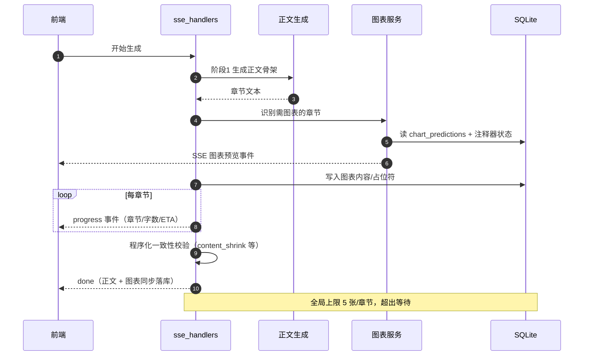

### 4.8 图表渲染与登记流水线

（⭐ 图 4-8，合并自 v5.3 版图 4-4；入库 13 类与 2.3.6 一致）

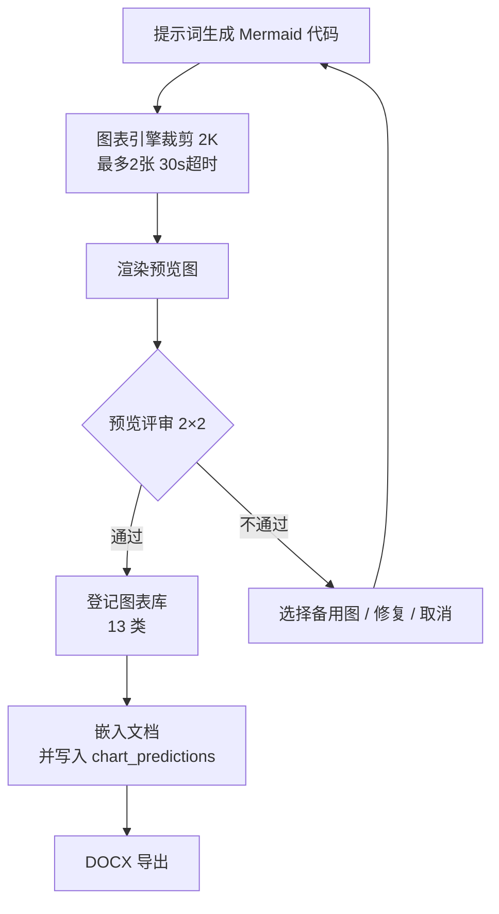

### 4.9 一致性 Agent 修复闭环

（⭐ 图 4-9，合并自 v5.3 版图 4-7）

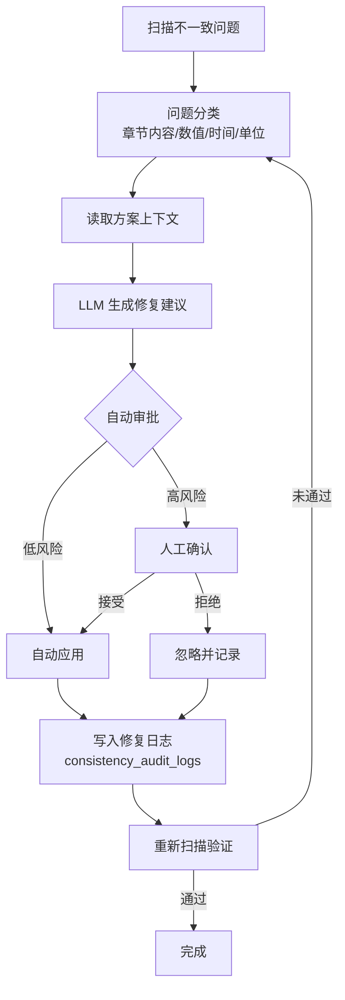

### 4.10 六维就绪度评分与程序化预检

（⭐ 图 4-10，合并自 v5.3 版图 4-8；六维权重 25/20/20/15/10/10 与 `audit_rules.py` 一致）

```mermaid
flowchart LR
    A[方案文本] --> B[六维并行评估]
    subgraph 评分维度
        B1[completeness 25]
        B2[compliance 20]
        B3[safety 20]
        B4[consistency 15]
        B5[traceability 10]
        B6[deliverability 10]
    end
    B --> B1 & B2 & B3 & B4 & B5 & B6
    B1 & B2 & B3 & B4 & B5 & B6 --> C[加权合计]
    C --> D[就绪度预评分]
    D --> E[提交前程序化预检]
    E --> F[六大维度 pass / warn / fail]
    F --> G[阻断门]
    G -- 存在阻断项 --> H[阻止提交]
    G -- 通过 --> I[生成导出报告]
    I --> J[就绪]
```

### 4.11 导出流水线

（⭐ 图 4-11，合并自 v5.3 版图 4-9；导出缓存「保留 5 份/方案」与 `_export_cache.py:664` 一致）

```mermaid
flowchart LR
    A[生成完成] --> B[占位符审计<br/>placeholder_audit]
    B --> C{问题扫描<br/>_export_issue_scan}
    C -- 有问题 --> D[返回修复建议]
    D --> A
    C -- 无问题 --> E[程序化预检<br/>六维度门]
    E -- fail --> F[阻断导出]
    E -- 通过 --> G[python-docx 导出<br/>+ 可选 COM 转 PDF]
    G --> H[写入导出缓存<br/>保留最多 5 份/方案]
    H --> I[可信快照溯源]
```

---

## 5. 数据模型与 ER

### 5.1 领域模型概述

**核心实体**：

- **项目**（projects）：方案所属项目
- **方案**（schemes）：一份专项施工方案（核心实体）
- **章节**（sections）：方案的章节（树形结构）
- **全局事实库**（global_facts）：跨方案复用的事实数据
- **上传文档**（documents）：四层存储（原件/抽取/分块/完整性）
- **知识库**（knowledge_base）：生成时检索注入的知识
- **审核记录**（review_records）：审核结果与问题清单
- **导出记录**（export_records）：导出日志与文件路径
- **缺陷账本**（scheme_defects + fix_decisions）：修复建议与执行决策（三态）
- **评分项**（scheme_scoring_items + scheme_scoring_extract_runs）：评分项 → 目录映射
- **编排状态**（agent_runs + agent_stage_runs）：R179-G 编排状态机
- **条款库**（standard_clauses）：规范条款三态检索
- **审计治理**（ai_config_audit_logs / ai_runtime_settings / ai_scene_routes / prompt_audit_logs）：配置与提示词审计

### 5.2 数据表 ER 图

```mermaid
erDiagram
    projects ||--o{ schemes : "包含"
    schemes ||--o{ sections : "包含"
    schemes ||--o{ section_contents : "生成"
    schemes ||--o{ section_audit_results : "审核"
    schemes ||--o{ review_records : "审核"
    schemes ||--o{ export_records : "导出"
    schemes ||--o{ scheme_defects : "缺陷账本"
    schemes ||--o{ scheme_scoring_items : "评分项"
    scheme_defects ||--o{ fix_decisions : "决策"
    global_facts ||--o{ global_facts_audit : "审计"
    sections ||--o{ global_facts : "引用"
    projects ||--o{ documents : "包含"
    documents ||--o{ doc_extractions : "抽取层"
    documents ||--o{ doc_chunks : "分块层"
    projects ||--o{ knowledge_base : "知识库"
    projects ||--o{ consistency_scan_cache : "一致性缓存"
    projects ||--o{ bid_sections : "八大章节"
    projects ||--o{ bid_sections_match : "章节匹配"
    ai_provider_state ||--o{ ai_config_audit_logs : "配置变更"
    ai_runtime_settings ||--o{ ai_scene_routes : "场景路由"
    ai_runtime_settings ||--o{ prompt_audit_logs : "提示词审计"
    agent_runs ||--o{ agent_stage_runs : "阶段"
    schemes ||--o{ agent_runs : "编排"
    schemes {
        int id PK
        string name "方案名称"
        string file_path "文件路径"
        int project_id FK
        int word_count "字数"
        json meta "元数据"
    }
    sections {
        int id PK
        int scheme_id FK
        string title "标题"
        int parent_id FK "父章节"
        int order_idx "排序"
        int level "层级"
        int planned_words "计划字数"
    }
    section_contents {
        int id PK
        int section_id FK
        text content "AI 生成内容"
        int word_count "字数"
        int version "版本"
    }
    section_audit_results {
        int id PK
        int section_id FK
        string dimension "维度"
        int score "得分"
        json issues "问题列表"
    }
    global_facts {
        int id PK
        int section_id FK
        string fact_key "事实键"
        string fact_value "事实值"
        float confidence "置信度"
        int project_id FK "项目"
    }
    documents {
        int id PK
        int project_id FK
        string file_path "原件路径"
        string parse_status "解析状态"
        int word_count "字数"
    }
    doc_extractions {
        int id PK
        int doc_id FK
        json entities "实体列表"
        float confidence "置信度"
        string status "抽取状态"
    }
    doc_chunks {
        int id PK
        int doc_id FK
        text chunk_text "分块文本"
        int chunk_index "分块序号"
    }
    knowledge_base {
        int id PK
        int project_id FK
        string title "标题"
        text content "内容"
        string category "分类"
    }
    scheme_defects {
        int id PK
        int scheme_id FK
        string severity "严重度"
        string state "建议/待确认/已执行"
        json diff "修复 diff"
    }
    fix_decisions {
        int id PK
        int defect_id FK
        string decision "人工决策"
        json before_after "前后对比"
    }
    scheme_scoring_items {
        int id PK
        int scheme_id FK
        string item_code "评分项编码"
        int section_id FK "映射目录"
    }
    agent_runs {
        int id PK
        int scheme_id FK
        string status "运行状态"
        int current_stage "当前阶段"
    }
    agent_stage_runs {
        int id PK
        int run_id FK
        string stage "阶段名"
        string status "状态"
    }
    standard_clauses {
        int id PK
        string clause_code "条款编码"
        string clause_type "三态类型"
        text clause_text "条款正文"
    }
```

**表总数：47 张**（`schema_sql.py` 41 张 + `db.py` 3 张：`facts_chunk_failures`/`facts_cross_conflicts`/`facts_write_leases` + `system.py` 1 张：`governance_settings` + `agent/state_machine.py` 2 张：`agent_runs`/`agent_stage_runs`）。完整字段定义见 `backend/app/schema_sql.py` 与 `docs/数据字典.docx`。

---

## 6. API 设计

### 6.1 统一响应格式

```json
{
  "code": 0,
  "message": "success",
  "data": {}
}
```

**错误码**：`0` 成功 / `400` 参数错误 / `401` 未授权 / `404` 不存在 / `500` 服务错误 / 自定义业务码（`AI_UNAVAILABLE`、`PDF_OCR_UNAVAILABLE`、`PDF_COM_UNAVAILABLE`、`FACTS_OVERLOADED` 等）。

### 6.2 认证方式

```text
Authorization: Bearer <API_AUTH_TOKEN>
```

- `API_AUTH_TOKEN` 为空时**不鉴权**（启动日志会声明）
- 比较用 `hmac.compare_digest`（防时序攻击；pyjwt 已移除，无 JWT）

### 6.3 API 模块清单

| 模块 | 路径前缀 | 说明 |
|------|---------|------|
| 健康检查 | `/api/v1/health` | 服务状态与版本（`version` 必须与 `APP_VERSION` 一致） |
| SSE 心跳 | （事件流内）`ping` 事件 + `: heartbeat` 注释 | `sse_utils.py` 心跳任务周期推送耗时/进行中章节/累计字数/ETA（**非 HTTP 路由，无 `/api/v1/ping`**） |
| 项目管理 | `/api/v1/projects` | 项目 CRUD |
| 方案管理 | `/api/v1/schemes` | 方案 CRUD、状态 |
| 章节 | `/api/v1/schemes/{scheme_id}/sections` | 章节树 CRUD、顺序调整 |
| 全局事实 | `/api/v1/global-facts` | 事实列表 / 抽取 / 修复 |
| 全局事实文档 | `/api/v1/global-facts/docs` | docx/pdf/md 导入与解析 |
| 知识库 | `/api/v1/knowledge` | 知识库 CRUD、上传 |
| 文件上传 | `/api/v1/projects/{project_id}/documents` | 文件上传与解析 |
| **文档四层** | `/api/v1/documents/{doc_id}` | `status` / `extractions` / `chunks` / `completeness` / `freshness` / `reparse` / `sync-extractions` / `cross-check`（v5.4 新增） |
| 大纲 | `/api/v1/projects/{project_id}/outline` | 目录生成与编辑 |
| 目录大纲库 | `/api/v1/outline-library` | 标准目录模板 |
| 上传大纲 | `/api/v1/upload-outline` | 上传解析目录 |
| **评分项** | `/api/v1/projects/{project_id}/scoring-items` / `/api/v1/schemes/{scheme_id}/scoring-coverage` | 评分项提取与目录映射（v5.4 新增） |
| BidAnalysis | `/api/v1/bid-analysis` | 八大章节提取与匹配 |
| 审核 | `/api/v1/schemes/{scheme_id}/review` | 六维审核、`preview-batch` |
| **审核定向修复** | `/api/v1/schemes/{scheme_id}/review/autofix` | `capabilities` / `plan` / `apply` / `rollback` / `repairs` / `collect` / `stage` / `confirm`（v5.4 新增） |
| **缺陷账本** | `/api/v1/schemes/{scheme_id}/defects` + `/api/v1/defects/{defect_id}` | `summary` / `sync` / `diff` / `proposal` / `apply` / `decision` / `verify`（v5.4 新增，开关 default OFF） |
| 合规检查 | `/api/v1/compliance` | 规范引用检查 |
| 一致性修复 | `/api/v1/schemes/{scheme_id}/consistency` | 一致性扫描与修复 |
| 图表生成 | `/api/v1/charts` | 图表生成与预览 |
| 导出 | `/api/v1/schemes/{scheme_id}/export` | DOCX/PDF 导出、预检 |
| **底稿导出** | `/api/v1/schemes/{scheme_id}/dossier` | 可复核底稿（v5.4 新增，开关 default OFF） |
| **条款库** | `/api/v1/clause-library` | `import` / `template` / `batch-import` / `search`（v5.4 新增，开关 default OFF） |
| **编排状态机** | `/api/v1/agent/runs` | `POST/GET /runs`、`start`、`stages/{stage}/start|complete`、`resume`（v5.4 新增，开关 default OFF） |
| **提示词治理** | `/api/v1/prompts` | 模板查看、`audit-logs`、回滚（v5.4 重构） |
| AI 配置 | `/api/v1/ai-config` | 供应商配置、连通性、密钥轮换 |
| **提示词指标页** | `/api/v1/settings/prompt-metrics` | 前端 PromptMetricsPage 数据源 |
| SSE 事件流 | `/api/v1/projects/{project_id}/...`（POST + SSE Accept） | 统一事件流（`progress` / `content` / `error` / `done`） |
| 系统 | `/api/v1/system` | 系统信息、配置、完整性扫描 |

**API 数量**：19+ 业务域，全量定义见 `openapi.json` 与 `http://localhost:8000/docs`（FastAPI 自动文档）。

### 6.4 统一 SSE 事件流图

```mermaid
sequenceDiagram
    participant C as 客户端
    participant R as FastAPI 路由
    participant Q as 任务队列
    participant P as Provider
    participant D as SQLite

    C->>R: POST /api/v1/...（Accept: text/event-stream）
    R->>R: 鉴权 + 请求校验
    R->>Q: 创建任务 + 写检查点（sse_checkpoint）
    Q-->>R: 任务句柄
    R-->>C: SSE 连接建立

    loop 流式生成
        Q->>P: LLM 调用（流式）
        P-->>Q: 内容块
        Q->>D: 进度落库（检查点）
        Q-->>R: 事件（progress/content）
        R-->>C: data: {...}\n\n
    end

    Q->>D: 完成落库
    Q-->>R: done 事件
    R-->>C: data: {"type":"done"} + 重试间隔
    C->>C: 关闭连接 / 更新 UI

    Note over C,R: 断线 → 指数退避重连 + 全局重连态；刷新 → 检查点恢复进度
```

### 6.5 AI 配置与治理流图

```mermaid
sequenceDiagram
    participant U as 用户
    participant F as 前端
    participant A as FastAPI
    participant G as 配置治理服务
    participant P as ProviderFactory
    participant D as SQLite

    U->>F: 打开「AI 配置」
    F->>A: GET /api/v1/ai-config/providers
    A->>D: 读取 ai_runtime_settings + ai_provider_state
    D-->>A: 配置 + 熔断状态
    A-->>F: 返回 24 平台预设 + 当前配置
    F-->>U: 渲染配置界面

    U->>F: 切换平台/模型/密钥
    F->>A: POST /api/v1/ai-config/providers
    A->>G: 校验 + 写入 ai_config_audit_logs（快照）
    G->>D: 持久化（ai_runtime_settings / ai_provider_state）
    G-->>A: 成功
    A-->>F: 配置生效
    F-->>U: 提示成功

    Note over G,D: 七场景路由（ai_scene_routes）/ 截断治理（clip_text_notice）/ 提示词快照回滚（prompt_audit_logs）
```

---

## 7. 性能优化

### 7.1 数据库优化

| 策略 | 实现 | 效果 |
|------|------|------|
| **WAL 模式** | `PRAGMA journal_mode=WAL` | 读写不阻塞 |
| **读写分离连接池** | 读池只读 / 写池 `BEGIN IMMEDIATE` | 消除升级锁死锁（取消安全、`close_db` 收尾） |
| 连接池 | `aiosqlite` 连接池（复用连接） | 减少连接开销 |
| 索引 | 关键字段索引（`scheme_id` / `section_id` / `project_id`） | 查询加速 |
| 批量插入 | `executemany` 批量插入 | 减少 IO |
| 事务优化 | 单事务多操作，减少提交次数 | 降低 fsync 开销 |
| 父子链完整性扫描 | `documents/{id}/completeness` + `freshness`（只读不回填） | 提前发现断链 |
| 事实写租约 | `facts_write_leases` 防跨方案写冲突 | 记账可追溯 |

### 7.2 应用层优化

| 策略 | 实现 |
|------|------|
| **异步全链路** | `async/await` + `aiosqlite` + `aiohttp/httpx` |
| **连接复用** | `http_pool`（aiohttp keep-alive 连接池） |
| **提示词预算** | 预算器 + 留痕裁剪（防超长重试） |
| 生成并发 | 内容生成并行（章节级并发） |
| 流式响应 | SSE 流式，避免长请求阻塞 |
| 结果缓存 | `consistency_scan_cache` 一致性扫描缓存 |
| 导出缓存 | `_export_cache` 保留 5 份/方案，`config_hash` 失效 |
| 静态资源 | 生产环境 FastAPI 直接托管 `dist/` |
| 代码分割 | 路由级 `React.lazy()` + `Suspense` |
| 熔断暖机 | `warmup_*_from_db` 启动恢复熔断/供应商状态 |

### 7.3 前端优化

| 策略 | 实现 |
|------|------|
| 虚拟滚动 | Ant Design Table `virtual` + 固定高度表体（`ReadinessDashboard` / `ReviewWorkflowPanel` / `ReviewTab` / `ComplianceRepairDrawer`，无 react-window 依赖） |
| 防抖节流 | 输入防抖、滚动节流 |
| 图片懒加载 | `loading="lazy"` |
| 代码分割 | 路由级分包 |
| 缓存 | localStorage 缓存用户配置 |
| 打字机节流 | `useContentGeneration` 帧节流渲染 |

**历史性能基准**（引用出处保留）：

- 大纲树操作 125 items/s × 500 并发（2026-08-29 批处理基准脚本）
- 章节字数统计 406/s（优化前 0.5/s，**812 倍**，commit `9584724`）
- 正则压缩 16~17 倍（`e6eb858`）、合并优化 14 倍（`b9b6e88`）
- 六维审核并行化 1.28x（`3d4baa7`）+ 段级缓存 1.47x（`bfa3668`）

### 7.4 弱模型稳定 JSON 工作流

（图 7-1，合并自 v5.3 版图 7-1，与 7.2「异步全链路」配套：JSON 模式/自愈工作流/错误反馈重试/JSON5 兜底）

```mermaid
flowchart TD
    A(["请求模型"]) --> B{"支持 JSON 模式？"}
    B -->|是| C["JSON 模式请求"]
    B -->|否| D["降级普通请求"]
    C --> E["提取 JSON"]
    D --> E
    E --> F{"Pydantic Schema 校验"}
    F -->|通过| G{"业务校验"}
    F -->|失败| H["定向 JSON 修复<br/>（传入具体错误）"]
    G -->|通过| N["程序统一重排编号<br/>不依赖模型编号"]
    G -->|失败| H
    H --> I{"修复成功？"}
    I -->|是| G
    I -->|否| J{"重试 < 上限？"}
    J -->|是| A
    J -->|否| K{"JSON 过大？"}
    K -->|是| L["切换分步生成<br/>一级 → 逐章二三级"]
    K -->|否| M(["抛出错误，走降级链"])
    L --> N
    N --> O(["返回结果"])
```

---

## 8. 安全设计

### 8.1 认证与授权

| 机制 | 实现 |
|------|------|
| Token 认证 | `Authorization: Bearer <API_AUTH_TOKEN>`，`hmac.compare_digest` 定长比较（无 JWT） |
| 无鉴权降级 | Token 为空时关闭认证（启动日志显式声明，防止"以为开了鉴权"） |
| 路径穿越 | `path.resolve()` + 前缀校验 |
| 角色 | 单租户桌面工具，无多角色 RBAC |

**图 8-1 中间件执行顺序与鉴权**（合并自 v5.3 版图 8-1；已按 `middleware.py:308-316` 注册顺序核验，LoopLag 为最外层）：

```mermaid
flowchart LR
    REQ(["HTTP 请求"]) --> LOOP["LoopLagMiddleware<br/>（最外层，最后注册：读写时钟回跳/暂停检测）"]
    LOOP --> CORS["CORSMiddleware<br/>（预检 OPTIONS 直接短路）"]
    CORS --> LOG["RequestLogMiddleware<br/>纯 ASGI，消除每请求额外任务跳转"]
    LOG --> AUTH{"ApiAuthMiddleware<br/>API_AUTH_TOKEN 非空？"}
    AUTH -->|空| PASS(["放行"])
    AUTH -->|非空且路径豁免| PASS
    AUTH -->|非空| CHK{"携带 X-API-Key<br/>或 Authorization: Bearer"}
    CHK -->|匹配（compare_digest bytes）| PASS
    CHK -->|不匹配| R401(["401 + WWW-Authenticate"])
    PASS --> ROUTE["业务路由"]
    style AUTH fill:#3a2a1e,stroke:#e8a33d,color:#fff
    style R401 fill:#5f1e1e,stroke:#ff4a4a,color:#fff
```

### 8.2 数据安全

| 机制 | 实现 |
|------|------|
| **Fernet 加密** | API Key 加密存储；**密钥三级来源**：`FERNET_KEY` 环境变量 > 自动密钥文件 `data/secret_key.key`（R175 启动自检）> 降级 |
| 密钥轮换 | `key_rotation` 端点支持重新加密存量密钥 |
| 输入校验 | Pydantic 模型全字段校验 + 长度限制 |
| SQL 注入 | 参数化查询（`aiosqlite` 参数绑定） |
| XSS 防护 | 前端 `DOMPurify` 清理富文本 |
| 日志脱敏 | 密钥/Token 不落日志（`log_context` 统一脱敏 + 启动声明） |

### 8.3 网络安全

| 机制 | 实现 |
|------|------|
| CORS | 限制 `localhost:5175`（开发） |
| HTTPS | 生产环境由反向代理（Nginx）终止 TLS |
| 速率限制 | 生成任务排队（LLMTaskQueue），防止滥用 |
| 文件类型白名单 | `.docx` / `.pdf` / `.md` / `.png` 等 |

---

## 9. 部署架构

### 9.1 部署拓扑图

```mermaid
graph TB
    subgraph Dev["开发环境"]
        D1[浏览器]
        D2[Vite Dev Server<br/>5175]
        D3[FastAPI<br/>8000]
        D4[(SQLite<br/>WAL)]
        D1 -->|localhost:5175| D2
        D1 -->|SSE/REST| D3
        D2 -->|/api 代理| D3
        D3 --> D4
    end

    subgraph Prod["生产环境"]
        P1[浏览器]
        P2[Nginx<br/>反向代理 + 静态资源]
        P3[FastAPI<br/>8000 单进程]
        P4[(SQLite WAL)]
        P5[AI Provider<br/>24 平台]
        P1 -->|HTTPS| P2
        P2 -->|静态 dist/| P2
        P2 -->|/api/v1 + SSE| P3
        P3 --> P4
        P3 -->|aiohttp/httpx| P5
    end

    subgraph Ext["外部依赖（可选）"]
        X1["AI 平台 24 家<br/>文生文"]
        X2["图像平台 7 家<br/>agnes/baidu/dashscope/hunyuan/stepfun/volcengine/zhipu"]
        X3["LibreOffice / Word·WPS COM"]
        X4["Tesseract / RapidOCR"]
    end
    subgraph Docker["Docker 部署"]
        K1[容器：FastAPI + 静态资源]
        K2[卷：./data]
        K3[端口：8000]
        K1 --> K2
        K1 --> K3
    end
```

> 注：仓库当前**未提供** `Dockerfile`/`docker-compose.yml`（2026-11-09 实测根目录 `docker*` 文件数 = 0）；上图 Docker 部署为需自行实现的参考拓扑。

### 9.2 环境变量配置

见《软件编译计划书》7.3 环境变量总表（按 9 类分组，含 R179 七开关）。

### 9.3 启动与停止

| 脚本 | 职责 |
|------|------|
| `start_all.bat` | 5 阶段一键启动：清端口 → 依赖强校验 → `start_backend.ps1` 起后端 → 前端 → 探活开浏览器 |
| `start_backend.ps1` | **单进程**后端（**无 `--reload`**，`--timeout-graceful-shutdown 30`），写 `logs/backend.log`（5MB×3 轮转） |
| `stop_all.bat` | 停止前后端 |
| `cleanup_guard.ps1` | `-Clean`/`-Shutdown` 双模式（按命令行指纹门禁）：清端口残留、泄漏 `pytest`/测试 worker 树、绑定失败的后端 python；配套 `kill_zombie_pytest.ps1`（DryRun 先报告） |

**健康检查**：`GET /api/v1/health`（返回 `version` 与 `APP_VERSION` 对齐）。

---

## 10. 核心状态机图集

> 本章 6 张图（图 10-1 ~ 10-6）合并自 v5.3（HEAD `ababdf4`，2026-10-05）版第十一章「状态机图集」，图号与小节按 v5.4 章节体系重排，并按各图实际内容重定标题。已对照现网代码核验：章节 130% 自动收缩判据（`auto_shrink_over`，默认手动触发）、任务启动恢复阈值 `progress ≥ 0.95`、`review_autofix` 的 `plan/apply/rollback` 与修复后复检均与代码一致。

### 10.1 方案生命周期状态机（状态与任务解耦）

```mermaid
stateDiagram-v2
    [*] --> 草稿 : 新建方案
    草稿 --> 目录生成中 : AI生成/目录库/标准目录/上传识别/混合
    目录生成中 --> 目录已确认 : 目录审核通过
    目录生成中 --> 草稿 : 生成失败
    目录已确认 --> 正文生成中 : 启动逐章生成
    正文生成中 --> 审核中 : 全部章节完成
    审核中 --> 已完成 : 审核通过
    审核中 --> 正文生成中 : 驳回重新生成
    已完成 --> 已归档 : 归档
    已归档 --> 已完成 : 取消归档
    note right of 审核中 : 方案状态与任务状态解耦<br/>不因任务在跑而被改写
```

### 10.2 章节评审状态机（pending / reviewing / approved / rejected）

```mermaid
stateDiagram-v2
    [*] --> pending : 章节创建
    pending --> reviewing : 提交审核
    reviewing --> approved : 通过
    reviewing --> rejected : 驳回（记录意见）
    rejected --> reviewing : 修改后重新提交
    approved --> reviewing : 复审
```

### 10.3 入库审核三态状态机（待审核 / 已通过 / 已停用）

```mermaid
stateDiagram-v2
    [*] --> 待审核 : 手动/上传/AI/历史方案/内置模板入库
    待审核 --> 已通过 : 审核通过（可被公共调用）
    待审核 --> 已停用 : 直接停用
    已通过 --> 已停用 : 停用
    已停用 --> 已通过 : 重新启用
    已通过 --> 待审核 : 新版本提交
```

### 10.4 章节内容状态机（生成 / 续写 / 审核 / 130% 收缩）

```mermaid
stateDiagram-v2
    [*] --> empty : 目录创建
    empty --> pending : 进入生成队列
    pending --> generated : AI 生成完成
    generated --> expanded : 字数不足续写
    expanded --> reviewed : 审核通过
    generated --> reviewed : 审核通过
    reviewed --> generated : 驳回重新生成
    generated --> pending : 重新生成
    generated --> over : 超出目标 130%
    over --> generated : 压缩（shrink，默认手动触发）
```

### 10.5 任务状态机（TaskTracker：断点恢复与 progress ≥ 0.95）

```mermaid
stateDiagram-v2
    [*] --> running : 注册任务（持久化至 SQLite）
    running --> paused : 用户暂停
    paused --> running : 恢复
    running --> stopped : 用户停止（cancel_tasks 统一取消子任务）
    running --> completed : 执行完成
    running --> failed : 异常终止
    failed --> running : 断点恢复（checkpoint_json）
    stopped --> running : 断点恢复
    running --> completed : 启动恢复：progress ≥ 0.95 判定已完成
    running --> failed : 启动恢复：其余标「服务重启，任务中断」
    completed --> [*]
    note right of running : SSE 多客户端订阅<br/>断线重连不丢进度
```

### 10.6 审核定向修复状态机

```mermaid
stateDiagram-v2
    [*] --> pending : 扫描 + 仲裁生成冲突项
    pending --> skipped : 无法确定权威值（不强行修复）
    pending --> fixing : 定向修复中
    fixing --> validating : repair_validator 二次校验
    validating --> fixing : 校验失败且未超重试
    validating --> failed : 仍失败（**不写库**）
    validating --> awaiting_confirm : 通过（已存快照，写入正文）
    awaiting_confirm --> accepted : 用户接受
    awaiting_confirm --> rejected : 用户拒绝（该章恢复快照原文）
    accepted --> [*]
    rejected --> [*]
    failed --> [*]
    note right of awaiting_confirm : 支持一键回滚<br/>只影响快照涉及章节
```

---

## 11. 测试与质量

### 11.1 测试策略

```text
测试金字塔
    /  E2E (SSE 全链路)  \
   /----------------------\
  /    集成测试 (API)       \
 /--------------------------\
/      单元测试 (服务层)      \
/------------------------------\
```

- **单元测试**：服务层业务逻辑
- **集成测试**：API 端点 + 数据库
- **E2E 测试**：SSE 全链路（上传 → 解析 → 大纲 → 事实 → 生成 → 审核 → 导出）

### 11.2 测试覆盖

| 层级 | 框架 | 文件数 | 用例规模 |
|------|------|--------|---------|
| 后端 | pytest 9.1 + pytest-asyncio 1.4 | **545 个测试文件** | 全量约 1.1 万条（2026-11-08 干净快照 `46d8248`：**10945 passed**） |
| 前端 | vitest 3 + jsdom 30 + @testing-library/react 16.3 | **104 个测试文件** | 2026-11-08 实测 **94 文件 / 1578 用例**，`tsc --noEmit` 21.33s 0 错误 |
| lint | ruff 0.6.9（后端主检查）/ ESLint 9 + Prettier 3 | — | `ruff check app tests` / `npm run lint` |
| CI | GitHub Actions（`ci.yml`） | — | Python 主腿 **3.12**（完整构建）+ 观察腿 **3.14**（允许失败）+ Node **22** |

**关键测试文件**（2026-11-09 实测存在）：

- 后端：`tests/test_export.py`（导出）、`tests/test_sse_utils.py` + `tests/test_sse_route_decorator_20261001.py`（SSE）、`tests/test_ai_config_module.py`（AI 配置）、`tests/test_adjust_facts.py` / `tests/test_content_facts.py`（事实）、`tests/test_agent_orchestration_phase_g_20261107.py`（编排状态机）、`tests/test_defect_ledger_phase_c_20261106.py`（缺陷账本）、`tests/test_clause_library_phase_e_20261106.py`（条款库）
- 前端：`src/tests/schemeWorkbench.test.tsx`（工作台）、`src/tests/useSchemeLiveTask.test.ts`（SSE）、`src/tests/exportResponse.test.ts` + `schemeWorkbenchExportTab20261006.test.tsx`（导出）、`src/tests/ReadinessDashboard.test.tsx` / `ReviewWorkflowPanel.test.tsx`（审核）
- 命名约定：多数文件带 **R 轮次 / 日期后缀**（如 `*_r179_20261105`、`*R203*`），按业务模块 + 迭代批次归档

### 11.3 质量门禁（CI）

```text
后端：
  ✓ ruff check app tests
  ✓ python -m pytest（全量）

前端：
  ✓ npm run lint（ESLint 9）
  ✓ npm run format:check（prettier --check .）
  ✓ tsc 类型检查（tsconfig `noEmit`，0 错误）
  ✓ npm run test（vitest 全量）
  ✓ npm run build（vite build）
```

**禁止**：测试 `skip` / `xfail` / 白名单 / 放松断言；发现红测必须先查根因。

---

## 12. 版本历史

| 版本 | 日期 | 主要变更 | 状态 |
|------|------|---------|------|
| **v5.4** | **2026-11-09** | **全面更新：技术栈（Py3.12+/SSE 自实现/标准库日志/读写连接池）；目录结构全量重绘（路由 43/服务 100+3/测试 545/前端 104）；新增 2.3.7~2.3.9 三个设计模式（提示词预算、缺陷账本、连接池取消安全）；前端 8 路由/6 工作流 Tab；ER 扩至 47 表；API 新增 9 模块；对冲改 45s 自适应；测试基线对齐 2026-11-08（后端 10945 passed / 前端 1578 用例）；第二批合并 v5.3 图集 20 张，新增第 10 章状态机图集，全图 34 张** | **已发布** |
| v5.3 | 2026-09-18 | 与编译计划书统一 mermaid 编号为图 1-1 ~ 14-2（14 张图）；补全交付使用说明书引用；新增能力开关状态字段 | 已发布 |
| v5.2 | 2026-09-07 | 技术栈逐项核对（Python 3.10+/FastAPI 0.130/pydantic-settings 2.11/openai>=1.60）；AI Provider 补 24 平台清单；Mermaid 数据流改为六阶段（去"阶段8 补全重试"）；新增「10 分钟验证命令速查」 | 已发布 |
| v5.1 | 2026-09-07 | 技术栈全面核对（FastAPI/pydantic-settings/SSE 框架）；核心亮点补 7 条（目录写锁/正文400×200000/占位符防线/引擎超时池/统一DX/秒级切换/JSON5）；行数实测 + 核对表；删 AI 生成/图像生成章节；修正 mermaid 轮次编号 | 已发布 |
| v5.0 | 2026-09-01 | 工具箱四代架构；统一 mermaid 图编号（图 1-1 ~ 14-2） | 已发布 |
| v4.2 | 2026-09-01 | 依赖改以 `requirements.txt` 为准；删 httpx 超时与 OCR 遗留 | 已发布 |
| v4.1 | 2026-09-01 | 按实际代码全面修订（四代架构、表初始化、依赖版本） | 已发布 |
| v4.0 | 2026-08-28 | 重新定位为「文档智能编译」工具箱 | 已发布 |

---

## 13. 附录

### 13.1 常用参数速查

| 参数 | 位置 | 默认值 | 说明 |
|------|------|--------|------|
| `APP_VERSION` | `config.py:24` | `5.3.0` | 必须与 `package.json` 一致（双写核对） |
| 六维权重 | `audit_rules.py` | 25/20/20/15/10/10 | completeness/compliance/safety/consistency/traceability/deliverability |
| 阈值 | `config.py` | 命题 0.60 / 引用 0.20 | 置信度阈值 |
| 超时 | `config.py` | 生成 900s / 导出 1800s / SSE 14400s | — |
| 对冲 | `config.py` | **45s 基线 + p90 自适应 30~90s**（ratio 1.5×p50，min_samples 12） | `AI_HEDGE_*` |
| OCR | `config.py` | 20/200/30 | 页秒/KB/页（`OCR_DPI=150`、`OCR_MIN_SIZE`、`OCR_MAX_PAGES`） |
| MinerU | `config.py` | 300/600/3 | 超时/并发/重试 |
| 图像 | `config.py` | 2K/2/30 | 边长/张数/秒（7 家平台） |
| 分块 | `config.py` | 16000/500 | `CHUNK_SIZE`/`CHUNK_OVERLAP` |
| 事实注入 | `sse_handlers.py` | 3000/6000 | 全局事实/知识（仅目录阶段，`_build_facts_text` 每条 300 字） |
| 提示词预算 | `config.py` | text 3000 / dict 4000 / overview 1800 | 超限→`clip_text_notice`（2.3.7） |
| LLM 并发 | `config.py` | 全局 5 / 每模型 3 / 抖动 0~500ms | `AI_CONCURRENCY*` |
| 事实队列 | `config.py` | LLM 4 / 跨方案 8 / 队列 64 | 超载 `FACTS_OVERLOADED` |
| **七开关** | `config.py` | `genre_tag / outline_instantiate / defect_ledger / dossier / clause_library / hybrid_generation / agent_runs` **全部 False** | 关闭时路由 404（预期） |
| 导出缓存 | `_export_cache.py:664` | 保留 **5 份/方案** | `config_hash` 失效 |
| 六阶段 | `content_*` | 01~06 | 证据→审查→初稿→事实→格式→质检；分区混合 C1/C2→B→C（开关） |
| 图表子项目 | `chart-gap-filler/` | — | 每 4 个月独立评估 |
| 服务端口 | `start_all.bat` / `vite.config.ts` | 8000 / 5175 | `server.port` + `host: true` |

### 13.2 代码规模（2026-11-09 实测）

| 维度 | 数量 |
|------|------|
| 后端 app 代码 | **150,778 行** `.py`（排除 `__pycache__`） |
| 前端 src 代码 | **83,039 行** `.ts/.tsx` |
| 路由模块 | **43 个**（27 公开 + 7 私有 + `ai_config/` 子包 9，不含 `__init__`） |
| 业务服务 | **100 个顶层** `.py` + 3 子包（`ai/` 53、`agent/` 2、`doc_pipeline/` 5） |
| 数据表 | **47 张**（41 + db.py 3 + system.py 1 + agent 2） |
| 后端测试 | **545 个文件**（全量约 1.1 万条） |
| 前端测试 | **104 个 `*.test.*`** |
| 前端页面 | **8 个**（Landing/Login/SchemeList/SchemeWorkbench(4154 行)/ProjectSelector/Playground/Agreement/PromptMetrics） |
| 关键单文件 | `sse_handlers.py` 7698 行 / `export.py` 6592 行 / `config.py` 1332 行 / `db.py` 2215 行 |
| AI 平台预设 | **24 个**文生文 + **7 家**文生图 |
| 种子清单 | **13 个一级分类 / 175 条**标准目录（SEED_VERSION v3.0） |
| 提交 | 2026-09-18 以来 **196 次**（Conventional Commits） |

### 13.3 历史遗留与说明

- **`bid_section_detector` + `bid_sections`**：历史曾列为"未接通"，现已接通（`bid_analysis` 路由 + 表结构 + 测试齐备），八大章节结构化抽取链路完整。
- **`mermaid_service`**：仅 `_PROC` 注册表触发，**默认关闭**；历史遗留说明保留原状。
- **`chart-gap-filler/`**：独立图表补全子项目，不参与主构建，每 4 个月独立评估。
- **能力开关默认全关**：R179 七件套（文种标签/模板实例化/缺陷账本/底稿/条款库/分区混合/编排状态机）默认 `False`，线上行为与 v5.3 一致；打开后对应路由才可见。
- **`content_agent/`、`docx_repair/` 服务子包目录**：工作区存在空目录（未跟踪、无源文件），实际实现位于 `services/` 顶层（如 `docx_repair.py`），以磁盘源文件为准。
