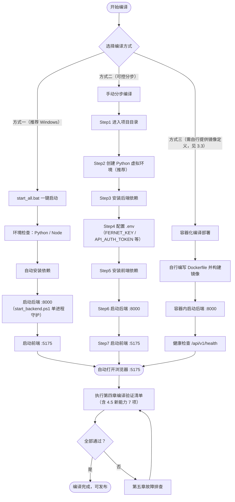
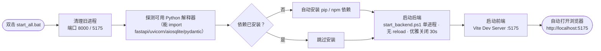
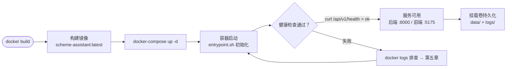
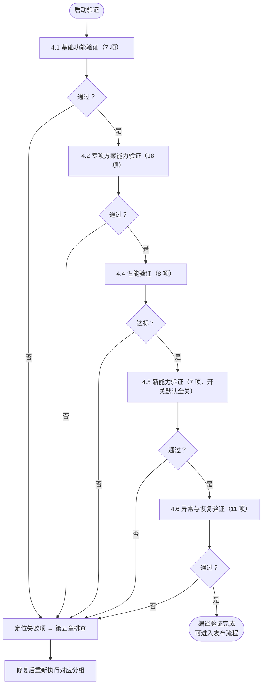
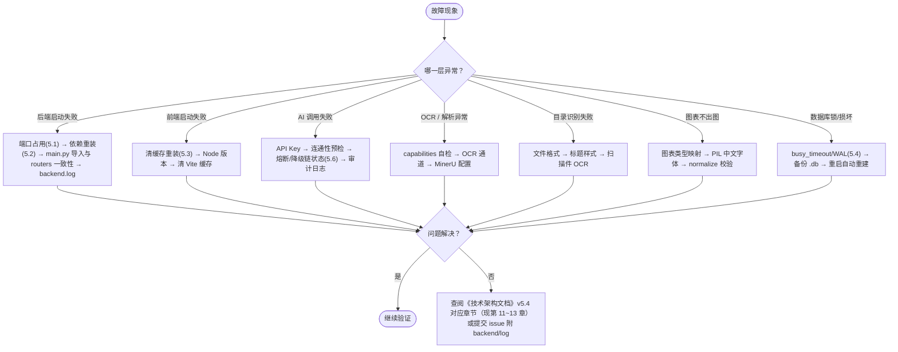
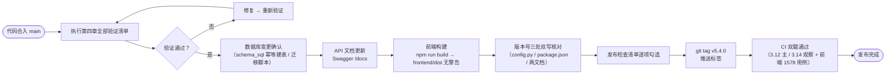

# 软件编译计划书 · 专项方案工具箱

> **版本**：v5.4 · **更新日期**：2026-11-09 · **状态**：已发布 · **对齐代码版本**：`APP_VERSION = 5.3.0`（`backend/app/config.py:24`；前端 `package.json` 5.3.0）· **对齐基线**：`ec3e1426d6461b6ff6a7d4b5327c2ed6bf85e1b5`（2026-11-08，2026-09-18 以来共 196 次提交）
> 关联文档：技术架构文档 / 交付使用说明书 / 产品需求文档（docs/）
> **数字口径**：本文所有「X 个文件 / X 张表 / X 行代码」均为 2026-11-09 实测（验证命令见文末**附录 A**）；与旧版冲突处以本版为准。

---

## 修订说明（v5.3 → v5.4，2026-11-09 全面更新）

| 章节 | 变更 | 依据 |
|------|------|------|
| 头部 | 版本 v5.3 → v5.4，更新日期 2026-09-18 → 2026-11-09，新增对齐基线 HEAD | `git log -1` |
| 1.1/1.2 | Python 基线 **3.10+ → 3.12+**（CI 主腿 3.12、观察腿 3.14、`.python-version`=3.14、生产实测 3.14.4）；Node CI 固定 22 | `backend/pyproject.toml:18`、`.github/workflows/ci.yml`、`backend/.python-version` |
| 1.3/8.x | 依赖由 1 个清单扩为 **4 个**（requirements / -dev / -ocr / -windows）；移除已不再引用的 sse-starlette、python-dotenv、httpx-sse、pyjwt、loguru、rich、orjson、python-dateutil；新增 numpy | `backend/requirements*.txt` + 全库 import 扫描为 0 |
| 2 | 目录结构与规模全部重测：路由 **43 个模块文件**（27 公开 + 7 私有 + `ai_config/` 子包 9）、服务 **100 个顶层文件 + 3 个子包**、表 **47 张**、后端测试 **545 个文件**、前端测试 **104 个**、后端 150,778 行 / 前端 83,039 行 | 见附录 A |
| 4 | 新增 **4.5 新能力验证清单**（R179 七开关、审核定向修复、评分项映射、完整性扫描，开关默认全关）；验证项 7+18+8+11 → 7+18+8+11+7 | `config.py` 开关字段 |
| 5 | 5.8 测试命令更新（pytest 9.1 / vitest 3 / ruff / eslint / prettier）；**新增 5.9 环境铁律补充**（reload-exclude、cleanup_guard、单进程启动） | AGENTS.md §3、启动脚本注释 |
| 6 | 发布流程命令落地：双写核对、`ruff check`、`eslint`、双 CI 腿 | `.github/workflows/ci.yml` |
| 7 | 环境变量总表按 9 类重排，新增 7 个能力开关与 AI 治理/熔断/截断族变量 | `backend/app/config.py` 逐字段提取 |
| 9 | 版本历史新增 v5.4.0 行 | 本版 |
| 附录 A | **新增实测命令清单**，文中关键数字均可复跑核对 | 本次更新实测 |
| 3/4/5/6 | **第二批（2026-11-09）合并 v5.3（HEAD `ababdf4`）版图集 6 张**：图 3-1 编译流程总览 / 图 3-2 一键启动 / 图 3-3 容器化（标注需自行提供镜像）/ 图 4-1 验证执行（补 4.5 组）/ 图 5-1 排障决策树 / 图 6-1 发布流水线；全部对齐现网事实（watchdog → `start_backend.ps1` 单进程、移除不存在的 `backend-ports.json` 与 CHANGELOG 步骤） | `git show ababdf4:docs/软件编译计划书.MD` 切图 + 逐图实测核验 |

---

## 1. 编译目标

### 1.1 目标产物

| 产物 | 形式 | 说明 |
|------|------|------|
| 后端服务 | Python 包 + SQLite 数据库 | FastAPI 应用，编译 = 安装依赖 + 生成数据目录，无传统编译步骤 |
| 前端静态资源 | Vite 构建产物 `frontend/dist/` | 开发用 Vite Dev Server，生产用静态文件由后端托管 |
| 数据库文件 | `backend/data/scheme_assistant.db`（WAL 模式；`database_url` 见 `config.py:28`，`data/app.db` 为 0 字节历史遗留文件） | 启动时自动迁移 + 幂等补列，无需手工建库 |
| 一键启动 | `start_all.bat` | 5 阶段：清端口 → 装依赖 → 起后端（`start_backend.ps1`）→ 前端 → 探活开浏览器；配套 `stop_all.bat`、`cleanup_guard.ps1`（30 秒孤儿进程清理） |

**运行环境要求**：

- 操作系统：Windows 10/11 或 Linux
- Python：**3.12+**（CI 主腿 3.12，观察腿 3.14；`.python-version` = 3.14；生产实测 3.14.4；`requires-python = ">=3.12"`，见 `backend/pyproject.toml:18`）
- Node.js：**20+**（CI 固定 22）
- 内存：≥ 4GB（推荐 8GB）
- 磁盘：≥ 2GB（含依赖缓存与数据文件）
- 数据库：内置 SQLite（WAL 模式），随应用编译，无需单独安装

### 1.2 必需软件

| 软件 | 版本要求 | 用途 |
|------|---------|------|
| Python | **3.12+**（推荐 3.14.x，与生产一致） | 后端运行环境 |
| Node.js | **20+**（推荐 22，与 CI 一致） | 前端构建 |
| npm | 随 Node.js 附带 | 依赖安装 |
| Git | 2.30+ | 版本管理 |

### 1.3 可选软件（仅特定导出/解析功能需要）

| 软件 | 版本要求 | 用途 | 未安装时的降级行为 |
|------|---------|------|-------------------|
| LibreOffice | 7.x+ | 批量转换 | 不影响 DOCX/PDF 导出；`.txt` 导出直接由 Python 生成，不受影响 |
| Microsoft Word 或 WPS | 最新版 | COM 自动化导出 PDF | 未安装时 PDF 按钮返回 `PDF_COM_UNAVAILABLE` 错误 |
| Legacy Office（旧版 Office） | 2010+ | `legacy_office` 服务（soffice 自动探测 + Word/WPS COM 兜底） | 自动跳过，走其他导出通道 |
| Tesseract OCR | 5.0+ | 扫描 PDF 转图片 | 未安装时自动检测并提示，不影响其他功能 |
| RapidOCR | `rapidocr_onnxruntime==1.2.3`（`requirements-ocr.txt`） | 本地中文 OCR | 同上，未装则不启用 |
| Docker | 20.x+ | 自行编写镜像定义（仓库当前未提供，见 3.3） | 不影响本地编译 |
| Visual C++ Redistributable | 2015-2022 | `python-multipart` 依赖 | 缺失时 pip 安装失败，见 5.2 |

> 注：v5.4 起 `pywin32` + `docx2pdf` 已从核心依赖移到 `requirements-windows.txt`（仅 Windows 导出链路需要）；项目不使用 Redis/消息队列（全库无引用）。

### 1.4 环境自检

```bash
# 验证 Python 版本与依赖
python --version          # 应显示 Python 3.12+
cd backend
pip install -r requirements.txt

# 验证后端启动
python -m uvicorn app.main:app --host 0.0.0.0 --port 8000
# 访问 http://localhost:8000/api/v1/health
# 应返回 {"status": "healthy", "service": "scheme-toolbox", "version": "5.3.0", ...}
# version 必须与 backend/app/config.py 的 APP_VERSION 一致（不一致见 5.5）

# 验证前端启动
cd frontend
npm install
npm run dev
# 访问 http://localhost:5175
```

**其他端点**：`/docs` 自动 API 文档；`/redoc` 备用文档。（健康检查仅 `/api/v1/health`，无 `/ping` 路由——`ping` 是 SSE 心跳事件，见技术架构文档 6.4）

---

## 2. 源码结构

> 统计口径：`*.py` / `*.tsx|*.ts` 文件数与行数（排除 `__pycache__`、`node_modules`、测试），2026-11-09 实测。

```text
专项方案工具箱/
├── backend/                          # 后端（app 代码 150,778 行）
│   ├── app/
│   │   ├── main.py                   # FastAPI 入口（676 行，lifespan 启动序列）
│   │   ├── config.py                 # 集中配置（1332 行，200+ pydantic-settings 字段）
│   │   ├── db.py                     # 数据库初始化/迁移（2215 行，WAL + 读写分离连接池）
│   │   ├── models.py                 # Pydantic 请求/响应模型
│   │   ├── middleware.py             # 中间件（请求上下文/日志）
│   │   ├── schema_sql.py             # 表结构 DDL（41 张表；另有 6 张在 db.py / system.py / agent/state_machine.py，全库共 47 张）
│   │   ├── seed_data.py              # 种子数据（13 个一级分类 / 175 条标准目录清单，SEED_VERSION v3.0）
│   │   ├── audit_rules.py            # 六维审核规则（六维权重 25/20/20/15/10/10）
│   │   ├── utils/                    # safe_log_handler（5MB×3 轮转）/ log_context
│   │   ├── routers/                  # 路由层：43 个模块文件（不含 __init__）
│   │   │   ├── sse_handlers.py ★     # 生成主链（7698 行，Upload→BidAnalysis→Outline→Content→Review→Export 全链）
│   │   │   ├── sse_checkpoint.py     # SSE 进度检查点（R130 拆分）
│   │   │   ├── sse_utils.py          # SSE 格式工具（拆分件）
│   │   │   ├── _sse_content_payloads.py / _sse_outline_build.py / _sse_outline_review.py
│   │   │   ├── export.py ★           # 导出与程序化预检（6592 行）
│   │   │   ├── export_dossier.py     # 可复核底稿导出（R179-D，开关 default OFF）
│   │   │   ├── _export_cache.py      # 导出缓存（保留 5 份/方案）
│   │   │   ├── _export_docx_parts.py / _export_issue_scan.py
│   │   │   ├── doc_pipeline.py       # 文档四层存储（原件/抽取/分块/完整性）
│   │   │   ├── agent_runs.py         # 编排状态机（R179-G，开关 default OFF）
│   │   │   ├── defects.py            # 统一缺陷账本（R179-C，开关 default OFF）
│   │   │   ├── scoring.py            # 评分项→目录映射校验（R179-M1）
│   │   │   ├── review_autofix.py     # 审核定向自动修复（R180-F）
│   │   │   ├── standards_admin.py    # 条款库管理导入（R179-E，开关 default OFF）
│   │   │   ├── global_facts_docs.py  # 全局事实库 / 知识库（docx/pdf/md）
│   │   │   ├── prompts.py            # 提示词查看/审计日志/回滚
│   │   │   ├── ai_config/            # 子包（9 个模块）：config/connectivity/models/usage/audit/key_rotation/scene_routes/runtime/_common
│   │   │   ├── _chart_pipeline.py / _export_cache.py / _sse_outline_* 等私有辅助件（共 7 个）
│   │   │   └── 其余公开模块：projects / schemes / scheme_catalog / sections / upload_outline / outline_library / global_facts / bid_analysis / compliance / consistency_repair / review / charts / knowledge / system / sse_checkpoint …（公开顶层 27 个）
│   │   └── services/                 # 业务服务：100 个顶层文件 + 子包
│   │       ├── ai/                   # AI 基础设施（53 个文件）
│   │       │   ├── provider_factory.py  # **24 个平台**预设
│   │       │   ├── providers/          # OpenAI/Anthropic 兼容 + base + __init__
│   │       │   ├── image_providers/    # **7 家**图像平台（agnes/baidu/dashscope/hunyuan/stepfun/volcengine/zhipu）
│   │       │   ├── prompts/            # 分层提示词模板（15 个，含 _limits/_metrics/_registry 截断治理件）
│   │       │   └── heading_v1/v2、mermaid_*（10 个）、image_engine、http_pool、warmup、task_registry …
│   │       ├── agent/state_machine.py  # 编排状态机持久化（agent_runs/agent_stage_runs）
│   │       ├── doc_pipeline/          # doc_chunker / doc_storage / md_structured / pipeline（四层存储管线）
│   │       ├── facts_extractor.py     # 全局事实三层抽取（16KB→分块重叠 500→确定性合并→LLM 补齐）
│   │       ├── docx_repair.py         # Word 修复（表格重写 496 家+列宽 / 全角空格 500+ / 批注集 221 种 / 去污 10 类）
│   │       ├── placeholder_audit.py / placeholder_resolve.py   # {{占位符}} 全文预检与替换
│   │       ├── bid_section_detector.py / bid_sections.py        # 八大章节结构化抽取与匹配
│   │       ├── legacy_office/         # 旧版 Office 转换（soffice 探测 + COM）
│   │       ├── genre_rules.py / genre_assist.py / numeric_lock.py / standard_clauses.py / scheme_fingerprint.py / duplicate_detection.py …
│   │       └── 更多：compliance_rules、consistency_checker、data_projection、diagnosis、env_rules、file_completeness、mermaid_service、outline_rules、outline_tree、quality_metrics、scoring_rules、task_tracker、content_* 等
│   ├── tests/                        # 测试：**545 个测试文件**（文件名按 业务模块 + R轮次/日期 后缀，全量约 1.1 万条用例）
│   ├── data/                         # scheme_assistant.db + secret_key.key（Fernet 自动密钥文件）
│   ├── logs/                         # backend.log（SafeRotatingFileHandler 5MB×3）
│   ├── requirements.txt              # 核心依赖（见 8.1）
│   ├── requirements-dev.txt          # pytest 9.1 / pytest-asyncio 1.4 / ruff 0.6.9 / lxml 6.1.1
│   ├── requirements-ocr.txt          # rapidocr_onnxruntime 1.2.3 / pytesseract 0.3.13
│   ├── requirements-windows.txt      # pywin32 312 / docx2pdf 0.1.8（COM 导出）
│   └── pyproject.toml                # ruff + requires-python >=3.12
├── frontend/                         # 前端（src 83,039 行）
│   ├── src/
│   │   ├── App.tsx                   # 路由（8 条 + `*` 通配）
│   │   ├── pages/                    # 8 个页面：LandingPage/LoginPage/SchemeListPage/SchemeWorkbenchPage(4154 行)/ProjectSelectorPage/PlaygroundPage/AgreementPage/PromptMetricsPage
│   │   ├── components/               # 26 个组件 + review/（Tab 组件、SSE 状态条、语音控制台、审核视图）
│   │   ├── hooks/                    # useAiConfigGovernance / useContentGeneration / useSchemeLiveTask
│   │   ├── utils/                    # 24 个（sseFormat/richText/textDictation/clipboard/matchCard/autofitSvg …）
│   │   ├── api/index.ts              # 19 个业务域 API 集合
│   │   └── tests/                    # **104 个 `*.test.*`**（vitest 3 + jsdom 30）
│   └── package.json                  # 5.3.0；scripts：dev/build/preview/lint/format/test + 7 个测试子集
├── chart-gap-filler/                 # 独立图表补全子项目（不参与主构建）
├── start_all.bat                     # 一键启动（5 阶段）
├── stop_all.bat / cleanup_guard.ps1  # 停止 + 30 秒孤儿清理（uvicorn --reload 重载器/泄漏 pytest）
├── start_backend.ps1                 # 单进程后端启动（无 --reload，--timeout-graceful-shutdown 30）
├── openapi.json                      # 导出的 OpenAPI 快照
├── AGENTS.md                         # 工程总纲（CI/基准/事实命令与铁律的权威源）
└── docs/                             # 技术架构文档 34 图/交付说明书/编译计划书 6 图/PRD/数据字典等
```

**关键子目录说明**：

- `routers/` — 43 个路由模块：27 个公开顶层 + 7 个私有辅助（`_chart_pipeline`、`_export_cache`、`_export_docx_parts`、`_export_issue_scan`、`_sse_content_payloads`、`_sse_outline_build`、`_sse_outline_review`）+ `ai_config/` 子包 9 个
- `services/` — 100 个顶层服务文件 + 3 个子包：`ai/`（53 文件，24 平台预设 + 7 图像平台 + 分层提示词）、`agent/`（编排状态机）、`doc_pipeline/`（四层存储管线）
- `tests/` — **545 个测试文件**，按业务模块归档，多数带 R 轮次/日期后缀（如 `test_defect_ledger_phase_c_20261106.py`）
- `frontend/src/tests/` — **104 个测试文件**（`*.test.*`），覆盖组件、hooks、utils
- `data/` — 运行时数据（SQLite 数据库 + 自动密钥文件）

---

## 3. 编译步骤

**图 3-1 编译流程总览**（⭐ 合并自 v5.3（HEAD `ababdf4`）版图 3-0；「watchdog 守护」已按现网改为 `start_backend.ps1` 单进程，Python 基线改 3.12+，方式三按 3.3 注明需自行提供镜像定义）：



### 3.0 前置准备

```bash
# 1. 克隆项目
git clone <repository_url>
cd 专项方案工具箱

# 2. 验证 Python 版本（必须 3.12+）
python --version
```

### 3.1 方式一：一键启动（推荐，Windows）

```bash
# 双击 start_all.bat 或在命令行执行
start_all.bat
```

脚本会按以下顺序执行（5 阶段，任一阶段失败立即中止并打印原因）：

| 阶段 | 动作 | 产物/日志 |
|------|------|----------|
| 1 | 清理被占用端口（8000/5175） | 进程查杀记录 |
| 2 | 后端依赖强校验（`import fastapi,uvicorn,aiosqlite,pydantic` → 整包导入图） | 失败则打印缺失包名 |
| 3 | `start_backend.ps1` 单进程启动后端（**无 `--reload`**，`--timeout-graceful-shutdown 30`），探活 `/api/v1/health` | `logs/backend.log`（5MB×3 轮转） |
| 4 | 前端 `npm install` + `npm run dev` | 5175 端口 |
| 5 | 全链路探活并打开浏览器 | `http://localhost:5175` |

> 配套：`stop_all.bat` 停止；`cleanup_guard.ps1`（`-Clean`/`-Shutdown` 模式，按命令行指纹门禁）清理占端口残留、泄漏 `pytest`/测试 worker 树、绑定失败的后端 python。**优先用 stop_all/cleanup_guard，不要手工 taskkill**（见 5.9）。

**图 3-2 一键启动执行流程**（⭐ 合并自 v5.3 版图 4-0；「backend-ports.json 同步」实测仓库无此文件、已移除；「watchdog 守护/崩溃自动重启」与现网 `start_backend.ps1` 单进程（无 `--reload`，优雅关闭 30s）不符，已改写）：



### 3.2 方式二：手动编译（全平台）

```bash
# Step 1：安装后端依赖
cd backend
pip install -r requirements.txt

# Step 1.5（按需）：安装扩展依赖
pip install -r requirements-dev.txt     # 测试与 lint：pytest 9.1 / ruff 0.6.9
pip install -r requirements-ocr.txt     # 本地 OCR：rapidocr + pytesseract
pip install -r requirements-windows.txt # Windows COM 导出：pywin32 + docx2pdf

# Step 2：配置环境变量（可选，全部有默认值；也可写入 backend/.env）
export APP_ENV=development
export APP_DATA_DIR="./data"
export API_AUTH_TOKEN=""                 # 留空 = 不启用 API 鉴权
export FERNET_KEY=""                     # 留空 = 自动生成 data/secret_key.key 密钥文件（R175）

# Step 3：安装前端依赖
cd frontend
npm install

# Step 4：启动后端
cd ../backend
python -m uvicorn app.main:app --host 0.0.0.0 --port 8000
# 开发热更新用：python -m uvicorn app.main:app --reload --host 0.0.0.0 --port 8000 --reload-exclude "..."

# Step 5：启动前端
cd ../frontend
npm run dev
```

**环境变量说明**（完整列表见 7.3；常用项）：

| 变量 | 默认值 | 说明 |
|------|--------|------|
| `APP_ENV` | `development` | 运行环境 |
| `APP_DATA_DIR` | `./data` | 数据库目录 |
| `API_AUTH_TOKEN` | 空 | 空 = 不启用鉴权；设置后 `Authorization: Bearer <token>` 必传 |
| `FERNET_KEY` | 空 | 空 = 自动生成 `data/secret_key.key`；设置则覆盖密钥文件 |
| `AI_API_KEY` / `AI_BASE_URL` | 空 | 可在「AI 供应商配置」界面配置，优先级高于环境变量 |
| `CHUNK_SIZE` / `CHUNK_OVERLAP` | 16000 / 500 | 文档分块（影响全局事实抽取质量） |
| `OCR_DPI` | 150 | 扫描 PDF 渲染 DPI |
| 七个能力开关（`*_enabled`） | **全部 False** | R179 七件套默认关，见 4.5 |

### 3.3 方式三：容器化部署（需自行提供镜像定义）

> **实测（2026-11-09）：仓库根目录不存在 `Dockerfile` / `docker-compose.yml`（`docker*` 文件数 = 0）**，容器化需自行编写镜像定义后使用：

```bash
# 自行编写 Dockerfile 后
docker build -t scheme-toolbox .
docker run -p 8000:8000 -v $(pwd)/data:/app/data scheme-toolbox
```

> 注意：LLM 配置需通过应用内「AI 供应商配置」界面或环境变量注入；SQLite 数据需挂载 `./data` 卷持久化。

**图 3-3 容器化构建流程**（⭐ 合并自 v5.3 版图 3-0 内 Docker 分支；⚠ 仓库实测无任何 docker 定义文件，以下为**需自行提供镜像定义**后的预期流程）：



### 3.4 数据库初始化

- **自动执行**：启动时 `main.py → init_db() → db.py → schema_sql.py`
- **自动迁移**：启动时检查表结构，自动创建缺失表、补齐新列（幂等）
- **幂等补列**：`_ensure_col()` 每列独立 try/except，逐列 `ALTER TABLE`
- **种子数据**：首次启动自动导入 13 个一级分类 / 175 条标准目录清单（`seed_data.py`，SEED_VERSION v3.0）
- **无需手工建库**

### 3.5 启动自检（`main.py` lifespan，按序）

```text
init_db()（schema + 幂等迁移 + 种子）
  → 孤儿导出文件 GC（_gc_orphan_exports）
  → 遗留僵尸任务恢复（progress ≥ 0.95 完成，否则回退排队）
  → 日志上下文安装（log_context）
  → 鉴权状态声明（API_AUTH_TOKEN 空时打印 WARNING）
  → 主密钥启动自检（R175：空密钥文件 / 不可写目录告警）
  → 提示词变量契约校验（G4；prompt_contract_fail_fast=True 时阻断启动，默认关）
  → 提示词治理开关回放（R175：从 ai_runtime_settings 表恢复）
  → 条款库探测（clause_library_enabled=True 时统计条款数，失败仅 WARNING）
  → apply_config_concurrency()（DB 回放并发配置）
  → warmup_reliability_from_db()（熔断状态暖机）
  → warmup_provider_state_from_db()（供应商状态暖机）
  → 启动期 R108/BUG 系列护栏自检
  → HTTP Server 就绪（8000 端口）
```

---

## 4. 验证与测试

### 4.1 验证清单总览

| 类别 | 项目数 | 优先级 | 执行时机 |
|------|--------|--------|---------|
| 基础验证 | 7 | 必须 | 编译后立即执行 |
| 专项功能验证 | 18 | 必须 | 基础验证通过后 |
| 性能验证 | 8 | 推荐 | 首次编译后 |
| 异常与恢复验证 | 11 | 推荐 | 基础验证通过后 |
| **新能力验证（v5.4 新增）** | **7** | 可选 | 开关打开时（默认全关，见 4.5） |

**图 4-1 验证执行流程**（⭐ 合并自 v5.3 版图 4-0；分组号已对齐现网 4.1~4.6，并补入 v5.4 新增的 4.5 新能力验证 7 项）：



### 4.2 基础验证（7 项，必须）

| # | 验证项 | 操作 | 预期结果 |
|---|--------|------|---------|
| 1 | 后端服务启动 | `python -m uvicorn app.main:app --host 0.0.0.0 --port 8000` | 无报错，8000 端口监听，日志输出 `Application startup complete` |
| 2 | 健康检查 | `curl http://localhost:8000/api/v1/health` | `{"status": "healthy", "service": "scheme-toolbox", "version": "5.3.0", ...}` |
| 3 | 前端服务启动 | `npm run dev` | 5175 端口监听 |
| 4 | 前端页面加载 | 浏览器访问 `http://localhost:5175` | 页面正常渲染，无 JS 报错 |
| 5 | 方案列表接口 | `curl http://localhost:8000/api/v1/schemes` | 返回 JSON（可为空数组 `[]`） |
| 6 | 静态资源托管 | 访问 `http://localhost:8000/`（后端） | 返回前端 `dist/index.html` 或 API 文档页 |
| 7 | 健康检查自检 | 访问 `http://localhost:8000/api/v1/health`，检查 `version` 字段 | 与 `config.py` 中 `APP_VERSION` 一致（不一致 → 见 5.5） |

### 4.3 专项功能验证（18 项，必须）

| # | 验证项 | 操作 | 预期结果 |
|---|--------|------|---------|
| 1 | 创建方案 | 方案列表 → 新建方案 | 方案创建成功，进入工作台 |
| 2 | **Word 解析** | 上传 `.docx` 文件 | 解析成功，章节结构清晰，段落、表格、多级编号完整 |
| 3 | **PDF 解析** | 上传文本型 PDF | 解析成功，章节结构完整 |
| 4 | **OCR 解析** | 上传扫描 PDF（需装 Tesseract 或 RapidOCR） | 自动 OCR，内容可读；未装 OCR 时返回 `PDF_OCR_UNAVAILABLE` |
| 5 | **目录生成** | AI 生成 / 手动选择 / 编辑目录 | 目录结构完整，含各级标题与计划字数 |
| 6 | **全局事实导入** | 导入全局事实库 | 事实项入库，可在生成时引用 |
| 7 | **知识库上传** | 上传知识库 `.docx` | 解析入库，生成时自动检索注入 |
| 8 | **正文生成** | 选择章节 → 生成正文 | AI 正文流式返回，含公式（LaTeX）、图表（Mermaid）、表格 |
| 9 | **审核检查** | 运行预检 | 返回问题列表，含严重等级、位置、建议 |
| 10 | **一致性修复** | 自动修复 / 手动修复 | 修复后重新检测通过 |
| 11 | **DOCX 导出** | 导出方案为 Word | 下载成功，文件可正常打开 |
| 12 | **PDF 导出** | 导出方案为 PDF | 下载成功，文件可正常打开 |
| 13 | **六维评分** | 运行方案体检 | 返回六维评分（权重 25/20/20/15/10/10）与总分 |
| 14 | **字数压缩** | 对超长章节压缩 | 压缩后字数达标，内容质量无明显下降 |
| 15 | **程序化预检** | 导出前运行 | 检测出占位符缺失、引用失效等问题 |
| 16 | **Mermaid 图表** | 生成含图表正文 | 图表正常渲染 |
| 17 | **AI 供应商配置** | 运行时界面切换供应商 | 切换生效，新请求走新供应商 |
| 18 | **数据持久化** | 重启后端 | 方案、目录、全局事实、审核记录、日志均保留 |

### 4.4 性能验证（8 项，推荐）

| # | 验证项 | 操作 | 预期结果 |
|---|--------|------|---------|
| 1 | 方案列表响应 | `curl` 查询方案列表 | < 500ms |
| 2 | 编辑器保存 | 工作台保存章节 | < 500ms |
| 3 | 审核预检 | 对 10 章方案运行预检 | < 5s |
| 4 | DOCX 导出 | 导出 10 章方案 | < 5s |
| 5 | PDF 导出 | 导出 10 章方案 | < 15s |
| 6 | 文件解析 | 上传 1MB DOCX | < 10s |
| 7 | AI 正文生成 | 流式输出首字 | < 10s（不含 LLM 延迟） |
| 8 | 并发生成 | 5 个章节同时生成 | 正常排队执行，不冲突 |

### 4.5 新能力验证（7 项，v5.4 新增；开关默认全关）

> R179 七件套 + R180 修复件默认 `False`，不打开开关时对应路由返回 404，属预期。以下仅在打开开关后验证。

| # | 验证项 | 开关 / 入口 | 预期结果 |
|---|--------|------------|---------|
| 1 | 文种三态标签 | `genre_tag_enabled=True` | 文种标签落库并在工作台展示 |
| 2 | 目录模板实例化 | `outline_instantiate_enabled=True` | 选模板 → 实例化目录，占位符可替换 |
| 3 | 缺陷账本 | `defect_ledger_enabled=True` | 「审核→修复」页签：建议 / 执行 / 待确认三态，人工确认后才落值 |
| 4 | 底稿导出 | `dossier_enabled=True` | 按开关分块导出（不改 `export.py`） |
| 5 | 条款级规范库 | `clause_library_enabled=True` | 启动期打印条款数；`/standards_admin` 导入标准条款；检索三态 |
| 6 | 分区混合生成 + 数值锁 | `hybrid_generation_enabled=True` | 分区 A 确定性装配 + 分区 B 生成 + 分区 C 校验 |
| 7 | 编排状态机 | `agent_runs_enabled=True` | `agent_runs` 降级持久化 + 重启恢复；关闭时 404 |

**另测（无需开关）**：完整性父子链扫描（`/documents/{id}/completeness` + `freshness`，R188，只读不回填）；审核定向自动修复（`/review_autofix/plan` → `apply` → `rollback`，R180）。

### 4.6 异常与恢复验证（11 项，推荐）

| # | 验证项 | 操作 | 预期结果 |
|---|--------|------|---------|
| 1 | 后端未启动 | 直接访问前端页面 | 前端显示错误提示，不白屏 |
| 2 | 数据库不存在 | 删除 `scheme_assistant.db` 后启动 | 自动创建，种子导入 |
| 3 | 表结构缺失 | 删除部分表后启动 | 自动迁移补齐 |
| 4 | AI 未配置 | 直接生成正文 | 返回友好错误，引导配置供应商 |
| 5 | AI 超时 | 配置不存在的 API | 自动切换备用供应商，前端提示 |
| 6 | OCR 未安装 | 上传扫描 PDF | 返回 `PDF_OCR_UNAVAILABLE`，不影响其他功能 |
| 7 | 导出依赖缺失 | 未装 Office/LibreOffice 导出 PDF | 返回 `PDF_COM_UNAVAILABLE`，不影响 DOCX |
| 8 | 端口占用 | 8000 端口被占用 | 启动报错并提示端口 |
| 9 | 依赖缺失 | 缺少 `python-multipart` | 启动失败，明确提示 |
| 10 | 健康检查不一致 | `config.py` 版本与 `package.json` 不同步 | `version` 字段可暴露不一致（5.5 排查） |
| 11 | 进程崩溃恢复 | 强杀后端后重启 | `init_db` 幂等重跑，僵尸任务按进度分级恢复（≥0.95 完成，否则回退） |

---

## 5. 常见问题与故障排查

**图 5-1 故障排查决策树**（⭐ 合并自 v5.3 版图 5-0；分支已对齐现网 5.1~5.9 章节号，`watchdog.log` 改为 `backend/logs/backend.log`，收尾指向《技术架构文档》v5.4）：



### 5.1 端口被占用

```bash
# Windows
netstat -ano | findstr :8000
taskkill /PID <pid> /F

# Linux
lsof -i :8000
kill -9 <pid>
```

### 5.2 依赖安装失败

```bash
# 升级 pip
python -m pip install --upgrade pip

# 安装失败时逐包诊断
pip install fastapi uvicorn aiosqlite pydantic

# python-multipart 缺失（Windows 常见）
# → 安装 Microsoft Visual C++ Redistributable 后重试
```

### 5.3 前端构建失败

```bash
cd frontend
rm -rf node_modules
npm install
npm run build
```

### 5.4 数据库锁

```bash
# 停止所有服务后重启
stop_all.bat    # Windows
```

**根本原因**：SQLite 单文件锁 → 已采用**读写分离连接池**（读池只读 / 写池 IMMEDIATE / 关闭期取消安全 / `close_db` 收尾），见 7.1。

### 5.5 健康检查返回 404

**排查**：

1. 确认路由已注册（`main.py → router.include_router()`）
2. 确认 URL 路径正确（`/api/v1/health`，不是 `/health`）
3. 检查 `version` 字段与 `config.py` 的 `APP_VERSION` 是否一致（不一致 = 代码版本与期望不符）

### 5.6 AI 生成失败

```bash
# 检查 AI 供应商配置
# 1. 应用内「AI 供应商配置」界面
# 2. 查看日志
tail -f logs/backend.log

# 常见原因
# - API Key 过期 → 界面更新 Key
# - Base URL 错误 → 界面修正
# - 网络不通 → 检查防火墙 / 代理
# - 模型不可用 → 切换备用模型
```

### 5.7 Windows 环境铁律（违反必踩坑）

| # | 铁律 | 原因 |
|---|------|------|
| 1 | **编码铁律**：所有源文件必须 UTF-8 with BOM | 未带 BOM 中文注释被 Python/gbk 解码 |
| 2 | **输出铁律**：cmd 脚本用 `chcp 65001 >nul` + `set PYTHONIOENCODING=utf-8` | 防止 GBK 编码异常 |
| 3 | **命令铁律**：不用 `head` / `tail`，用 PowerShell `Select-Object -First/-Last` | 避免命令不存在 |
| 4 | **文件名铁律**：产物用纯 ASCII（`wb_04_*`），中文放正文 | Word XML 包含中文路径 |
| 5 | **路径铁律**：不用 `/tmp`，用 `tempfile.mkdtemp()` | 跨平台路径兼容 |
| 6 | **重跑铁律**：连续失败 2 次停 60s 再用新编号 | 防止文件句柄占用 |
| 7 | **导入铁律**：`import` 放文件顶部 | `__init__.py` 会破坏模块导入 |
| 8 | **死循环铁律**：必须有失败计数器和退出路径 | 防止不可中断循环 |

### 5.8 测试执行

```bash
# 后端全量（约 1.1 万条用例；先装 requirements-dev.txt）
cd backend
python -m pytest
python -m pytest tests/test_export.py          # 单文件
python -m pytest -k "keyword" -x               # 按名匹配，首败即停

# 后端 lint（CI 主检查）
ruff check app tests

# 前端测试（vitest 3 + jsdom；104 个测试文件）
cd frontend
npm run test               # 全量
npm run test:facts         # 全局事实 Tab / API
npm run test:content       # 正文生成 Tab / 事件
npm run test:outline       # 目录 / 目录库
npm run test:ai-config     # AI 配置治理
npm run test:import-upload # 导入上传 / 解析
npm run test:review        # 审核 / 就绪度
npm run test:workflow      # 工作台工作流派生

# 前端质量门禁
npm run lint               # eslint 9（含 react-hooks）
npm run format:check       # prettier --check .
npm run build              # tsc && vite build
```

> 2026-11-08 干净快照 `46d8248` 实测基线：后端全量 **10945 passed**；前端 vitest **94 文件 / 1578 用例**，`tsc --noEmit` 21.33s 0 错误。测试文件数持续增长（现 545 / 104），以 AGENTS.md §6 最新数字为准。

### 5.9 环境铁律补充（v5.4 新增）

| # | 铁律 | 原因 |
|---|------|------|
| 9 | **uvicorn 单进程**：生产/一键启动不带 `--reload`（`start_backend.ps1`） | reload 父进程抢 :8000 → 「address already in use」；重载器不退出（AGENTS §3.3） |
| 10 | **开热重载必须 `--reload-exclude`** 排除 `.pytest_cache`/`.ruff_cache`/`docs`/测试文件 | 重载风暴 + 日志句柄累积耗尽句柄池（AGENTS §4） |
| 11 | **杀进程用工具不手杀**：`stop_all.bat` + `cleanup_guard.ps1`（含 `kill_zombie_pytest.ps1`，DryRun 先报告） | 泄漏的 `pytest` 占 `logs/backend.log` 句柄 → 模块已卸载/句柄未关闭竞态；手工 taskkill 覆盖不了 `--reload` 派生树 |
| 12 | **测试不并发**：同一工作区不同时跑两份 pytest | 并发写 `.pyc` 触发 `WinError 5` |

---

## 6. 发布流程

**图 6-1 发布流水线**（⭐ 合并自 v5.3 版图 6-1；已删除仓库并不存在的 Docker 推送步骤，`git tag v5.3.0` 改为随版本发布，补「三处版本号双写核对」与「CI 双腿」——原 `更新 CHANGELOG` 步骤因仓库无 CHANGELOG.md 移除）：



### 6.1 发布前检查清单

```text
□ 所有测试通过（后端 pytest 全量 + 前端 vitest 全量，数字与 AGENTS.md §6 对齐）
□ ruff check app tests 通过（CI 主检查）
□ eslint + `npm run format:check` 通过
□ `npm run build`（tsc 类型检查 + vite build）成功
□ 健康检查版本号与 config.py 一致（/api/v1/health → 5.3.0）
□ config.py 版本号与 package.json 版本号一致
□ 文档已更新（本编译计划书、技术架构文档、交付使用说明书）
□ 性能指标达标（4.4 的 8 项）
□ 异常场景验证通过（4.6 的 11 项）
□ CHANGELOG 已记录变更
```

### 6.2 发布步骤

```bash
# 1. 运行全部测试
cd backend && python -m pytest
cd ../frontend && npm run test

# 2. 代码质量检查
ruff check app tests
npm run lint && npm run format:check

# 3. 构建前端
npm run build

# 4. 双写核对（AGENTS §6）
#    config.py APP_VERSION === package.json version === /health.version

# 5. 更新版本号（三处同步）
#    backend/app/config.py → APP_VERSION
#    frontend/package.json → version
#    文档头部「对齐代码版本」字段

# 6. 提交（共享工作区铁律：必须带 pathspec）
git add backend/app/config.py frontend/package.json docs/软件编译计划书.MD docs/技术架构文档.MD
git commit -m "chore(release): v5.x.x" -- backend/app/config.py frontend/package.json docs/软件编译计划书.MD docs/技术架构文档.MD

# 7. 打 tag
git tag -a v5.x.x -m "Release v5.x.x"
git push origin main --tags

# 8. CI 验证（.github/workflows/ci.yml）
#    - Python 主腿 3.12（完整构建）
#    - Python 观察腿 3.14（允许失败）
#    - Node 22（lint + test + build）
```

### 6.3 发布后监控

```bash
# 监控日志
tail -f logs/backend.log

# 监控健康检查
curl http://localhost:8000/api/v1/health

# 监控性能
# - 响应时间
# - 错误率
# - AI 调用成功率
# - 熔断状态（ai_runtime_settings / ai_provider_state）
```

---

## 7. 开发规范

### 7.1 代码规范

| 项目 | 规范 |
|------|------|
| 语言版本 | Python **3.12+**（CI 3.12 主腿 + 3.14 观察腿）；TypeScript 5.9 |
| 代码风格 | 后端 `ruff check`（CI 主检查）；前端 ESLint 9（`npm run lint`）+ Prettier 3（`npm run format:check`） |
| 命名规范 | 函数/变量 snake_case；类 PascalCase；常量 UPPER_SNAKE_CASE；前端 camelCase / PascalCase |
| 类型注解 | 关键路径 Pydantic 模型 + 前端严格 TS；测试禁 `xfail`/`skip`/白名单 |
| 注释 | 中文注释，解释「为什么」 |
| 提交 | Conventional Commits（feat/fix/test/docs/chore/refactor/style + scope），2026-09-18 以来 196 次提交全部合规 |

### 7.2 分支策略

```text
main          # 主分支（稳定版本）
  ├── feat/*  # 功能分支
  ├── fix/*   # 修复分支
  └── docs/*  # 文档分支
```

- `main`：稳定版本，直接部署
- 功能/修复分支：合并前必须过测试 + lint
- 版本发布：打 tag，遵循语义化版本

### 7.3 环境变量总表（`backend/app/config.py`，按类分组）

| 分类 | 变量 | 默认值 | 说明 |
|------|------|--------|------|
| **运行环境** | `APP_ENV` | `development` | 运行环境 |
| | `APP_DATA_DIR` | `./data` | 数据目录 |
| | `APP_HOST` / `APP_PORT` | `0.0.0.0` / `8000` | 监听地址与端口 |
| **鉴权** | `API_AUTH_TOKEN` | 空 | 空 = 关闭；设置后所有端点需 Bearer Token |
| **AI 供应商** | `AI_API_KEY` / `AI_BASE_URL` / `AI_MODEL` | 空 / `https://api.deepseek.com/v1` / `deepseek-chat` | 环境变量兜底；**应用内配置优先**（24 平台预设） |
| | `AI_PROVIDER_TYPE` | `deepseek` | 文生文平台类型 |
| | `AI_IMAGE_PROVIDER_TYPE` | `dashscope` | 文生图平台类型（7 家适配） |
| | `AI_TIMEOUT_SECONDS` | `900` | 请求超时 |
| | `AI_MAX_RETRIES` | `2` | 重试次数（≥0） |
| | `AI_FAILOVER_TIMEOUT` | `1800` | 每供应商累计失败超时 → 自动切换 |
| | `AI_HEDGE_DELAY_SECONDS` | `45` | 对冲等待基线；实际为 **p90 自适应 30~90s**（见《技术架构文档》13.1） |
| | `AI_CONCURRENCY` / `AI_CONCURRENCY_PER_MODEL` | `5` / `3` | 全局 / 每模型并发 |
| | `AI_JITTER_MIN_MS` / `AI_JITTER_MAX_MS` | `0` / `500` | 抖动延迟 |
| | `OPENAI_*` / `ANTHROPIC_*` | — | OpenAI/Anthropic 兼容协议变量 |
| **提示词治理** | `PROMPT_TEXT_BUDGET` | `3000` | 每模板正文预算（超限→`clip_text_notice`） |
| | `PROMPT_DICT_BUDGET` | `4000` | 字典注入预算 |
| | `PROMPT_OVERVIEW_BUDGET` | `1800` | 大纲 overview 预算 |
| | `PROMPT_MAX_TOKENS` | `4096` | 单次生成上限 |
| | `PROMPT_HEADING` / `PROMPT_JSON` | `400` / `1000` | 标题指令 / JSON 示例预算 |
| | `PROMPT_CLIP_NOTIFY` | `True` | 裁剪留痕 |
| | `PROMPT_CONTRACT_FAIL_FAST` | `False` | 契约违约是否阻断启动 |
| **事实抽取** | `CHUNK_SIZE` / `CHUNK_OVERLAP` | `16000` / `500` | 分块与重叠 |
| | `GLOBAL_FACTS_LLM_CONCURRENCY` | `4` | LLM 分块合并并发 |
| | `GLOBAL_FACTS_MAX_CONCURRENCY` | `8` | 跨方案全局事实最大并发 |
| | `GLOBAL_FACTS_MAX_QUEUE` | `64` | 超载返回 `FACTS_OVERLOADED` |
| | `LLM_TIMEOUT_SECONDS` | `300` | LLM 等待上限 |
| **OCR / 文件解析** | `OCR_DPI` / `OCR_MIN_SIZE` / `OCR_MAX_PAGES` | `150` / `200` / `30` | 扫描 PDF 渲染与 OCR |
| | `MINERU_TIMEOUT` / `MINERU_MAX_CONCURRENCY` / `MINERU_MAX_RETRIES` | `300` / `600` / `3` | MinerU 云解析 |
| | `IMAGE_MAX_EDGE_PX` / `IMAGE_MAX_COUNT` / `IMAGE_TIMEOUT` | `2048` / `2` / `30` | 图像压缩/内嵌 |
| **生成节奏** | `CONCURRENCY_MODE` | `immediate` | immediate / queue / sequential |
| | `GENERATION_TIMEOUT` | `14400` | 生成超时（秒） |
| **DB 连接池** | `DB_READ_POOL_MIN/MAX`、`DB_WRITE_POOL_MIN/MAX` | 见 config | 读写分离池（取消安全、`close_db` 收尾） |
| **导出** | `EXPORT_*` | — | 导出缓存（保留 5 份/方案）、预检开关 |
| **能力开关（R179 七件套）** | `GENRE_TAG_ENABLED` | `False` | 文种三态标签 |
| | `OUTLINE_INSTANTIATE_ENABLED` | `False` | 目录模板实例化 |
| | `DEFECT_LEDGER_ENABLED` | `False` | 统一缺陷账本 |
| | `DOSSIER_ENABLED` | `False` | 可复核底稿导出 |
| | `CLAUSE_LIBRARY_ENABLED` | `False` | 条款级规范库 |
| | `HYBRID_GENERATION_ENABLED` | `False` | 分区混合生成 + 数值锁 |
| | `AGENT_RUNS_ENABLED` | `False` | 编排状态机 |
| **其他治理** | `BOUNDARY_MODE` / `RERANK_TOP_K` | `text` / `5` | 文本判定 / 检索重排 |
| | `MCP_*` / `MCP_GATEWAY_*` / `CLEANUP_GUARD_*` / `TRACE_*` / `OPENCLAW_*` | 空/默认 | MCP 网关与清理护栏变量 |

**完整字段清单以 `backend/app/config.py` 为准**（本表为常用/新增字段；v5.4 从 200+ 字段中提取）。

---

## 8. 附录：依赖版本清单

### 8.1 后端核心依赖（`backend/requirements.txt` 实测快照）

```text
# Web 框架
fastapi==0.139.0
starlette==1.3.1
uvicorn[standard]==0.49.0
python-multipart==0.0.32

# 数据校验与配置
pydantic==2.13.4
pydantic-settings==2.14.1

# 数据库与缓存
aiosqlite==0.22.1

# 文档处理
python-docx==1.2.0
docx2python==3.6.2
Pillow==12.2.0
PyMuPDF==1.27.2.3
pdfplumber==0.11.9
pypdf==6.14.2
openpyxl==3.1.5
xlrd==1.2.0
numpy==2.4.6

# 加密与网络
cryptography==48.0.1
httpx==0.28.1
aiohttp==3.14.1
```

**v5.4 移出核心的依赖**（全库 import 扫描为 0，已不再引用）：`sse-starlette`（SSE 改由 `StreamingResponse` 自实现）、`python-dotenv`（由 pydantic-settings 传递依赖覆盖）、`httpx-sse`、`pyjwt`（改用 `hmac.compare_digest`）、`loguru`（改用标准库 logging + `SafeRotatingFileHandler`）、`rich`、`orjson`、`python-dateutil`。

**扩展依赖**：

```text
# requirements-dev.txt
pytest==9.1.0
pytest-asyncio==1.4.0
ruff==0.6.9
lxml==6.1.1

# requirements-ocr.txt
rapidocr_onnxruntime==1.2.3
pytesseract==0.3.13

# requirements-windows.txt（COM 导出链路）
pywin32==312
docx2pdf==0.1.8
```

### 8.2 前端依赖（`frontend/package.json` 逐字快照，2026-11-09 读取；文件 LastWriteTime 2026-11-03，`git diff -- frontend/package.json` 为空）

```json
{
  "name": "scheme-assistant-frontend",
  "version": "5.3.0",
  "private": true,
  "type": "module",
  "engines": {
    "node": ">=20.0.0"
  },
  "scripts": {
    "dev": "vite --port 5175 --host",
    "build": "tsc && vite build",
    "preview": "vite preview --port 5175",
    "lint": "eslint .",
    "lint:fix": "eslint . --fix",
    "format": "prettier --write .",
    "format:check": "prettier --check .",
    "test": "vitest run",
    "test:facts": "vitest run factsTab factsApi",
    "test:content": "vitest run contentTab contentEvents contentStandard SectionContentCard",
    "test:outline": "vitest run outline OutlineLibrary",
    "test:ai-config": "vitest run aiConfig",
    "test:import-upload": "vitest run importSubTabBar upload documentParseList DocumentPipelineSummary parseResultCategoryPanel parseSourceNotice",
    "test:review": "vitest run ReviewWorkflowPanel ReadinessDashboard reviewApiContract auditTypesContract",
    "test:workflow": "vitest run schemeWorkbench baItemFlatList bidAnalysis workflowDerived workflowTabsGuard"
  },
  "dependencies": {
    "@ant-design/icons": "^5.6.0",
    "antd": "^5.29.3",
    "axios": "^1.12.0",
    "dompurify": "^3.4.15",
    "katex": "^0.18.7",
    "marked": "^14.0.0",
    "mermaid": "^11.0.0",
    "react": "^18.3.0",
    "react-dom": "^18.3.0",
    "react-router-dom": "^7.18.3"
  },
  "devDependencies": {
    "@eslint/js": "^9.39.5",
    "@testing-library/dom": "^10.4.1",
    "@testing-library/react": "^16.3.3",
    "@types/katex": "^0.16.8",
    "@types/react": "^18.3.0",
    "@types/react-dom": "^18.3.0",
    "@vitejs/plugin-react": "^4.7.0",
    "eslint": "^9.39.4",
    "eslint-plugin-react-hooks": "^7.1.1",
    "eslint-plugin-react-refresh": "^0.5.7",
    "jsdom": "^30.0.1",
    "prettier": "3.9.10",
    "typescript": "^5.9.0",
    "typescript-eslint": "^8.71.0",
    "vite": "^6.0.0",
    "vitest": "^3.2.4"
  }
}
```

**测试子集速查**：`test`（全量）/ `test:facts` / `test:content` / `test:outline` / `test:ai-config` / `test:import-upload` / `test:review` / `test:workflow`。

---

## 9. 版本历史

| 版本 | 日期 | 主要变更 | 状态 |
|------|------|---------|------|
| **v5.4** | **2026-11-09** | **全面更新：Python 基线 3.10→3.12；依赖拆 4 清单（移除 loguru/orjson/pyjwt/sse-starlette 等 8 项）；规模全部重测（路由 43 / 服务 100+3 / 表 47 / 后端测试 545 / 前端测试 104 / 150,778+83,039 行）；新增 4.5 新能力验证（R179 七开关）与 5.9 环境铁律补充；环境变量表按 9 类重排；新增附录 A 实测命令** | **已发布** |
| v5.3 | 2026-09-18 | 与技术架构文档统一 mermaid 编号为图 1-1 ~ 14-2（14 张图，编号唯一）；补全交付使用说明书引用；标注能力开关状态字段 | 已发布 |
| v5.2 | 2026-09-07 | 依赖清单与当前代码逐项核对：Python 3.10+ / FastAPI 0.130.0 / 24 国内平台 / Pillow 12.1.0 / 开关 16 项 / LLM 七场景；新增「10 分钟验证命令速查」 | 已发布 |
| v5.1 | 2026-09-07 | 环境要求对齐代码实况（Node 20+、SQLite、LibreOffice/Tesseract 可选、openai>=1.60、npm script 精确描述）；删除 Redis；重新实测代码规模；测试数与 CI 对齐（1405 / 462）；修正误写的 nodejs-pdf | 已发布 |
| v5.0 | 2026-09-01 | 与 PRD/技术架构文档/交付说明书同步为工具箱四代架构；更新命令、版本号（5.1.0）、端口（8000/5175）；统一 mermaid 图编号（图 1-1 ~ 14-2） | 已发布 |
| v4.2 | 2026-09-01 | 依赖从 `requirements.in` 改为以 `requirements.txt` 为准；删去未使用的 `requests`；删除 httpx 超时与 OCR 章节遗留表述 | 已发布 |
| v4.1 | 2026-09-01 | 按实际代码全面修订：工具箱四代架构更新、补充数据表初始化方式、按实际 requirements 更新版本清单 | 已发布 |
| v4.0 | 2026-08-28 | 重新定位为「文档智能编译」工具箱：更新编译目标、目录结构、性能与质量要求 | 已发布 |

---

## 10. 附录：GPU 环境配置

> **适用对象**：需要本地部署大模型推理服务的用户（如通过 vLLM/Ollama 提供 OpenAI 兼容 API）。**仅使用云端 LLM API（DeepSeek/通义/智谱等）的用户可跳过本节。**

### 10.1 GPU 环境要求

| 项目 | 最低配置 | 推荐配置 |
|------|---------|---------|
| GPU | NVIDIA GPU，8GB+ VRAM | NVIDIA RTX 4090/5090（24GB）或 A100/H100 |
| CUDA | CUDA 11.8+ | CUDA 12.x |
| Python | 3.12+ | 3.12+ |
| 内存 | 16GB | 32GB+ |
| 磁盘 | 50GB+ | 100GB+（含模型权重） |

### 10.2 GPU 依赖安装

```bash
# 1. 安装 PyTorch（根据 CUDA 版本选择）
pip install torch torchvision torchaudio --index-url https://download.pytorch.org/whl/cu121

# 2. 安装 vLLM（本地推理引擎）
pip install vllm

# 或安装 Ollama（轻量方案）
# 下载 Ollama：https://ollama.com/download
```

### 10.3 本地模型部署（vLLM）

```bash
# 启动 OpenAI 兼容 API 服务
python -m vllm.entrypoints.openai.api_server \
  --model Qwen/Qwen2.5-7B-Instruct \
  --port 8001 \
  --gpu-memory-utilization 0.85 \
  --max-model-len 8192
```

### 10.4 配置应用连接本地模型

```bash
# 在 backend/.env 中配置
AI_PROVIDER_TYPE=openai
AI_API_KEY=none                    # 本地模型无需 Key
AI_BASE_URL=http://localhost:8001/v1
AI_MODEL=Qwen/Qwen2.5-7B-Instruct
```

或在应用内「AI 供应商配置」界面选择「自定义（OpenAI 兼容）」并填入 Base URL。

### 10.5 GPU 验证

```bash
# 检查 GPU 是否可用
nvidia-smi

# 测试模型服务
curl http://localhost:8001/v1/models
```

### 10.6 GPU 故障排查

| 问题 | 原因 | 解决方案 |
|------|------|---------|
| `CUDA out of memory` | VRAM 不足 | 减小 `--gpu-memory-utilization`；关闭其他 GPU 进程 |
| `torch.cuda.is_available() = False` | PyTorch 与 CUDA 版本不匹配 | 重装匹配版本的 PyTorch |
| vLLM 启动失败 | 模型路径错误 / 依赖缺失 | 检查模型名、`pip install vllm` |
| API 无法访问本地模型 | 端口/防火墙 | 确认 8001 端口开放、`curl` 验证 |

---

## 附录 A：文中关键数字的实测命令（2026-11-09 复跑）

```powershell
# 版本三处一致
Select-String backend\app\config.py -Pattern 'APP_VERSION'; (Get-Content frontend\package.json -Raw | ConvertFrom-Json).version

# 路由/服务/测试文件数
(Get-ChildItem backend\app\routers -Recurse -Filter *.py -File | Where-Object Name -ne '__init__.py').Count   # 43
(Get-ChildItem backend\app\services\*.py -File).Count                                                          # 100
(Get-ChildItem backend\tests -Filter *.py -File).Count                                                          # 545
(Get-ChildItem frontend\src\tests -Recurse -File | Where-Object Name -match '\.test\.').Count                   # 104

# 表数（41 在 schema_sql.py，另有 6 处：db.py 3 / system.py 1 / agent\state_machine.py 2）
(Select-String backend\app\schema_sql.py -Pattern 'CREATE TABLE IF NOT EXISTS').Count                           # 41

# 代码行数
(Get-ChildItem backend\app -Recurse -Filter *.py | Where-Object FullName -notmatch '__pycache__' | Get-Content).Count   # 150,778
(Get-ChildItem frontend\src -Recurse -Include *.ts,*.tsx | Get-Content).Count                                            # 83,039

# 种子清单
# seed_data.py SCHEME_CATALOG：13 个 4-space 键 / 175 条 8-space 条目

# 提交基线
git log -1 --pretty=format:'%H %ad' --date=short    # ec3e142... 2026-11-08
git log --since=2026-09-18 --oneline | Measure-Object   # 196

# 健康检查
curl http://localhost:8000/api/v1/health
```
